# ADR 0001: Outside-In Monitoring, SLOs and Alerting on Grafana Cloud

**Purpose**: Record the decision to monitor the homelab from the outside in with Grafana Cloud: synthetic checks run from an in-cluster probe and Grafana's public probes, availability SLOs that count missing data as failure, alerts routed to Discord, and public status dashboards, all managed by Terraform with its state in the cluster

**Scope**: Every listener-facing service (Jellyfin, Navidrome, Immich, Audiobookshelf, Golden Rules Studio, Harbor, K2), the probe that checks the private ones, the SLO math, alert routing, billing, and where the Terraform code and state live. Cluster-wide traces, metrics and logs are a follow-up ([telemetry-plan.md](telemetry-plan.md))

**Overview**: Visual first. The marked-up screenshots and formula cards below carry the explanation; the
    text around them is short. Key terms come first, because Grafana's alerting vocabulary (alert rule,
    notification policy, contact point) is not obvious. Then the architecture, the SLO math including how
    "no data" is turned into a failure, what Grafana bills for, and how the probe and Terraform state were
    moved into the cluster and verified

**Dependencies**: [research.md](research.md) (options and free-tier limits), [grafana-poc.md](grafana-poc.md) (POC tests), `monitoring/terraform/` (all Grafana resources), `apps/sm-probe/` (the probe pod)

**Exports**: The decision, the definitions of the terms used across the monitoring docs, the slot-based SLI with its PromQL

**Related**: [telemetry-plan.md](telemetry-plan.md), `monitoring/checks/` (k6 scripts), `monitoring/reports/` (per-check reports shown on the dashboards)

---

**Status**: Accepted

## Decision in one picture

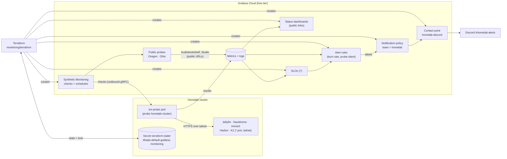

## Key terms

| Term | Plain meaning | In this setup |
|---|---|---|
| **Check** | *What* is tested: a script or URL, how often, from which probes | `monitoring/terraform/checks_*.tf`; scripts in `monitoring/checks/` |
| **Probe** | *Where* a check runs from: an agent that receives checks from Grafana and sends results back | `homelab-cluster` (pod in the cluster) for private services; Grafana's Oregon and Ohio for public URLs |
| **Alert rule** | A question Grafana asks every minute ("is the probe silent?", "is the error budget burning fast?"). When the answer is yes, the alert fires and carries **labels** such as `team = homelab` | `alerts_heartbeat.tf`; burn-rate rules generated by each SLO |
| **Notification policy** | A routing rule: reads the labels an alert rule put on the alert and picks contact points | `team = homelab` → `homelab-discord`; everything else → `empty` |
| **Contact point** | A connector: one place a message can be delivered, with its settings. It has no rules of its own | `homelab-discord` (webhook of `#homelab-alerts`); `empty` (no integrations, delivers nowhere) |
| **Mute timing** | A schedule during which a policy holds messages back | Not used yet; planned for phone paging (see Follow-ups) |
| **SLI** | Service level *indicator*: the measured share of good results | passing 5-minute slots ÷ expected slots |
| **SLO** | Service level *objective*: the target for the SLI over a window | 99.9 % over 14 days, one per service |
| **Error budget** | The failure the target allows: (1 − target) × expected | 0.1 % of the window ≈ 20 minutes per 14 days |
| **Burn rate** | How fast the budget is being spent, relative to spending it exactly over the window | Fast and slow burn alerts, generated by Grafana SLO |

### How an alert reaches Discord

An alert rule fires with labels; the notification policy matches the labels; the contact point delivers.

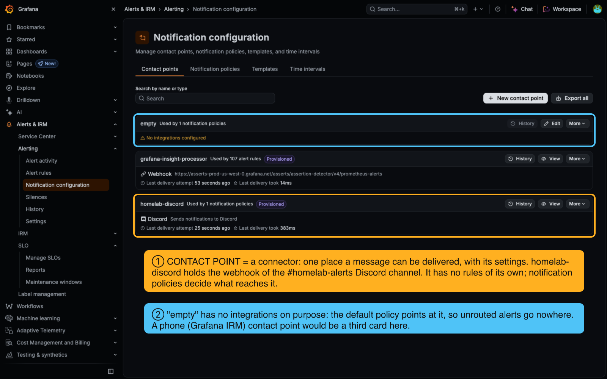


### Probes and checks

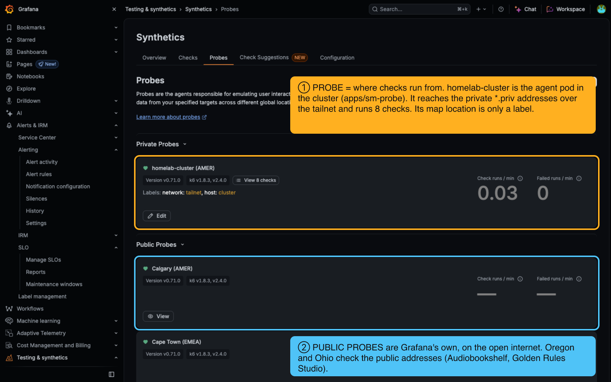

## What the dashboards look like

Two public dashboards are built from one Terraform recipe (`status_dashboard.tf`): **Homelab status** (every
service) and **Studio stack status** (Golden Rules Studio plus Harbor and K2, the services it depends on). At
first glance they are uptime pages; everything deeper sits in collapsed rows.

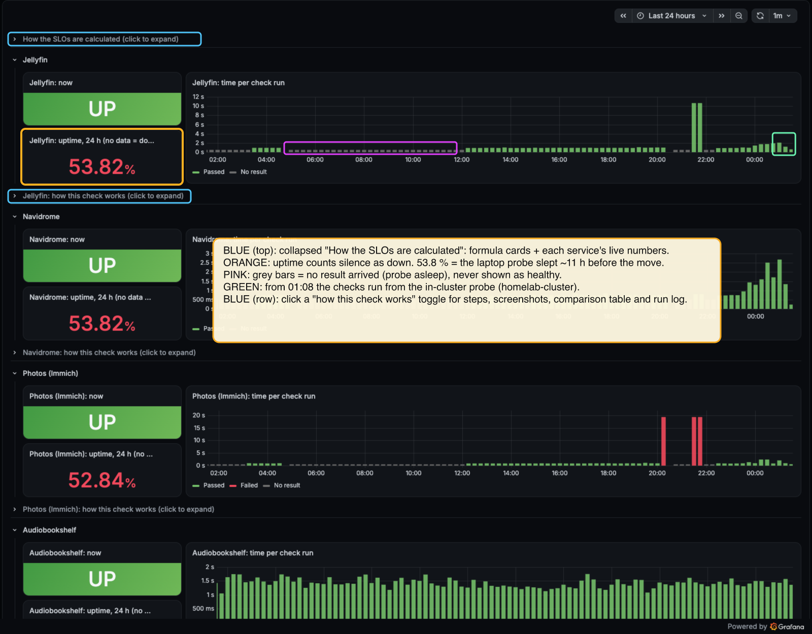

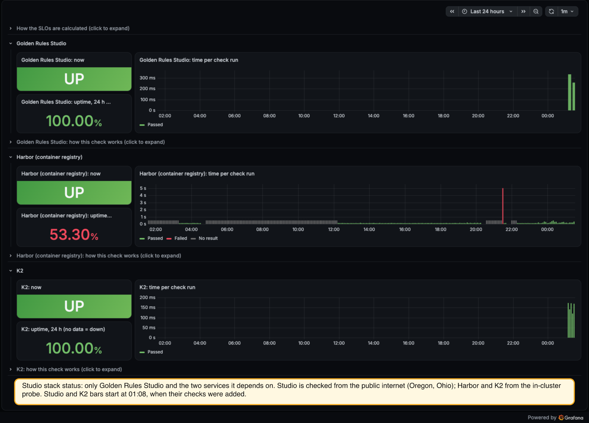

The collapsed **How the SLOs are calculated** row walks through the math the way the FIRE calculator does
(each term named, the formula in words, then symbols, then the numbers), followed by a table that
substitutes every service's live values:

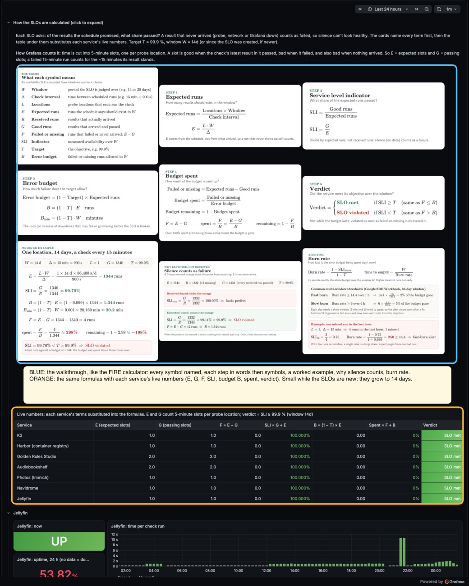

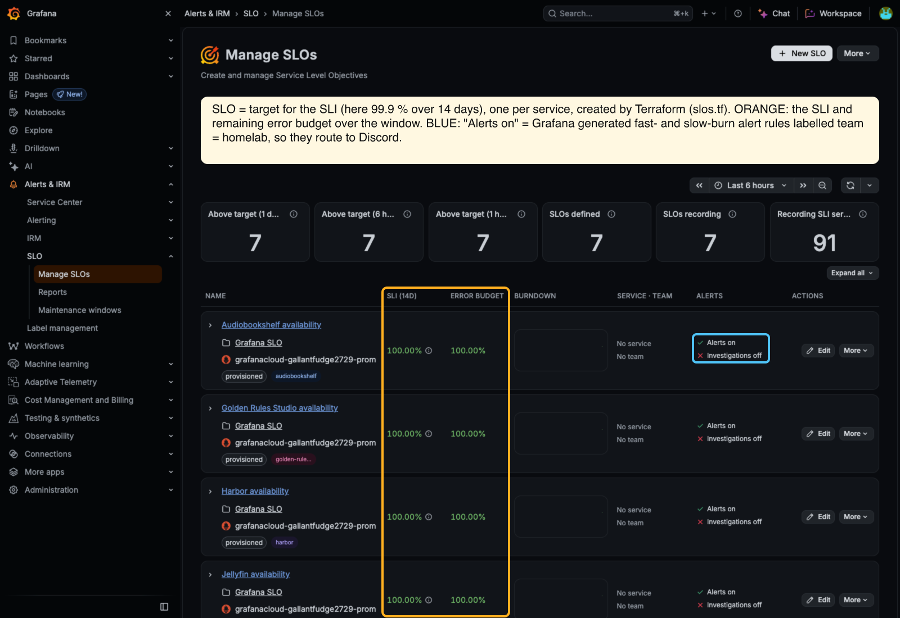

## SLO math

The same cards render on the dashboard. Symbols first:

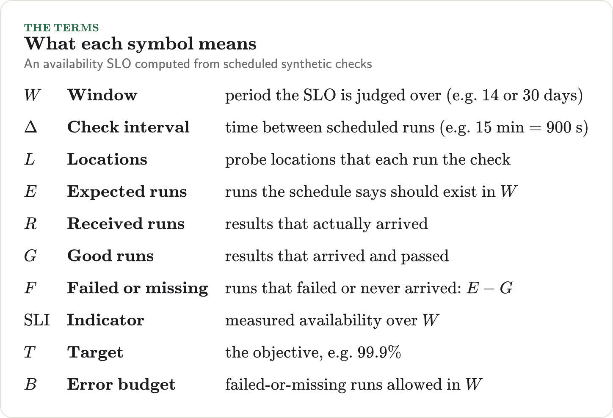

| | |
|---|---|
| 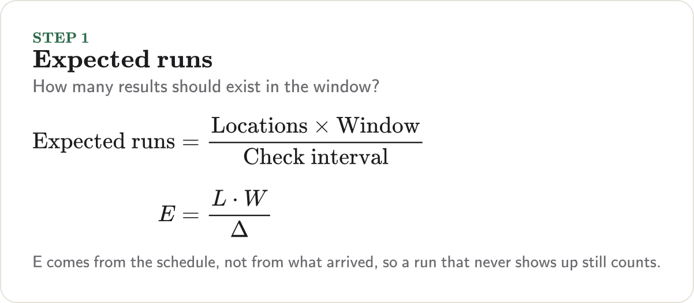 | 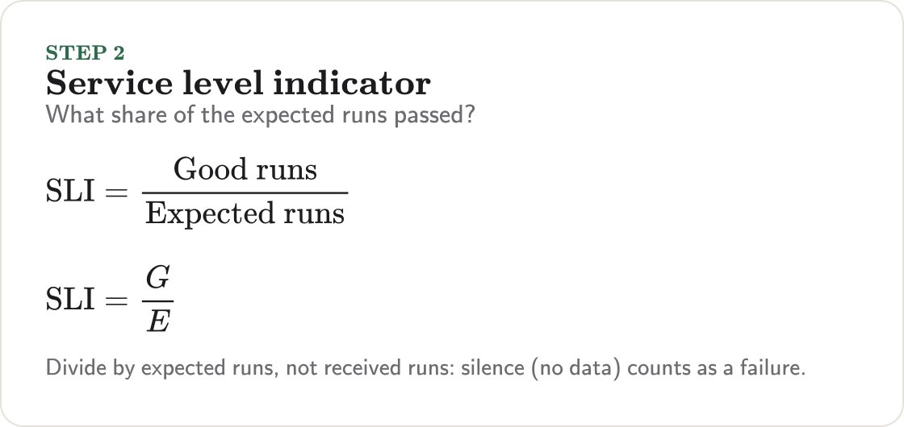 |
| 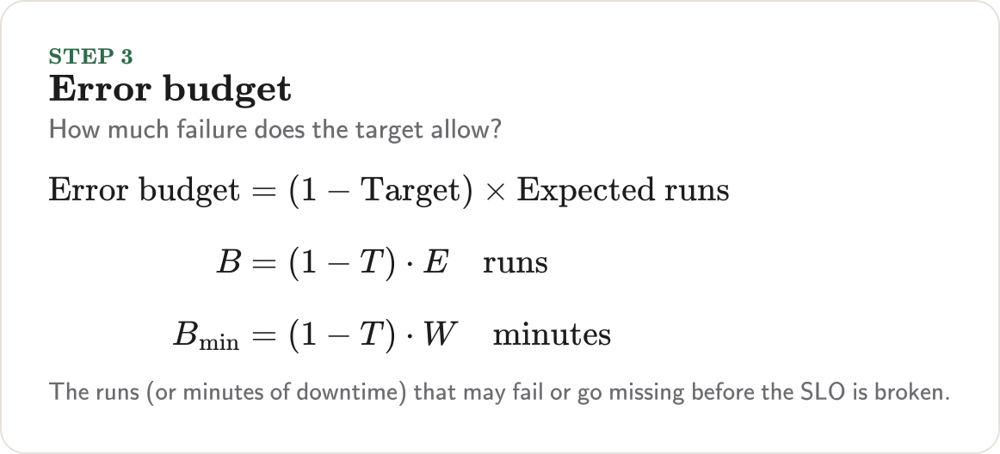 | 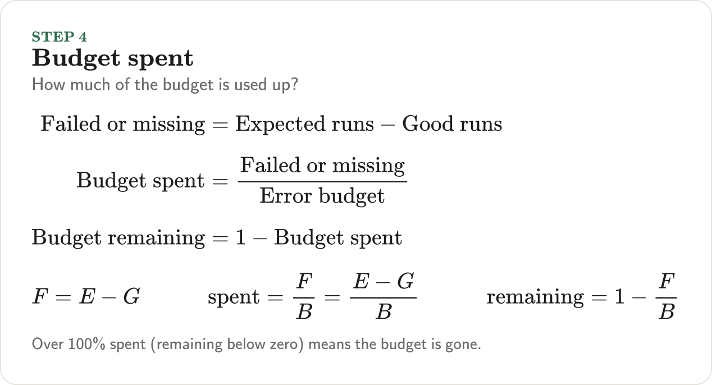 |
| 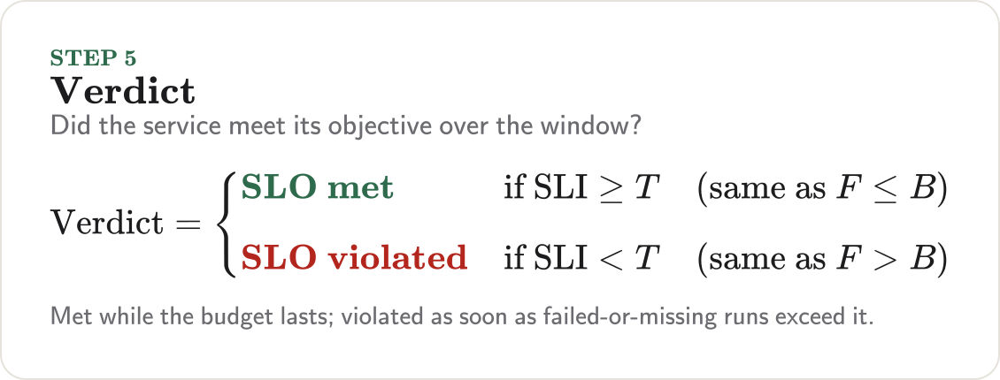 | 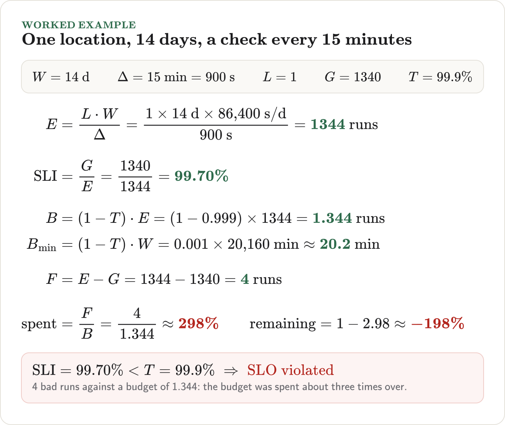 |

### No data counts as a violation

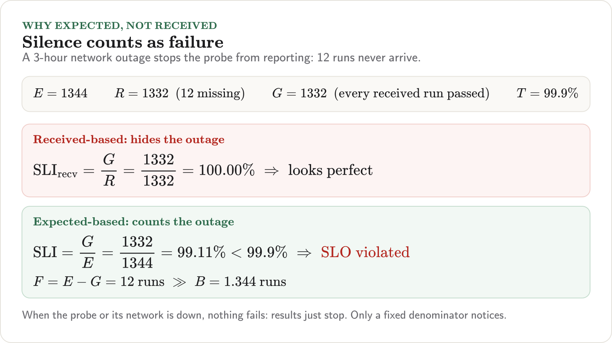

A ratio of `passed ÷ received` reads 100 % while the probe is down, because nothing failed: results just
stopped. The fix is a denominator that comes from the schedule, not from what arrived.

**How it is done in PromQL** (`monitoring/terraform/slos.tf`). The SM agent re-publishes each check's latest
result about once a minute, so `probe_success` is a state that holds between runs and disappears while the
probe or network is down. Grafana SLO evaluates a freeform query in 5-minute buckets
(`$__rate_interval` = 5m) and adds the buckets up over each window:

```promql
# numerator: per 5-minute bucket, the share of the bucket each location reported "passing";
# "or vector(0)" turns an empty bucket into 0 passes instead of dropping it
sum_over_time((sum(avg_over_time(probe_success{job="jellyfin-login"}[5m])) or vector(0))[$__rate_interval:5m])
/
# denominator: L slots per bucket (L = probe locations), whether or not anything arrived
sum_over_time(vector(1)[$__rate_interval:5m])
```

So **E = expected slots** and **G = passing slots**: a failed 15-minute run counts for the ~15 minutes its
result stands, and a silent hour counts as 12 failed slots per location. Two simpler forms were tried and
rejected while building this: counting samples overcounts (one run is published many times), and
`increase()` of the run counter loses runs that straddle a bucket edge.

The same slot math drives each dashboard's **uptime, 24 h (no data = down)** stat, starting from the check's
first-ever result so a new check doesn't start near 0 %.

### Burn-rate alerts

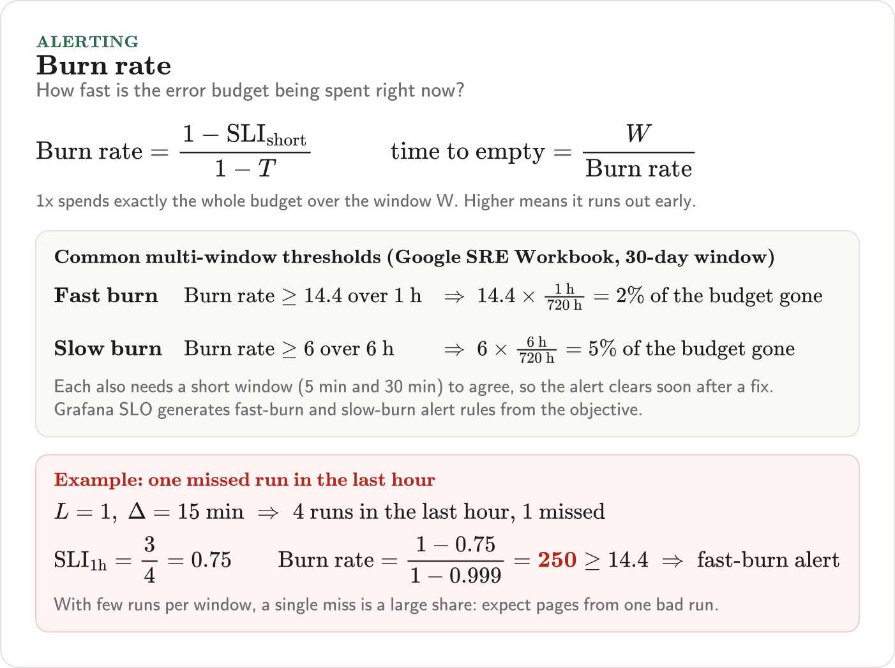

Grafana SLO generates two alert rules per SLO, labelled `team = homelab`, so they route to Discord. With
15-minute checks an hour holds only 4 results, so one missed run is a large share of a short window: expect
a page from a single bad run on those services (the 5-minute checks for Harbor and K2 are less jumpy).

## What Grafana bills for

| Item | Free tier | Above it | This setup |
|---|---|---|---|
| API test executions (HTTP, scripted k6) | 100k / month | $5 per 10k | ≈ 65.5k / month |
| Browser test executions | 10k / month | $50 per 10k | ≈ 6.0k / month |
| Metrics, logs from checks | Free-tier series/GB limits | Standard Cloud rates | Small; shared with everything else |

One **execution** is one check run in one probe location. **Runs on our own probe are billed exactly like
runs on Grafana's public probes**: the cost is in scheduling, storing and querying results, not in where the
request is made. The estimate (31-day month):

| Checks | Interval | Locations | Runs / month |
|---|---|---|---|
| Health: Jellyfin, Immich, Harbor, K2 | 5 min | 1 | 4 × 8,928 = 35,712 |
| Media health (scripted) | 5 min | 1 | 8,928 |
| Logins: Jellyfin, Navidrome, Immich | 15 min | 1 | 3 × 2,976 = 8,928 |
| Login: Audiobookshelf | 15 min | 2 | 5,952 |
| Health: Golden Rules Studio | 15 min | 2 | 5,952 |
| **API total** | | | **65,472** |
| Browser: Audiobookshelf page load | 15 min | 2 | 5,952 |

Alert rules are not billed per evaluation; the free tier allows 500 alert rules (about 15 are in use).
Sources: [Synthetic Monitoring pricing](https://grafana.com/docs/grafana-cloud/platform/pricing-and-usage/synthetic-monitoring/),
[Grafana pricing](https://grafana.com/pricing/).

## Moving the probe and the Terraform state into the cluster

| What | Before | After | Verified by |
|---|---|---|---|
| Private probe | `homelab-tailnet-laptop`, Podman on a laptop; checks went silent whenever the laptop slept | `homelab-cluster`, Deployment `sm-probe/sm-probe` (1 replica, `Recreate`, not on cluster-node-4) | Probe API reports `homelab-cluster online v0.71.0`; all private jobs report `probe="homelab-cluster"`; laptop probe destroyed and its container removed |
| Network path | Laptop on the tailnet | Pod traffic leaves through the node, which is on the tailnet, so `*.priv.mlops-club.org` resolves to Traefik's tailnet IP and works without a sidecar | `curl https://jellyfin.priv.mlops-club.org/health` from a pod: 200 via 100.95.181.95 |
| Probe token | `tf output` pasted into Podman | `apps/sm-probe/deploy.sh` pipes `tf output -raw cluster_probe_token` straight into Secret `sm-probe-token`; never written to disk | Pod starts and connects |
| Terraform state | `monitoring/terraform/terraform.tfstate` inside one git worktree | `backend "kubernetes"`: Secret `terraform-state/tfstate-default-grafana-monitoring` (gzip, ≈ 14 KB of a 1 MB limit), Lease `lock-tfstate-default-grafana-monitoring` | `terraform init -migrate-state`; `plan` with the local file moved away reports no changes; a second `plan` during a running one fails with "Error acquiring the state lock" |

State is organised as **one Terraform folder (root module) = one state = one Secret** in the
`terraform-state` namespace, named after the folder. Split folders by system and credentials (Grafana
monitoring, Studio telemetry, a future Cloudflare setup), not by size. GitHub Actions can run Terraform
later by joining the tailnet the way `helmfile-deploy.yml` does and using a kubeconfig with access to that
namespace only.

**Trade-off accepted:** a probe inside the cluster can't run when the whole cluster is down. The
"Tailnet probe is silent" alert (`no_data_state = Alerting`) fires in that case, the public probes keep
checking the public URLs, and the SLOs count the silence as downtime.

## Consequences

- Missing data is never healthy: grey "no result" bars, uptime and SLOs all treat silence as down.
- Each SLO's budget is small (≈ 1.3 failed 15-minute runs per 14 days); one bad night shows up clearly.
- The probe shares the cluster's fate (see trade-off above).
- Terraform needs a working kubeconfig for the homelab cluster to plan or apply.
- Observed: from the in-cluster probe, Navidrome and Jellyfin login runs take longer than they did from the laptop (Navidrome ≈ 0.6 s → 2–2.5 s). Worth a look with the traces from [telemetry-plan.md](telemetry-plan.md).

## Follow-ups

1. **Phone paging with quiet hours:** add a Grafana IRM contact point next to Discord, with a mute timing
   (America/Denver) so the phone only buzzes 08:45–18:00 weekdays, 09:45–18:00 Saturday and 11:00–18:00
   Sunday; alerts still firing when quiet hours end page then. Needs the owner to install Grafana IRM and
   pair it.
2. **Cluster telemetry:** Traefik OTLP traces, request metrics and error logs into Grafana Cloud, shown only
   inside the dashboard toggles ([telemetry-plan.md](telemetry-plan.md)).
3. Switch `docs_ref` in `status_dashboard.tf` to `main` after the PR merges (dashboard images load from it).
4. Run Terraform from GitHub Actions against the in-cluster state.
