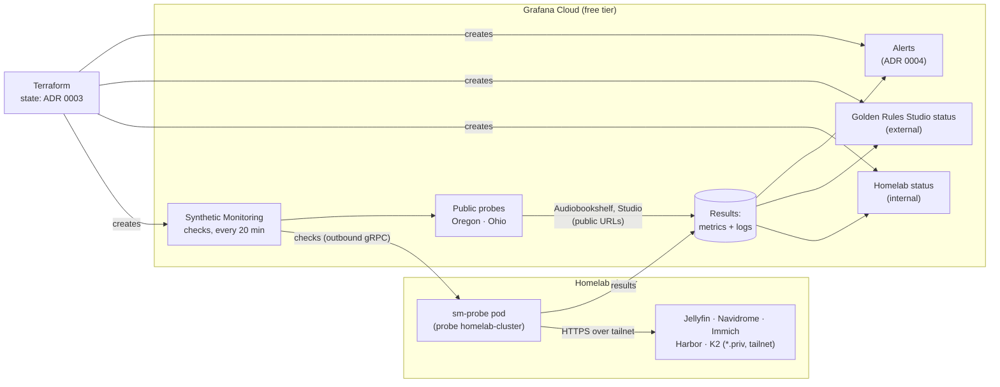
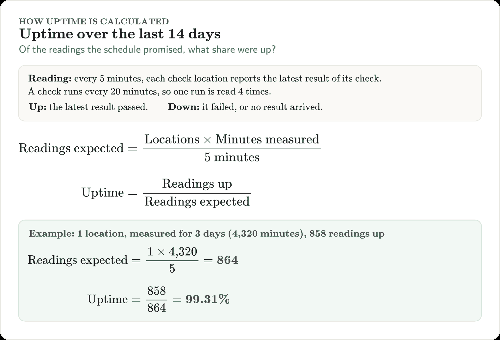
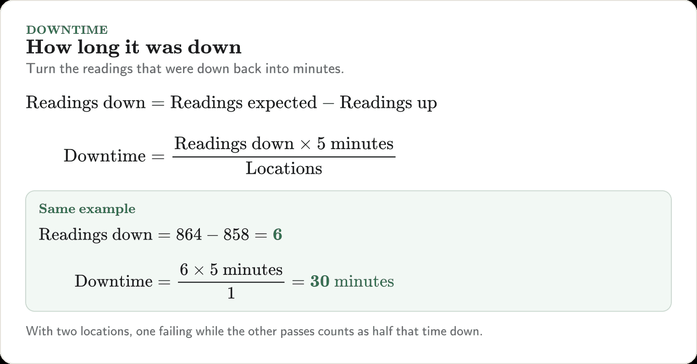
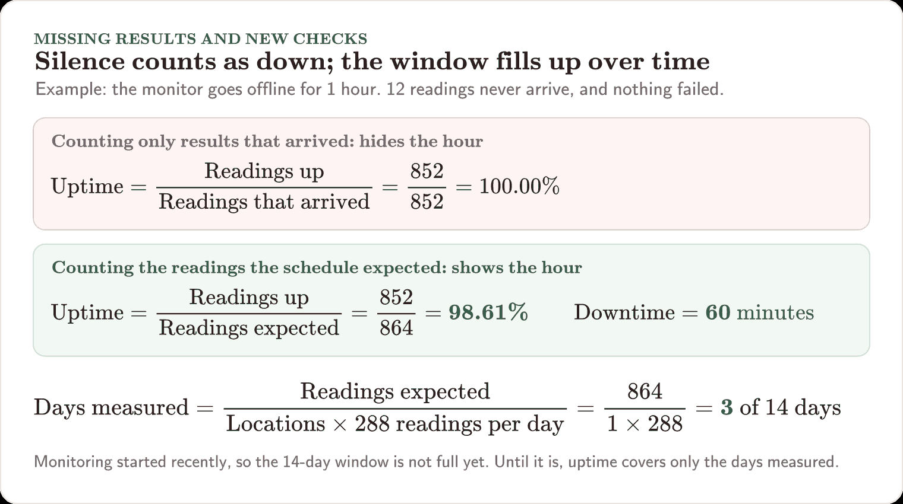

# ADR 0001: Outside-In Uptime Monitoring on Grafana Cloud

**Purpose**: Record the decision to measure the homelab's uptime from the outside in with Grafana Cloud Synthetic Monitoring: what is checked, from where, how uptime is calculated (a missing result counts as down), the two status dashboards, and what Grafana bills for

**Scope**: Every monitored service (Jellyfin, Navidrome, Immich, Audiobookshelf, Golden Rules Studio, Harbor, K2), the in-cluster probe, the uptime math, the internal and external dashboards, and billing. Where the Terraform state lives is [ADR 0003](../0003-terraform-state-in-cluster/decision.md); which alerts exist and how they reach Discord is [ADR 0004](../0004-alerts-and-routing/decision.md); when the phone may ring is [ADR 0005](../0005-on-call-schedule/decision.md). Cluster-wide traces, metrics and logs are a follow-up ([telemetry-plan.md](telemetry-plan.md))

**Overview**: Visual first. Key terms come first, each with an example from this setup. Then the two
    dashboards (marked-up screenshots), the uptime formulas, how
    "no result" becomes "down" in PromQL, how a window that is not full yet is handled, and billing.
    No uptime target is shown or judged anywhere: the dashboards report uptime and downtime only

**Dependencies**: [ADR 0003](../0003-terraform-state-in-cluster/decision.md) (Terraform state), [research.md](research.md) (options and free-tier limits), [grafana-poc.md](grafana-poc.md) (POC tests), `monitoring/terraform/` (all Grafana resources), `apps/sm-probe/` (the probe pod)

**Exports**: The decision, the monitoring terms used across these ADRs, the readings-based uptime formula and its PromQL

**Related**: [ADR 0004](../0004-alerts-and-routing/decision.md), [ADR 0005](../0005-on-call-schedule/decision.md), [telemetry-plan.md](telemetry-plan.md), `monitoring/checks/` (k6 scripts), `monitoring/reports/` (per-check reports on the internal dashboard), `images/uptime-math/render.js` (renders the formula cards)

---

**Status**: Accepted

## Decision in one picture



## Key terms

| Term | Plain meaning | Example in this setup |
|---|---|---|
| **Check** | *What* is tested: a URL or a k6 script, how often, from which probes | `jellyfin-login`: signs in as the read-only `homelab-monitor` user, lists a library and reads 64 KB of a real file, every 20 minutes |
| **Probe** | *Where* a check runs from: an agent that receives checks from Grafana and sends results back | `homelab-cluster`, the `sm-probe` pod in the cluster, which reaches `jellyfin.priv.mlops-club.org` over the tailnet |
| **Location** | One probe running one check. A check on two probes has two locations, and each is billed | `golden-rules-studio-health` runs from Oregon and Ohio: 2 locations |
| **Run** | One execution of a check at one location; it passes or fails and takes some time | A `harbor-health` run at 09:40 that got `200` in 0.21 s |
| **Reading** | Every 5 minutes, each location's latest result: up if it passed, down if it failed **or if no result arrived**. A 20-minute run is read 4 times | K2 for one day: 1 location × 288 readings |
| **Uptime** | Readings up ÷ readings expected, over the window | K2: 115 up of 115 expected = 100.00 % |
| **Downtime** | Readings down turned back into time: × 5 minutes ÷ locations | 6 readings down at 1 location = 30 minutes |
| **Window** | The period uptime is reported over | The last 14 days (Grafana's trial keeps 14 days of metrics) |
| **Days measured** | How much of the window has readings so far, counted from the check's first result | K2: 0.4 of 14 on its first day |
| **Execution** | Grafana's billing unit: one run at one location | `audiobookshelf-browser` at 2 locations every 20 minutes = 4,464 browser executions a month |

## The two dashboards

Both come from one Terraform recipe (`monitoring/terraform/status_dashboard.tf`) and are shared by public
link. At first glance each is an uptime page; everything deeper sits in collapsed rows.

| | Homelab status (internal) | Golden Rules Studio status (external) |
|---|---|---|
| Audience | Everyone who runs the cluster | People who use Golden Rules Studio |
| Services | All seven | Golden Rules Studio, Harbor, K2 (Studio depends on the other two) |
| Check toggle | Step-by-step report naming hosts, routes (Cloudflare, Traefik) and the code that defines the check | A plain-language description: what is checked, how often, what a red bar means |
| Run log | Yes (its error lines can name hosts and IP addresses) | No |
| Links to the repo | Yes | None |
| 14-day uptime | In each service's toggle: one table row, then pseudocode of the queries behind it | Same |


## How uptime is calculated

Each formula in words, then with an example's numbers. On the dashboards, each service's toggle shows its
14-day row and the same steps as pseudocode with that service's own job name and locations.







### How "no result" becomes "down" in PromQL

Dividing by the results that *arrived* reads 100 % while the probe is down, because nothing failed:
results just stopped. The fix is a denominator that comes from the schedule. The SM agent re-publishes
each check's latest result about once a minute, so `probe_success` holds its value between runs and
disappears while the probe or its network is down. Both numbers are computed straight from the raw
results (`monitoring/terraform/slos.tf`, `status_dashboard.tf`):

```python
# inputs
job               = "k2-health"
locations         = 1                          # probe locations running this check
period            = 5 * 60                     # seconds in one reading period (5 minutes)
periods_per_day   = 24 * 12                    # = 288: 12 five-minute periods an hour
periods_in_window = 14 * periods_per_day       # = 4,032: 14 days

# from the check results
first_result = min(min_over_time(timestamp(probe_success{job=job})[14d:5m]))
    # time of the check's first result in the window
readings_up  = sum_over_time((sum(max by (probe) (avg_over_time(probe_success{job=job}[5m]))) or vector(0))[14d:5m])
    # every 5 minutes, each location's share of the period its latest result passed (avg_over_time),
    # one series per location (max by (probe)); no result adds 0 (or vector(0))

# arithmetic
readings_expected = locations * clamp_max(ceil((time() - first_result) / period), periods_in_window)
    # periods since the first result, at most the whole window: from the clock, not from what arrived
readings_down     = readings_expected - readings_up
uptime            = readings_up / readings_expected
downtime          = readings_down * period / locations           # seconds
days_measured     = readings_expected / (locations * periods_per_day)
```

PromQL has no variables, so the dashboard runs each column with the names written out, keeping the
products as written (`/ (5 * 60)`, `clamp_max(..., 14 * 288)`).

The 24 h stat uses the same two building blocks over 24 h (at most 288 periods). Two simpler forms were tried and rejected: counting samples
overcounts (one run is published many times), and `increase()` of the run counter loses runs that straddle
a bucket edge.

### A window that isn't full yet

Readings expected start at the check's first result, so a check that is two days old is measured over two
days, not charged for twelve empty ones. The **Days measured** column says how much of the 14 days that is.
Silence *after* the first result counts as down: Jellyfin and Navidrome show about 70 % over their first
2.5 days because the laptop probe slept at night before it moved into the cluster.

### Grafana SLO is only for alerts

Each service also has a Grafana SLO with the same readings query, because Grafana generates burn-rate alert
rules from it ([ADR 0004](../0004-alerts-and-routing/decision.md)). Grafana SLO requires an objective, so
each is set to 95 %. No dashboard shows the objective or reads the SLO's recording rules.

## What Grafana bills for

| Item | Free tier | Above it | This setup |
|---|---|---|---|
| API executions (HTTP, scripted k6) | 100k / month | $5 per 10k | 26,784 / month |
| Browser executions | 10k / month | $50 per 10k | 4,464 / month |
| Metrics and logs from checks | Free-tier series and GB limits | Standard Cloud rates | Small; shared with everything else |

**Runs on our own probe are billed exactly like runs on Grafana's public probes**: the cost is in
scheduling, storing and querying results, not in where the request is made. Every check runs every 20
minutes (3 runs an hour, 2,232 a month per location in a 31-day month):

| Checks | Locations | Executions / month |
|---|---|---|
| Health: Jellyfin, Immich, Harbor, K2 | 1 each | 4 × 2,232 = 8,928 |
| Media health (scripted, from the POC) | 1 | 2,232 |
| Logins: Jellyfin, Navidrome, Immich | 1 each | 3 × 2,232 = 6,696 |
| Login: Audiobookshelf | 2 | 4,464 |
| Health: Golden Rules Studio | 2 | 4,464 |
| **API total** | | **26,784** (was 65,472 with 5- and 15-minute checks) |
| Browser: Audiobookshelf page load | 2 | 4,464 (was 5,952) |

Alert rules are not billed per evaluation; the free tier allows 500 alert rules (about 15 are in use).
Sources: [Synthetic Monitoring pricing](https://grafana.com/docs/grafana-cloud/platform/pricing-and-usage/synthetic-monitoring/),
[Grafana pricing](https://grafana.com/pricing/).

## The probe runs in the cluster

| What | Before | After | Verified by |
|---|---|---|---|
| Private probe | `homelab-tailnet-laptop`, Podman on a laptop; checks went silent whenever the laptop slept | `homelab-cluster`, Deployment `sm-probe/sm-probe` (1 replica, `Recreate`, not on cluster-node-4) | Probe API reports `homelab-cluster online v0.71.0`; all private jobs report `probe="homelab-cluster"`; laptop probe destroyed |
| Network path | Laptop on the tailnet | Pod traffic leaves through the node, which is on the tailnet, so `*.priv.mlops-club.org` resolves to Traefik's tailnet IP without a sidecar | `curl https://jellyfin.priv.mlops-club.org/health` from a pod: 200 via 100.95.181.95 |
| Probe token | `tf output` pasted into Podman | `apps/sm-probe/deploy.sh` pipes `tf output -raw cluster_probe_token` into Secret `sm-probe-token`; never written to disk | Pod starts and connects |

**Trade-off accepted:** a probe inside the cluster can't run when the whole cluster is down. Its readings
go missing, which counts as down; the public probes keep checking the public URLs; and the "probe is
silent" alert fires ([ADR 0004](../0004-alerts-and-routing/decision.md)).

## Consequences

- Missing data is never healthy: grey "no result" bars, 24 h uptime and 14-day uptime all count silence as down.
- With 20-minute checks, an outage shorter than 20 minutes can fall between runs and go unseen; a failed run counts as about 20 minutes down.
- The external dashboard is safe to share with Studio users; the internal one names hosts and links to code.
- Uptime includes the probe's own outages: silence counts as down even when the service was fine (the 70 % above).
- Observed: from the in-cluster probe, Navidrome and Jellyfin login runs take longer than they did from the laptop (Navidrome ≈ 0.6 s → 2–2.5 s). Worth a look with the traces from [telemetry-plan.md](telemetry-plan.md).

## Follow-ups

1. **Cluster telemetry:** Traefik OTLP traces, request metrics and error logs into Grafana Cloud, shown only
   inside the dashboard toggles ([telemetry-plan.md](telemetry-plan.md)).
2. Switch `docs_ref` in `status_dashboard.tf` to `main` after the PR merges (internal report links and
   screenshots load from it).
3. Decide whether the POC's `media-health` check is still worth 2,232 executions a month.
