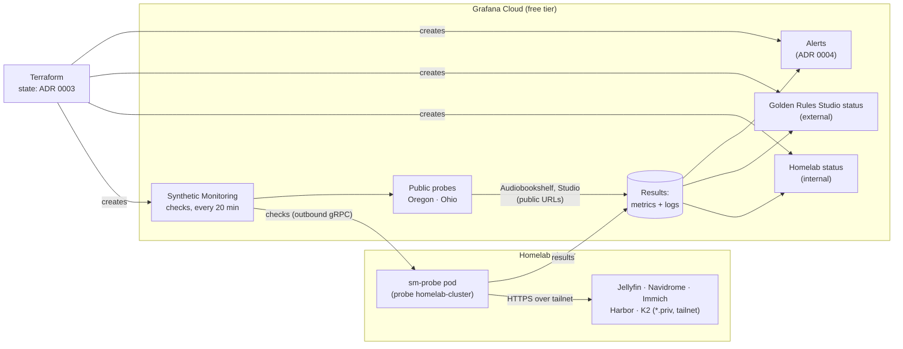
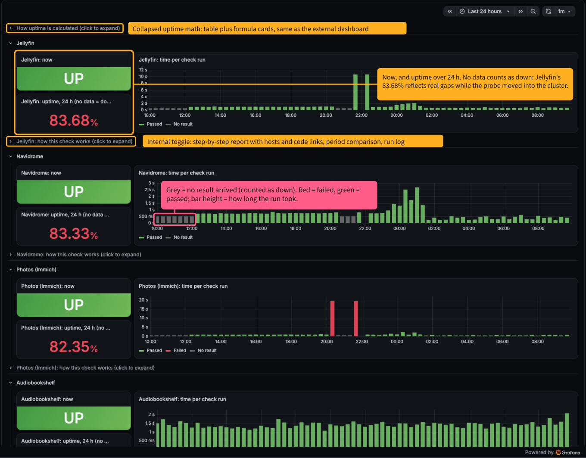
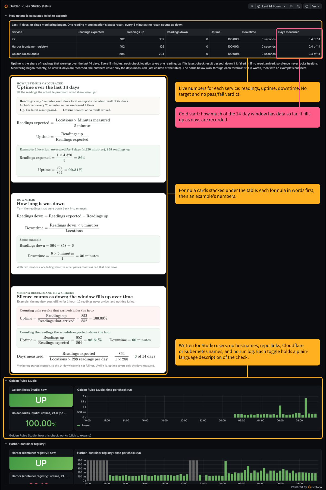

# ADR 0001: Outside-In Uptime Monitoring on Grafana Cloud

**Purpose**: Record the decision to measure the homelab's uptime from the outside in with Grafana Cloud Synthetic Monitoring: what is checked, from where, how uptime is calculated (a missing result counts as down), the two status dashboards, and what Grafana bills for

**Scope**: Every monitored service (Jellyfin, Navidrome, Immich, Audiobookshelf, Golden Rules Studio, Harbor, K2), the in-cluster probe, the uptime math, the internal and external dashboards, and billing. Where the Terraform state lives is [ADR 0003](../0003-terraform-state-in-cluster/decision.md); which alerts exist and how they reach Discord is [ADR 0004](../0004-alerts-and-routing/decision.md); when the phone may ring is [ADR 0005](../0005-on-call-schedule/decision.md). Cluster-wide traces, metrics and logs are a follow-up ([telemetry-plan.md](telemetry-plan.md))

**Overview**: Visual first. Key terms come first, each with an example from this setup. Then the two
    dashboards (marked-up screenshots), the uptime formulas (the same cards the dashboards show), how
    "no result" becomes "down" in PromQL, how a window that is not full yet is handled, and billing.
    No uptime target is shown or judged anywhere: the dashboards report uptime and downtime only

**Dependencies**: [ADR 0003](../0003-terraform-state-in-cluster/decision.md) (Terraform state), [research.md](research.md) (options and free-tier limits), [grafana-poc.md](grafana-poc.md) (POC tests), `monitoring/terraform/` (all Grafana resources), `apps/sm-probe/` (the probe pod)

**Exports**: The decision, the monitoring terms used across these ADRs, the readings-based uptime formula and its PromQL

**Related**: [ADR 0004](../0004-alerts-and-routing/decision.md), [ADR 0005](../0005-on-call-schedule/decision.md), [telemetry-plan.md](telemetry-plan.md), `monitoring/checks/` (k6 scripts), `monitoring/reports/` (per-check reports on the internal dashboard), `monitoring/dashboard-images/` (formula cards and their renderer)

---

**Status**: Accepted

## Decision in one picture



## Key terms

| Term | Plain meaning | Example in this setup |
|---|---|---|
| **Check** | *What* is tested: a URL or a k6 script, how often, from which probes | `jellyfin-login`: signs in as the read-only `homelab-monitor` user, lists a library and reads 64 KB of a real file, every 20 minutes |
| **Probe** | *Where* a check runs from: an agent that receives checks from Grafana and sends results back | `homelab-cluster`, the `sm-probe` pod in the cluster, which reaches `jellyfin.priv.mlops-club.org` over the tailnet |
| **Location** | One probe running one check. A check on two probes has two locations, and each is billed | `golden-rules-studio-health` runs from Oregon and Ohio: 2 locations |
| **Run** | One execution of a check at one location; it passes or fails and takes some time | A `harbor-health` run at 09:40 that got `200` in 0.21 s |
| **Reading** | Every 5 minutes, each location's latest result: up if it passed, down if it failed **or if no result arrived**. A 20-minute run is read 4 times | K2 for one day: 1 location × 288 readings |
| **Uptime** | Readings up ÷ readings expected, over the window | K2: 102 up of 102 expected = 100.00 % |
| **Downtime** | Readings down turned back into time: × 5 minutes ÷ locations | 6 readings down at 1 location = 30 minutes |
| **Window** | The period uptime is reported over | The last 14 days (Grafana's trial keeps 14 days of metrics) |
| **Days measured** | How much of the window has readings so far; less than 14 until monitoring has run that long | 0.4 of 14 on the day the readings started |
| **Execution** | Grafana's billing unit: one run at one location | `audiobookshelf-browser` at 2 locations every 20 minutes = 4,464 browser executions a month |

## The two dashboards

Both come from one Terraform recipe (`monitoring/terraform/status_dashboard.tf`) and are shared by public
link. At first glance each is an uptime page; everything deeper sits in collapsed rows.

| | Homelab status (internal) | Golden Rules Studio status (external) |
|---|---|---|
| Audience | Everyone who runs the cluster | People who use Golden Rules Studio |
| Services | All seven | Golden Rules Studio, Harbor, K2 (Studio depends on the other two) |
| Check toggle | Step-by-step report naming hosts, routes (Cloudflare, Traefik) and the code that defines the check | A plain-language description: what is checked, how often, what a red bar means |
| Run log | Yes (its error lines can name hosts and IP addresses) | No |
| Links to the repo | Yes | None. The formula cards are embedded in the dashboard, so nothing loads from GitHub |
| Uptime math row | Table + cards + links to the code | Table + cards |





## How uptime is calculated

The dashboards show these three cards, stacked under the live table. Each states the formula in words,
then puts an example's numbers in.


### How "no result" becomes "down" in PromQL

Dividing by the results that *arrived* reads 100 % while the probe is down, because nothing failed:
results just stopped. The fix is a denominator that comes from the schedule. The SM agent re-publishes
each check's latest result about once a minute, so `probe_success` holds its value between runs and
disappears while the probe or its network is down. Grafana SLO evaluates a query in 5-minute buckets and
adds the buckets up over the window (`monitoring/terraform/slos.tf`):

```promql
# readings up, per 5-minute bucket: each location's share of the bucket that reported "passing".
#   max by (probe): one series per location (editing a check briefly overlaps old and new series)
#   or vector(0):   an empty bucket counts 0 readings up instead of disappearing
sum_over_time((sum(max by (probe) (avg_over_time(probe_success{job="k2-health"}[5m]))) or vector(0))[$__rate_interval:5m])
/
# readings expected, per 5-minute bucket: one per location, whether or not anything arrived
sum_over_time(vector(1)[$__rate_interval:5m])
```

Two simpler forms were tried and rejected: counting samples overcounts (one run is published many times),
and `increase()` of the run counter loses runs that straddle a bucket edge.

Grafana SLO is used only as the engine that turns this query into 5-minute recording rules
(`grafana_slo_success_rate_5m`, `grafana_slo_total_rate_5m`); the dashboard table adds those up over 14
days. Grafana SLO requires an objective, so each one is set to 95 %. The objective drives only the
burn-rate alerts ([ADR 0004](../0004-alerts-and-routing/decision.md)); no dashboard shows it.

### A window that isn't full yet

The recording rules exist only from the moment each service's SLO was created, so "readings expected"
counts the measured days only, never the empty days before monitoring began. The **Days measured**
column says how much of the 14 days that is. The 24 h uptime stat on each row uses the same readings and
starts at the check's first-ever result, so a new check doesn't start near 0 %.

## What Grafana bills for

| Item | Free tier | Above it | This setup |
|---|---|---|---|
| API executions (HTTP, scripted k6) | 100k / month | $5 per 10k | 26,784 / month |
| Browser executions | 10k / month | $50 per 10k | 4,464 / month |
| Metrics and logs from checks | Free-tier series and GB limits | Standard Cloud rates | Small; shared with everything else |

**Runs on our own probe are billed exactly like runs on Grafana's public probes**: the cost is in
scheduling, storing and querying results, not in where the request is made. Every check runs every 20
minutes (3 runs an hour, 2,232 a month per location in a 31-day month):

| Checks | Locations | Executions / month |
|---|---|---|
| Health: Jellyfin, Immich, Harbor, K2 | 1 each | 4 × 2,232 = 8,928 |
| Media health (scripted, from the POC) | 1 | 2,232 |
| Logins: Jellyfin, Navidrome, Immich | 1 each | 3 × 2,232 = 6,696 |
| Login: Audiobookshelf | 2 | 4,464 |
| Health: Golden Rules Studio | 2 | 4,464 |
| **API total** | | **26,784** (was 65,472 with 5- and 15-minute checks) |
| Browser: Audiobookshelf page load | 2 | 4,464 (was 5,952) |

Alert rules are not billed per evaluation; the free tier allows 500 alert rules (about 15 are in use).
Sources: [Synthetic Monitoring pricing](https://grafana.com/docs/grafana-cloud/platform/pricing-and-usage/synthetic-monitoring/),
[Grafana pricing](https://grafana.com/pricing/).

## The probe runs in the cluster

| What | Before | After | Verified by |
|---|---|---|---|
| Private probe | `homelab-tailnet-laptop`, Podman on a laptop; checks went silent whenever the laptop slept | `homelab-cluster`, Deployment `sm-probe/sm-probe` (1 replica, `Recreate`, not on cluster-node-4) | Probe API reports `homelab-cluster online v0.71.0`; all private jobs report `probe="homelab-cluster"`; laptop probe destroyed |
| Network path | Laptop on the tailnet | Pod traffic leaves through the node, which is on the tailnet, so `*.priv.mlops-club.org` resolves to Traefik's tailnet IP without a sidecar | `curl https://jellyfin.priv.mlops-club.org/health` from a pod: 200 via 100.95.181.95 |
| Probe token | `tf output` pasted into Podman | `apps/sm-probe/deploy.sh` pipes `tf output -raw cluster_probe_token` into Secret `sm-probe-token`; never written to disk | Pod starts and connects |

**Trade-off accepted:** a probe inside the cluster can't run when the whole cluster is down. Its readings
go missing, which counts as down; the public probes keep checking the public URLs; and the "probe is
silent" alert fires ([ADR 0004](../0004-alerts-and-routing/decision.md)).

## Consequences

- Missing data is never healthy: grey "no result" bars, 24 h uptime and 14-day uptime all count silence as down.
- With 20-minute checks, an outage shorter than 20 minutes can fall between runs and go unseen; a failed run counts as about 20 minutes down.
- The external dashboard is safe to share with Studio users; the internal one names hosts and links to code.
- The formula cards are embedded in the dashboard JSON (about 120 KB per dashboard), which also lands in the Terraform state ([ADR 0003](../0003-terraform-state-in-cluster/decision.md)).
- Observed: from the in-cluster probe, Navidrome and Jellyfin login runs take longer than they did from the laptop (Navidrome ≈ 0.6 s → 2–2.5 s). Worth a look with the traces from [telemetry-plan.md](telemetry-plan.md).

## Follow-ups

1. **Cluster telemetry:** Traefik OTLP traces, request metrics and error logs into Grafana Cloud, shown only
   inside the dashboard toggles ([telemetry-plan.md](telemetry-plan.md)).
2. Switch `docs_ref` in `status_dashboard.tf` to `main` after the PR merges (internal report links and
   screenshots load from it).
3. Decide whether the POC's `media-health` check is still worth 2,232 executions a month.
