# ADR 0001 POC: All-Grafana Monitoring Stack

**Purpose**: Record how the Grafana Cloud proof of concept for ADR 0001 is set up, starting with the credentials that let Terraform, the probe agent and Claude Code drive the stack

**Scope**: Grafana Cloud stack credentials (service account token, Synthetic Monitoring token and API URLs), how they were created and stored, and the POC test plan that runs from a laptop before anything is deployed to the cluster

**Overview**: The research in `research.md` narrowed the design to an all-Grafana stack: a private probe
    with a Tailscale sidecar runs smoke tests against the real URLs, one public browser check covers the
    outside view, Grafana SLOs and no-data alerts page through the IRM mobile app, and a shared dashboard
    serves as the status page. Everything except the final probe pod can be tested from a laptop on the
    tailnet, because the private probe agent runs anywhere. This document walks through the credential
    setup with annotated screenshots (token values masked), then lists the tests in the order they run

**Dependencies**: `research.md` (goals, free-tier limits, the all-Grafana option), `env.example` (variable names)

**Exports**: Credential inventory, step-by-step token setup, POC test order

**Related**: `research.md`, `.ai/howto/how-to-capture-screenshots-for-docs.md`

---

## At a glance

**What runs** (all in [`monitoring/terraform/`](../../../../monitoring/terraform/), driven by `./tf apply`):

| Piece | What it does | Evidence |
|---|---|---|
| Private probe `homelab-tailnet-laptop` | Synthetic Monitoring agent in Podman on the tailnet; reaches `*.priv` services | Test 1 |
| Login checks (Jellyfin, Navidrome, Immich, Audiobookshelf) | Log in as a read-only `homelab-monitor` user, browse, read 64 KB of real media every 15 min | Test 9 |
| Browser check (Audiobookshelf) | Loads the public login page from Oregon and Ohio; records FCP, LCP, TTFB | Test 3 |
| Jellyfin SLO (99.9 %) | Burn-rate alerts generated by Grafana SLO | Test 4 |
| "Tailnet probe is silent" | No-data alert: Grafana's own dead man's switch | Test 5 |
| Discord route | `team=homelab` alerts to `#homelab-alerts`; everything else silent | Test 6 |
| "Homelab status" public dashboard | Per-service state, uptime and per-run duration bars, no login | Test 7 |
| `homelab-mcp` Viewer token | Read-only investigation from Claude Code via mcp-grafana | Test 8 |

**What we learned**

| Lesson | Consequence |
|---|---|
| A multi-step k6 script is billed as **one run** per execution | Rich smoke tests cost the same as a ping; 15-min checks leave half the 100k free runs unused |
| Private-probe runs are billed like public ones | The quota, not the probe, limits check frequency |
| Missing data reads as healthy unless designed otherwise | Status tiles show NO DATA, bars show grey, and a no-data alert pages |
| Grafana secrets work on private probes and Terraform writes them write-only | Monitoring passwords never land in state or git |
| SLO windows longer than the 14-day trial retention are accepted but unproven | Default to 14-day windows until the Free tier is checked |
| Grafana has no status-page product; a public dashboard covers state and history | Instatus only if incident notes or subscribers are needed |
| Grafana's default Discord message is noisy | Add a custom notification template |

Accounts and credentials: [MONITORING_ACCOUNTS.md](../../MONITORING_ACCOUNTS.md).

## 1. Questions the tests answer

Each test in §8 exists to answer one or more of these. The ID appears next to the evidence that answers it.

| ID | Question | Why it matters | Answered by |
|---|---|---|---|
| Q1 | Can a **private probe** run on the Free tier, and do its runs draw from the same 100k API / 10k browser quota? | The whole inside-out design depends on it | Test 1 (on trial), repeated after the trial ends |
| Q2 | Does a probe on the tailnet reach `*.priv.mlops-club.org` the same way a phone does? | Proves inside-out checks cover the Tailscale path | Test 1 |
| Q3 | How is a **multi-step** (scripted) check counted: one run, or one per request? | Sets how often each smoke test can run inside the quota | Test 2 |
| Q4 | Can each smoke test (login, list, ~2 s of media, open a photo) be written as a **k6 API check** rather than a browser check? | API runs are 10× more plentiful than browser runs | Test 2 |
| Q5 | Does a public **browser check** report page-load timing (first contentful paint, LCP) for Audiobookshelf? | Only outside-in measurement left in the design | Test 3 |
| Q6 | How does a Grafana **SLO** behave when its window is longer than the 14-day retention, and do burn-rate alerts fire? | Decides the SLO window (14 vs 30 days) | Test 4 |
| Q7 | Does a **no-data alert** catch the probe dying, standing in for a dead man's switch? | Decides whether Healthchecks.io is needed | Test 5 |
| Q8 | Does the **IRM app** push to the phone, and do mute timings give per-service quiet hours? Does a Discord contact point work? | Phone + Discord alerting goal | Test 6 |
| Q9 | Can a **shared dashboard** be viewed without login on Free, and is it good enough as a status page? | Decides whether Instatus is needed | Test 7 |
| Q10 | Can Claude Code, through **mcp-grafana**, query checks, SLOs and alert history read-only? | Root-cause investigation goal | Test 8 |
| Q11 | Does **Terraform** cover checks, probes, SLOs, contact points and notification policies end to end? | Code-first goal; dry-run with `terraform plan` | All tests |

## 2. Questions for the owner

Answers change what gets built; tests that don't depend on them run first.

| # | Question | Blocks | Default if unanswered |
|---|---|---|---|
| O1 | OK to install `k6` (Homebrew) and run the probe agent in Podman on the laptop? | Tests 1–2 | Proceed; both are local and removable |
| O2 | Who creates the **monitoring users** in Jellyfin, Audiobookshelf, Navidrome and Immich (or API keys)? Credentials go in Grafana's secret store, never the repo | Test 2 logins | **Answered:** created by the agent; see [MONITORING_ACCOUNTS.md](../../MONITORING_ACCOUNTS.md) |
| O3 | Which **Discord** channel gets alerts? A channel webhook URL is needed | Test 6 | **Answered:** `#homelab-alerts`, webhook `homelab-monitor` |
| O4 | **Quiet hours** per service (e.g. Jellyfin 23:00–07:00)? | Test 6 mute timings | One example mute timing |
| O5 | Is the IRM mobile app installed and linked (Profile → IRM settings QR code)? | Test 6 | Test with email first |
| O6 | Is an "anyone with the link" dashboard acceptable as the Audiobookshelf listeners' status page? | Test 7 | Build it; decide after seeing it |
| O7 | Approve a **canary catalog** for the Studio → k2 → Azure Generate check? | Studio end-to-end check | Read path only |
| O8 | Push this POC to PR #46 or open a separate PR? | Review | Separate commit on PR #46 |

---

## 3. Credential inventory

| Variable | What it is | Created in | Used by | Secret |
|---|---|---|---|---|
| `GRAFANA_URL` | Stack URL (`https://<stack>.grafana.net`) | Signup | Terraform `grafana` provider, mcp-grafana | No |
| `GRAFANA_SA_TOKEN` | Token for service account `homelab-terraform`, role **Admin**, no expiry | Administration → Users and access → Service accounts | Terraform `grafana` provider, mcp-grafana | **Yes** |
| `GRAFANA_SM_URL` | Synthetic Monitoring API for the stack's region | Synthetics → Configuration → General | Terraform `grafana` provider (`sm_url`) | No |
| `GRAFANA_SM_TOKEN` | Synthetic Monitoring access token | Synthetics → Configuration → Access tokens | Terraform `grafana` provider (`sm_access_token`), creates checks and private probes | **Yes** |
| Probe API server | gRPC endpoint (`synthetic-monitoring-grpc-<region>.grafana.net:443`) | Synthetics → Configuration → General | Private probe agent (`API_SERVER`) | No |
| Probe token | One per private probe | Returned when Terraform creates the probe | Private probe agent (`API_TOKEN`) | **Yes** |

Where secrets live:

| Location | Holds | Notes |
|---|---|---|
| `.env` (gitignored) | All of the above during the POC | `chmod 600` |
| `~/credentials/homelab.env` | Secrets, per the repo convention in `env.example` | Move the two tokens here before the stack is relied on |

### Checking the tokens without printing them

```bash
set -a; source .env; set +a
curl -s -o /dev/null -w 'grafana %{http_code}\n' \
  -H "Authorization: Bearer $GRAFANA_SA_TOKEN" "$GRAFANA_URL/api/folders"
curl -s -o /dev/null -w 'synthetics %{http_code}\n' \
  -H "Authorization: Bearer $GRAFANA_SM_TOKEN" "$GRAFANA_SM_URL/api/v1/probe/list"
```

Both return `200` when the tokens are valid.

---

## 4. Service account token (`GRAFANA_SA_TOKEN`)

A stack service account is what the Terraform `grafana` provider and mcp-grafana authenticate as. It is
named for its long-term role (`homelab-terraform`), not for the POC.

### 4.1 Open Service accounts

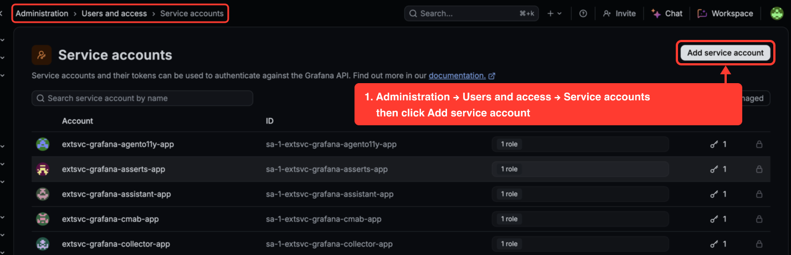

The `extsvc-*` accounts are created by Grafana for its own apps. Leave them alone.

### 4.2 Name it and give it the Admin role

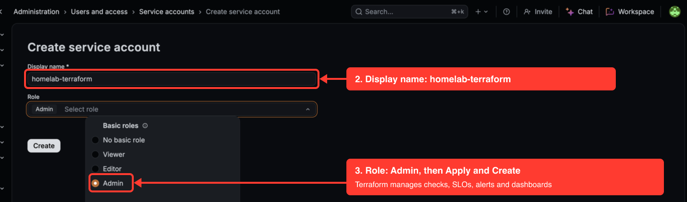

Admin is the simplest role that lets Terraform manage checks, SLOs, alert rules, contact points and
dashboards. Narrowing it to fixed roles is a follow-up; see §7.

### 4.3 Add a token

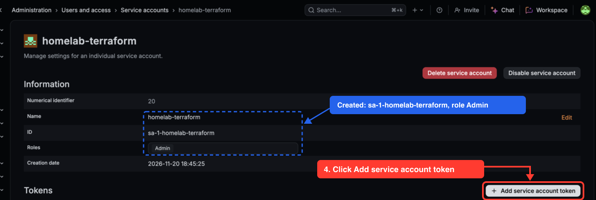

### 4.4 Name the token and generate it

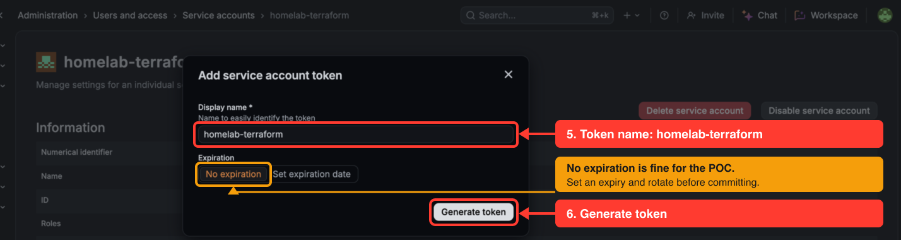

### 4.5 Copy the token (shown once)

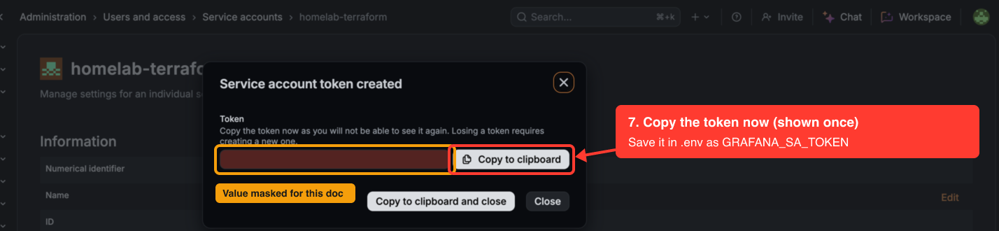

The token is only shown in this dialog. Losing it means generating a new one and deleting the old one.

---

## 5. Synthetic Monitoring token and URLs (`GRAFANA_SM_TOKEN`, `GRAFANA_SM_URL`)

Synthetic Monitoring has its own API and its own tokens, separate from the stack's service accounts.
Terraform needs both to create checks and private probes.

### 5.1 Initialize the Synthetics app (once per stack)

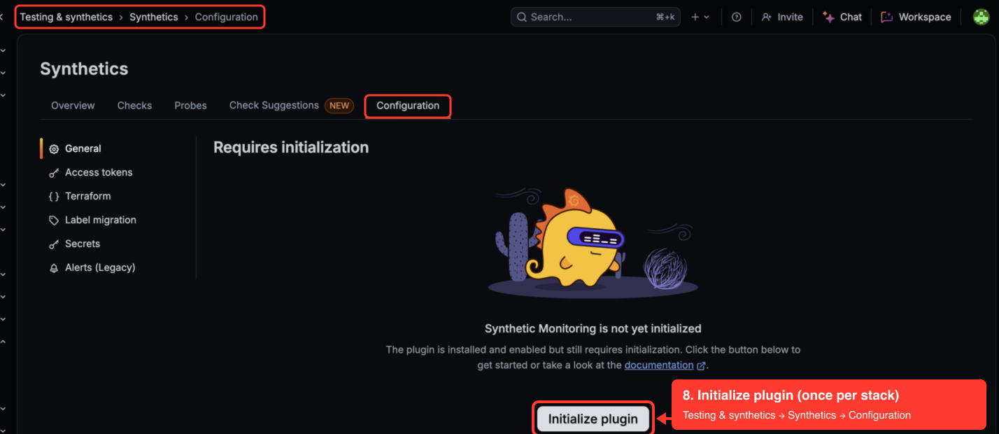

### 5.2 Note the API addresses

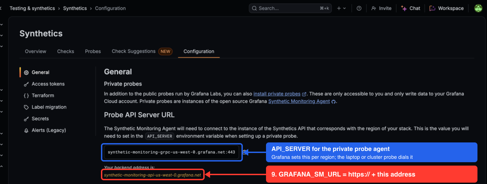

| Value | Goes to |
|---|---|
| `synthetic-monitoring-grpc-<region>.grafana.net:443` | `API_SERVER` on each private probe agent |
| `https://synthetic-monitoring-api-<region>.grafana.net` | `GRAFANA_SM_URL`, the Terraform provider's `sm_url` |

### 5.3 Generate an access token

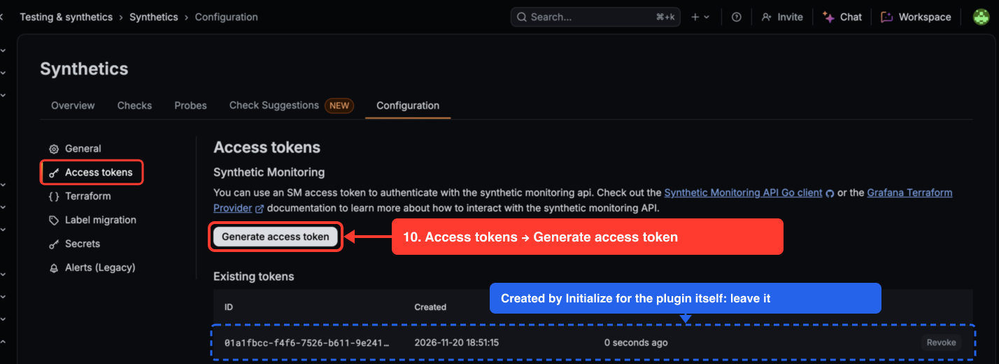

### 5.4 Copy the token (shown once)

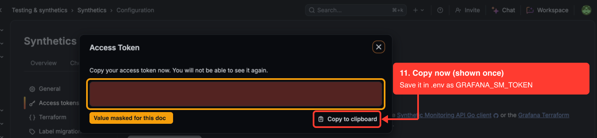

---

## 6. What the setup revealed

| Finding | Impact on the POC |
|---|---|
| A new stack starts on a **14-day trial** with paid features turned on | Anything that works during the trial, private probes especially, must be re-checked after the stack drops to Free. Record each free-tier verdict with "trial" or "free" next to it |
| Synthetics needs a one-time **Initialize** before its API or tokens exist | Terraform can't create checks on a fresh stack until this is done (or until the provider's `grafana_synthetic_monitoring_installation` resource runs) |
| Service account tokens and Synthetic Monitoring tokens are **separate systems** | Two secrets to rotate; the SM token can't call the Grafana API and the reverse |
| Each private probe gets **its own token**, shown once | Terraform creates the probe and outputs the token; store it as a Kubernetes secret, not in the repo |
| Password-manager browser extensions interfere with scripted form filling in the Grafana UI | When automating UI steps, set values through the page rather than simulated keystrokes |

---

## 7. Follow-ups before relying on the stack

- [ ] Move both tokens to `~/credentials/homelab.env` (repo convention), keep only the non-secret URLs in `.env`
- [ ] Create a second service account, `homelab-mcp`, with the **Viewer** role for mcp-grafana, so Claude Code investigations can't change anything
- [ ] Replace Admin on `homelab-terraform` with the fixed roles Terraform actually uses, once the resource set is known
- [ ] Set an expiry on both tokens and document rotation
- [ ] Bring the Synthetics initialization itself under Terraform so a rebuilt stack needs no manual steps

---

## 8. POC test order

Every test below runs from a laptop on the tailnet. Nothing is deployed to the cluster until test 1 passes
on the **Free** tier, not only on the trial.

| # | Test | How | Passes when |
|---|---|---|---|
| 1 | **Private probe on Free** (go/no-go) | Terraform creates a private probe; run `synthetic-monitoring-agent` on the laptop in a container | Probe shows online and a check against a `*.priv` URL succeeds; runs draw from the free quota |
| 2 | Smoke test scripts | `k6 run` locally against real URLs (API checks for most services, browser checks for Audiobookshelf and Studio) | Each script passes locally and as a deployed check |
| 3 | Public browser check | Terraform check on Audiobookshelf from a Grafana public probe | Results include page-load timing; run counting matches the quota math in `research.md` |
| 4 | SLOs and burn rate | Terraform SLO per service, 14-day window; break a check on purpose | Error budget drops and the burn-rate alert fires |
| 5 | Whole-outage detection | Stop the laptop agent | No-data alert fires and pages |
| 6 | Phone and Discord | IRM mobile app, Discord contact point, test notifications | Push arrives on the phone; quiet hours / mute timings hold |
| 7 | Status page | Shared dashboard, opened in a private window | Viewable without login on the free tier |
| 8 | Investigation loop | mcp-grafana with the `homelab-mcp` Viewer token in Claude Code | Claude can query checks, SLOs and alert history |

---

## 9. Results

Raw command output for each test is in [`evidence/`](evidence/). Code lives in `monitoring/`:

```text
monitoring/
  terraform/        # provider, probe, checks; ./tf wraps terraform with .env credentials
  checks/           # k6 scripts, identical locally and in Grafana
  scripts/promql    # instant PromQL query against the stack, printed as a table
```

### Scoreboard

| Q | Answer | Tier | Evidence |
|---|---|---|---|
| Q1 | ✅ Private probe works; its runs are billed like public ones (`grafanacloud_sm_billable_check_executions_per_second` counts them) | Trial: re-check on Free | Test 1 |
| Q2 | ✅ Probe on the tailnet reaches `*.priv` services through the private ingress | Trial | Test 1 |
| Q3 | ✅ A multi-step script counts as **one run per execution**, not per request | Trial | Test 2 |
| Q4 | ✅ Login → browse → 64 KB of real media works as a k6 API check for all four apps; passwords come from Grafana's secret store on both private and public probes | Trial | Test 9 |
| Q5 | ✅ Public browser check reports FCP, LCP, TTFB per probe location | Trial | Test 3 |
| Q6 | ✅ Burn-rate alerts fire; ⚠️ 30-day window accepted but unproven past 14 days of data | Trial | Test 4 |
| Q7 | ✅ No-data alert fires ~7 min after the probe goes silent; Grafana can be its own dead man's switch | Trial | Test 5 |
| Q8 | ✅ Discord: a `team=homelab` route delivers firing alerts to `#homelab-alerts`; ⏳ phone push waits on the IRM app (O5); quiet hours wait on O4 | Trial | Test 6 |
| Q9 | ✅ Public dashboard loads and queries with no login | Trial: re-check on Free | Test 7 |
| Q10 | ✅ mcp-grafana with a Viewer token reads metrics and alert rules; writes get 403 | Trial | Test 8 |
| Q11 | ✅ Probe, checks, SLOs, alert rules, dashboard, public share and service account all in Terraform | Trial | All |

### Test 1: private probe on the tailnet (Q1, Q2)

**Setup.** Terraform creates the probe and outputs its token; Podman runs the agent with the token
passed through the environment, so it never appears in a command line or log.

```hcl
# monitoring/terraform/probes.tf
resource "grafana_synthetic_monitoring_probe" "tailnet_laptop" {
  name   = "homelab-tailnet-laptop"
  region = "AMER"
  labels = { network = "tailnet", host = "laptop" }
  # latitude / longitude omitted
}
```

```bash
cd monitoring/terraform && ./tf apply
API_TOKEN="$(./tf output -raw tailnet_laptop_probe_token)" \
podman run -d --name homelab-sm-agent --restart=unless-stopped \
  --cap-add=NET_RAW -e API_TOKEN \
  docker.io/grafana/synthetic-monitoring-agent:latest-browser \
  --api-server-address=synthetic-monitoring-grpc-us-west-0.grafana.net:443
```

```text
grafana_synthetic_monitoring_probe.tailnet_laptop: Creation complete after 0s [id=547]
grafana_synthetic_monitoring_check.private_health["jellyfin"]: Creation complete after 0s [id=69015]
grafana_synthetic_monitoring_check.private_health["harbor"]: Creation complete after 0s [id=69016]
grafana_synthetic_monitoring_check.private_health["immich"]: Creation complete after 0s [id=69017]
Apply complete! Resources: 4 added, 0 changed, 0 destroyed.
```

> **Gotcha:** without `--cap-add=NET_RAW` the container loops on
> `[FATAL tini (2)] exec /usr/local/bin/synthetic-monitoring-agent failed: Operation not permitted`.
> The binary carries a file capability for ICMP checks that rootless Podman drops.

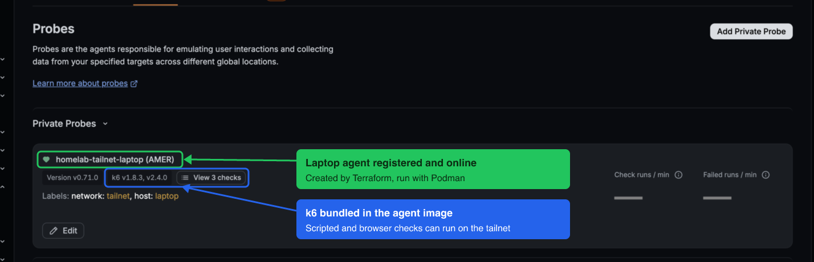

**Result.** All three health checks succeed from the laptop probe:

```text
$ monitoring/scripts/promql 'probe_success{probe="homelab-tailnet-laptop"}'
job               instance                                             service   value
jellyfin-health   https://jellyfin.priv.mlops-club.org/health          jellyfin  1
harbor-health     https://cr.priv.mlops-club.org/api/v2.0/health       harbor    1
immich-health     https://photos.priv.mlops-club.org/api/server/ping   immich    1
```

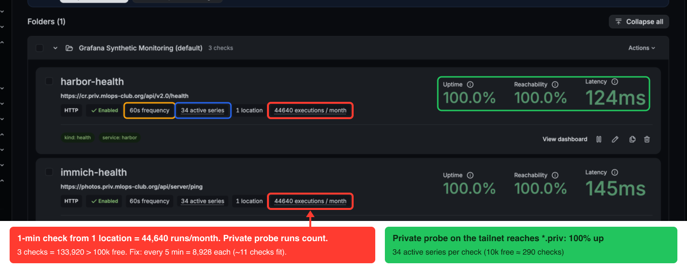

**Quota finding.** The checks list shows the monthly cost of each check. One location at 1-minute
frequency is **44,640 runs/month**, so three such checks (133,920) already exceed the free 100k API runs.
The checks were moved to 5 minutes:

| Frequency | Runs/month per check per location | Checks that fit in 100k |
|---|---|---|
| 1 min | 44,640 | 2 |
| 5 min | 8,928 | 11 |
| 15 min | 2,976 | 33 |

Active series are not the constraint: **34 series per HTTP check** against a 10k limit.

**Private runs are billed.** Grafana's usage data source counts executions by check class. The only
protocol and scripted checks run on the private probe, and both show up as billable:

```text
$ query grafanacloud-usage: grafanacloud_sm_billable_check_executions_per_second
  check_class=browser   0.00000/s
  check_class=protocol  0.04583/s
  check_class=scripted  0.00417/s
```

### Test 2: multi-step scripted check (Q3)

One k6 script makes five requests across Jellyfin, Immich and Navidrome. The same file runs locally and
in Grafana:

```javascript
// monitoring/checks/media-health.js (excerpt)
group('immich', () => {
  const ping = http.get('https://photos.priv.mlops-club.org/api/server/ping');
  check(ping, { 'immich pong': (r) => r.status === 200 && r.json('res') === 'pong' });
});
```

```text
$ k6 run -q monitoring/checks/media-health.js
    ✓ jellyfin healthy
    ✓ jellyfin reports a version
    ✓ immich pong
    ✓ immich reports a version
    ✓ navidrome answers subsonic
    checks_succeeded...: 100.00% 5 out of 5
    http_reqs......................: 5
    iteration_duration.............: avg=481.63ms
```

```hcl
# monitoring/terraform/checks_scripted.tf (excerpt)
settings {
  scripted { script = file("${path.module}/../checks/media-health.js") }
}
```

**Result.** Grafana estimates the 5-request script at **8,928 runs/month** at 5-minute frequency, the
same as a single HTTP check. Billing counts each started minute of run time, so a script stays at one
run per execution as long as it finishes in under a minute. Smoke tests can bundle several services in
one script without multiplying cost.

Per-step results come for free: every k6 `check()` becomes a labelled series, so the status page can show
which step broke while the SLO uses the whole script's pass/fail.

```text
$ monitoring/scripts/promql 'probe_check_success_rate{job="media-health"}'
check                         group        value
immich pong                   ::immich     1
immich reports a version      ::immich     1
jellyfin healthy              ::jellyfin   1
jellyfin reports a version    ::jellyfin   1
navidrome answers subsonic    ::navidrome  1
```

### Test 3: public browser check with Web Vitals (Q5)

The only outside-in check: a k6 browser script loads the Audiobookshelf login page from two Grafana
public probes.

```javascript
// monitoring/checks/audiobookshelf-browser.js (excerpt)
await page.goto('https://books.mlops-club.org/login', { waitUntil: 'networkidle' });
await page.locator('input[type="password"]').waitFor({ state: 'visible', timeout: 10000 });
```

```hcl
# monitoring/terraform/checks_browser.tf (excerpt)
frequency = 900000 # 15 min
probes = [
  data.grafana_synthetic_monitoring_probes.public.probes.Oregon,
  data.grafana_synthetic_monitoring_probes.public.probes.Ohio,
]
settings { browser { script = file("${path.module}/../checks/audiobookshelf-browser.js") } }
```

**Result.** Each run reports Web Vitals per probe location:

| Metric | Laptop (`k6 run`, home network) | Oregon probe | Ohio probe |
|---|---|---|---|
| First contentful paint | 1,150 ms | 936 ms | 1,508 ms |
| Largest contentful paint | 1,470 ms | 1,000 ms | 1,716 ms |
| Time to first byte | 237 ms | 356 ms | 387 ms |

```text
$ monitoring/scripts/promql 'probe_browser_web_vital_fcp{job="audiobookshelf-browser"}'   # ms
probe   value_ms
Ohio    1508
Oregon  936
```

**Cost.** Grafana estimates **5,952 browser runs/month** (2 locations × every 15 min), 60% of the
free 10k. One more browser check at this rate would exceed the quota; a second check should run from
one location or every 30 minutes.

### Test 7: status page from a public dashboard (Q9)

A Terraform-managed dashboard ([`status_dashboard.tf`](../../../../monitoring/terraform/status_dashboard.tf))
plus one resource to share it:

```hcl
resource "grafana_dashboard_public" "status" {
  dashboard_uid          = grafana_dashboard.status.uid
  is_enabled             = true
  share                  = "public"
  time_selection_enabled = false
}
```

**Result.** The link works with no login. Checked with `curl` and no `Authorization` header:

```text
unauthenticated:
  page            200
  dashboard api   200
$ curl -X POST "$GRAFANA_URL/api/public/dashboards/$TOKEN/panels/1/query"   # no Authorization header
   immich-health = 1
   media-health = 1
   audiobookshelf-browser = 1
   harbor-health = 1
   jellyfin-health = 1
```

**First design failed the outage test.** With the tailnet probe stopped, the original "Up now" tile simply
dropped the private services, and "Uptime, last 24 h" stayed at 100%: missing data read as healthy.

**Second design**: one row per listener-facing service. The tile shows UP, DOWN or a grey NO DATA (no
result in 20 min). The bar chart has one bar per check run, its height the run's duration: green passed,
red failed, grey no result.

```hcl
# monitoring/terraform/status_dashboard.tf (excerpt): three series, one colour each
{ refId = "A", legendFormat = "Passed",
  expr = "max(last_over_time(probe_duration_seconds{job=\"${s.job}\"}[$__interval])) and on() (min(last_over_time(probe_success{job=\"${s.job}\"}[$__interval])) == 1)" },
{ refId = "B", legendFormat = "Failed",   expr = "... == 0)" },
{ refId = "C", legendFormat = "No result",
  expr = "(vector(0.5) unless on() count(count_over_time(probe_success{job=\"${s.job}\"}[20m]))) and on() (...[30d]) > 0)" },
```

Rendered by a fresh headless Chromium with no Grafana cookies (`k6 browser`): HTTP 200, no login form.

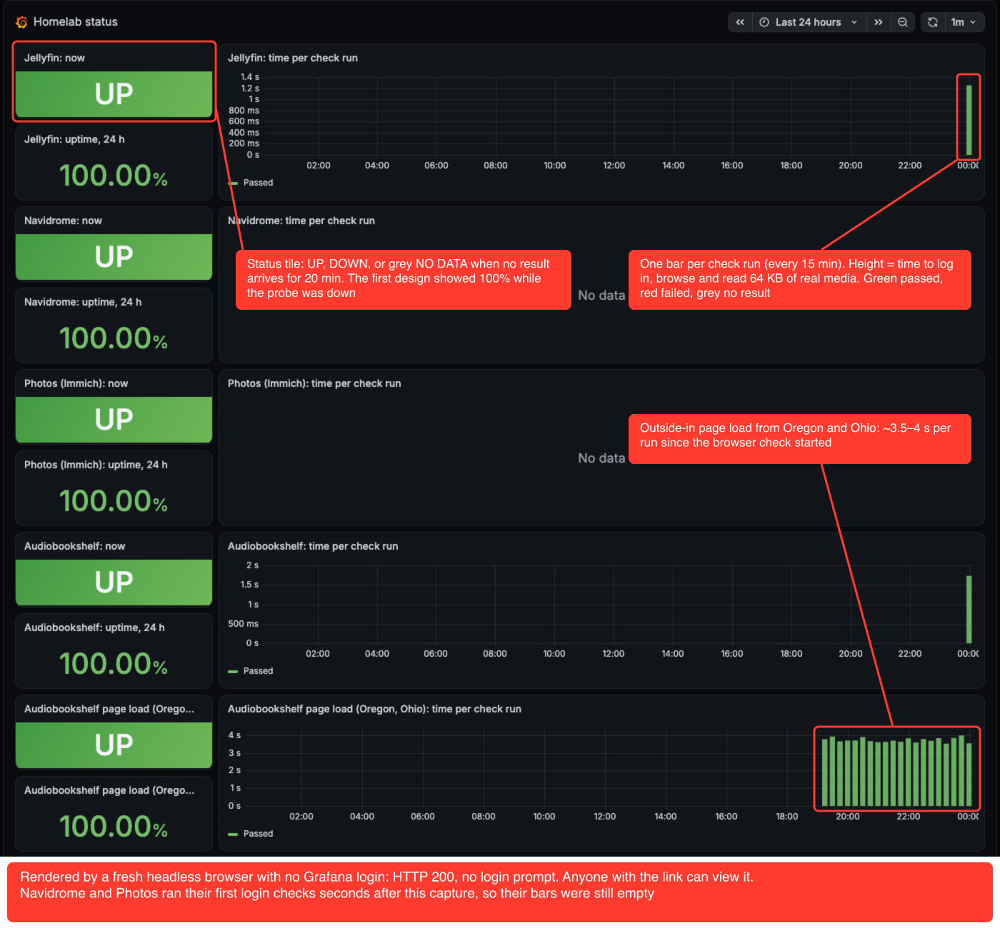

**Check reports.** Under each service, a collapsed row explains the check step by step: the API calls,
what passes, what a red bar means, and screenshots of the equivalent screens. The text lives in
[`monitoring/reports/`](../../../../monitoring/reports/) and Terraform loads it with `templatefile()`.
A headless browser captured the screenshots, signed in as each `homelab-monitor` user with covers and
titles blurred, and GitHub serves them to the public page.

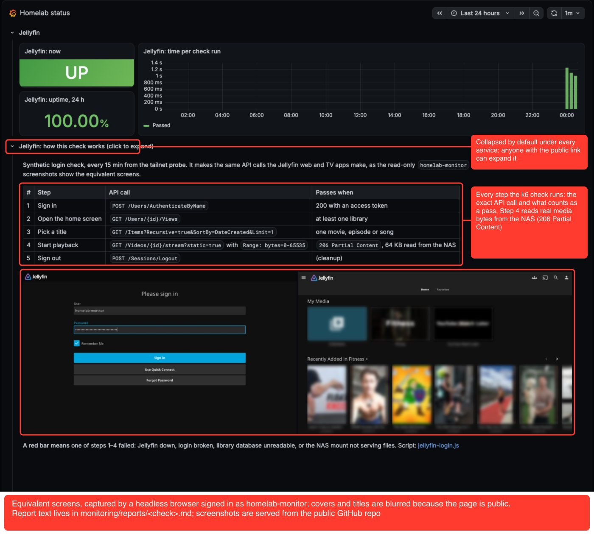

> **Synthetic, but API-level.** The login checks make the calls the apps make (sign in, list, stream);
> they don't render or click the UI, so a broken button wouldn't fail them. Only `audiobookshelf-browser`
> drives a real browser. Moving all four apps to browser checks at 15 min would cost about 11,904 browser
> runs a month, which is over the 10k free.

> **Gotchas:** panels need explicit `id`s or the public panel API returns
> `publicdashboards.panelNotFound`; the provider ignores `id` when diffing, so adding them later needs
> `./tf apply -replace=grafana_dashboard.status -replace=grafana_dashboard_public.status`. Replacing the
> share issues a new link. The link is a bearer secret: it is not written in this repo.

### Test 8: read-only investigation through mcp-grafana (Q10)

A second service account, `homelab-mcp`, has the **Viewer** role and is created by Terraform
([`service_accounts.tf`](../../../../monitoring/terraform/service_accounts.tf)). A small script drives
the `grafana/mcp-grafana` container over stdio exactly as Claude Code would:

```bash
MCP_TOKEN="$(cd monitoring/terraform && ./tf output -raw mcp_token)" \
python3 monitoring/scripts/mcp-smoke.py '[
  ["query_prometheus", {"datasourceUid": "grafanacloud-prom", "expr": "min by (job) (probe_success)",
                        "queryType": "instant", "startTime": "now", "endTime": "now"}],
  ["alerting_rules_read", {"operation": "list"}],
  ["create_folder", {"title": "should-be-denied"}]]'
```

```text
80 tools: add_activity_to_incident, alerting_manage_routing, ..., query_prometheus, ...

>>> query_prometheus
{"data":[{"metric":{"job":"immich-health"},"value":[...,"1"]},{"metric":{"job":"media-health"},...

>>> alerting_rules_read {"operation": "list"}
[{"title":"Jellyfin availability - Error Budget Burn Rate is High","state":"normal","health":"ok",...

>>> create_folder {"title": "should-be-denied"}
create folder 'should-be-denied': [POST /folders][403] createFolderForbidden
  {"message":"You'll need additional permissions to perform this action. Permissions needed: folders:create"}
```

**Result.** Queries and alert reads work; writes are refused by the Viewer role even though the server
advertises write tools. For Claude Code, register it with the same token:

```bash
claude mcp add grafana -- podman run -i --rm -e GRAFANA_URL -e GRAFANA_SERVICE_ACCOUNT_TOKEN \
  docker.io/grafana/mcp-grafana:latest -t stdio
```

### Test 4: SLOs and burn-rate alerts (Q6)

An SLO is one Terraform resource. The ratio query uses the counters every synthetic check emits:

```hcl
# monitoring/terraform/slos.tf (excerpt)
resource "grafana_slo" "jellyfin_availability" {
  name = "Jellyfin availability"
  query {
    type = "ratio"
    ratio {
      success_metric = "probe_all_success_sum{job=\"jellyfin-health\"}"
      total_metric   = "probe_all_success_count{job=\"jellyfin-health\"}"
    }
  }
  objectives {
    value  = 0.999
    window = "30d"
  }
  destination_datasource { uid = "grafanacloud-prom" }
  alerting {
    fastburn {}
    slowburn {}
  }
}
```

Grafana turns each SLO into recording rules (`grafana_slo_sli_5m` … `_3d`) and two multi-window
burn-rate alert rules:

```text
lowNarrow  (1 - grafana_slo_sli_30m{...}) > bool 0.006
lowWide    (1 - grafana_slo_sli_6h{...})  > bool 0.006
highNarrow (1 - grafana_slo_sli_5m{...})  > bool 0.0144
highWide   (1 - grafana_slo_sli_1h{...})  > bool 0.0144
alert      (${lowNarrow} && ${lowWide}) || (${highNarrow} && ${highWide})
```

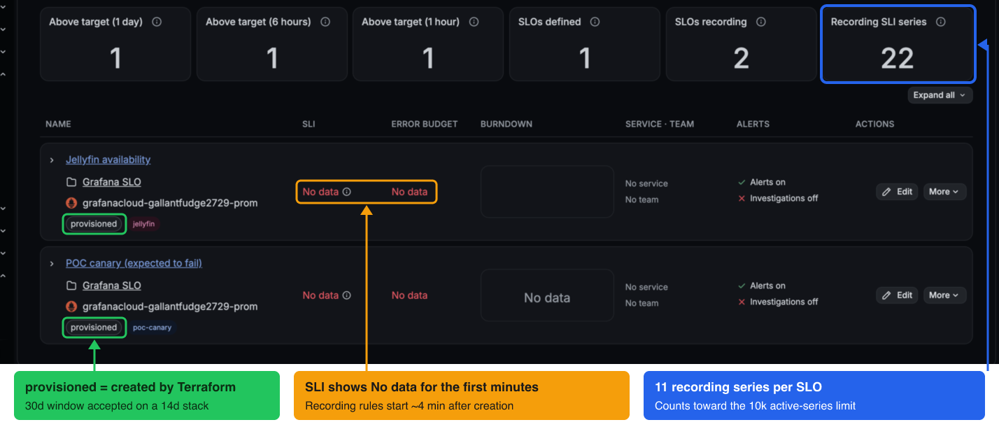

**Proving an alert fires.** A temporary check that always fails (`poc_canary.tf`, deleted after the test) feeds a canary SLO:

```text
19:06:34  terraform apply: poc-canary-fail check + "POC canary (expected to fail)" SLO
19:10:50  Very High burn rate: Pending
19:12:50  Very High burn rate: Alerting
$ monitoring/scripts/alert-states 'POC'
inactive  POC canary (expected to fail) - Error Budget Burn Rate is High       [('Normal (NoData)', ...)]
firing    POC canary (expected to fail) - Error Budget Burn Rate is Very High  [('Alerting', '2026-11-21T02:12:50')]
```

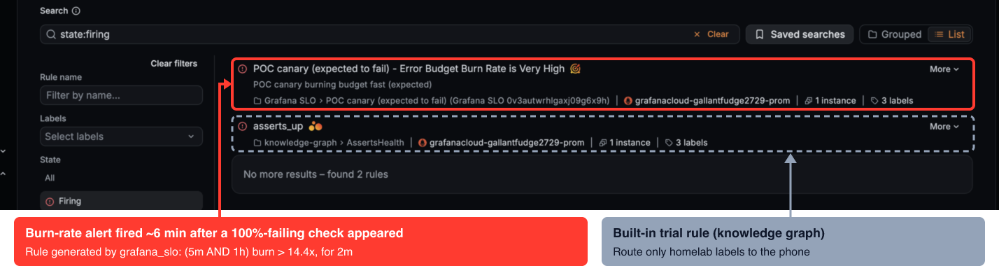

**Result.**

| Question | Finding |
|---|---|
| Burn-rate alerts | ✅ Generated automatically from `alerting { fastburn {} slowburn {} }`; fired about 6 minutes after a total failure began |
| 30-day window on a 14-day stack | ⚠️ Accepted without error. Whether the 30-day SLI silently becomes a 14-day one needs 15+ days of data, and the trial runs with longer retention. Default to `window = "14d"` |
| Series cost | 11 recording series per SLO (22 for two) against the 10k limit |
| Noise | Built-in trial rules (`asserts_up`, knowledge graph) also fire; route only `service`-labelled homelab alerts to the phone |

### Test 5: whole-outage detection with a no-data alert (Q7)

A cluster outage takes the in-cluster probe down with it, so the signal is **silence**. One alert rule
turns silence into a page:

```hcl
# monitoring/terraform/alerts_heartbeat.tf (excerpt)
rule {
  name           = "Tailnet probe is silent"
  condition      = "B"
  for            = "2m"
  no_data_state  = "Alerting" # missing data is the outage
  exec_err_state = "Alerting"
  # A: count(probe_success{probe="homelab-tailnet-laptop"})   B: $A < 1
}
```

The test stops the agent and polls the rule every 30 seconds
([`evidence/t5-outage.txt`](evidence/t5-outage.txt)):

```text
19:13:34 podman stop homelab-sm-agent
19:13:34 inactive  Tailnet probe is silent  [('Normal', ...)]
   ...     (series still inside the 5-minute lookback)
19:18:40 pending   Tailnet probe is silent  [('Pending (NoData)', '2026-11-21T02:18:30')]
19:20:42 firing    Tailnet probe is silent  [('Alerting (NoData)', '2026-11-21T02:20:30')]
```

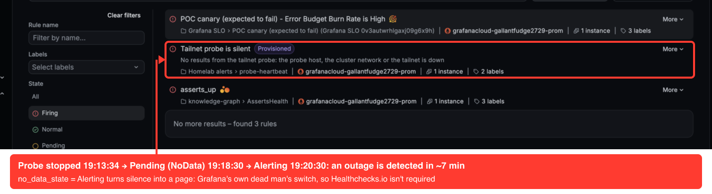

**Result.** Detection time = last sample + 5 min Prometheus lookback + 2 min `for` ≈ **7 minutes**.
Healthchecks.io is not needed for this; the remaining blind spot is Grafana Cloud's own alerting being
down. Detection could be ~4 minutes with a 1-minute lookback (`count_over_time(...[3m])`) at no extra
cost.

### Test 9: login smoke tests with Grafana secrets (Q4)

Each app has a read-only `homelab-monitor` user (inventory and permissions:
[MONITORING_ACCOUNTS.md](../../MONITORING_ACCOUNTS.md)). Each script logs in, lists a library, then reads
the first 64 KB of a real media file with a `Range` header. A `206 Partial Content` response proves the
NAS mount serves bytes, which a `/health` endpoint never touches.

```js
// monitoring/checks/navidrome-login.js (excerpt): salted-token auth, password never on the wire
const password = await secrets.get('navidrome-monitor-password');
const salt = Math.random().toString(36).slice(2, 12);
const q = `u=homelab-monitor&t=${crypto.md5(password + salt, 'hex')}&s=${salt}&v=1.16.1&c=homelab-monitor&f=json`;
...
const r = http.get(`${BASE}/stream?id=${song.id}&format=raw&${q}`,
  { headers: { Range: 'bytes=0-65535' }, responseType: 'binary' });
check(r, { 'track bytes served from NAS': (x) => x.status === 206 && x.body.byteLength === 65536 });
```

Passwords move from `~/credentials/homelab-monitoring.env` into Grafana's secret store through a
**write-only** Terraform argument, so they never land in state:

```hcl
# monitoring/terraform/secrets.tf (excerpt)
resource "grafana_apps_secret_securevalue_v1beta1" "monitor_password" {
  for_each = local.monitored_apps
  metadata { uid = "${each.key}-monitor-password" }
  spec {
    description = "${each.key} monitor pw"
    value       = var.monitor_passwords[each.key] # ephemeral variable, write-only argument
    decrypters  = ["synthetic-monitoring"]
  }
}
```

Local run, same files Grafana runs ([evidence/t9-login-local.txt](evidence/t9-login-local.txt)):

```text
$ k6 run -q --secret-source=file=secrets.txt monitoring/checks/navidrome-login.js
checks_succeeded...: 100.00% 5 out of 5
✓ login succeeds
✓ music folders listed
✓ library has albums
✓ album has tracks
✓ track bytes served from NAS
```

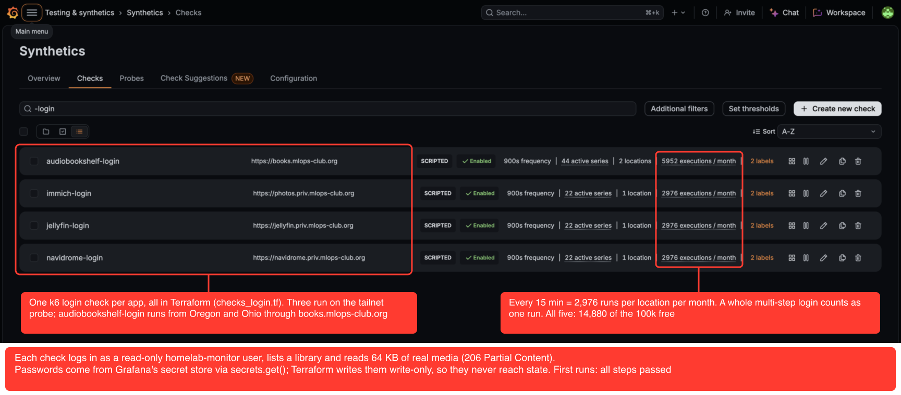

| App | Steps | Probe | Local | Grafana |
|---|---|---|---|---|
| Jellyfin | login, libraries, oldest item, 64 KB of the video/audio stream | tailnet | 4/4 ✅ | 4/4 ✅ |
| Navidrome | Subsonic ping, folders, album, 64 KB of a track | tailnet | 5/5 ✅ | 5/5 ✅ |
| Immich | login, find canary, preview thumbnail, 64 KB of the original | tailnet | 4/4 ✅ | 4/4 ✅ |
| Audiobookshelf | login, libraries, oldest book, 64 KB of its audio file | Oregon, Ohio via `books.mlops-club.org` | 5/5 ✅ | 5/5 ✅ both |

After `./tf apply` ([evidence/t9-apply.txt](evidence/t9-apply.txt)), a grep for each password in
`terraform.tfstate` and the apply log found **0** matches.

**Findings.**

| Finding | Detail |
|---|---|
| Secrets work on private probes | `secrets.get()` resolved on the self-hosted agent as well as on public probes; the docs don't say either way |
| Guest permissions hold | Audiobookshelf `/api/items/<id>/file/<ino>` returns 206 for the guest; `/download` returns 403 |
| Immich needs a canary | A fresh user's library is empty. The monitor user owns one generated PNG (quota raised to upload, then set back to 0) |
| Cloudflare blocks Python's default client | `urllib` got 403 from `books.mlops-club.org`; curl and k6 pass. Use a normal User-Agent in admin scripts |
| Provider requirements | Secure values need provider ≥ 4.26, Terraform ≥ 1.11 (write-only args) and `stack_id` on the provider |

### Test 6: Discord alert routing (Q8)

```hcl
# monitoring/terraform/notifications.tf (excerpt)
resource "grafana_notification_policy" "root" {
  contact_point = "empty"                    # everything else stays silent (incl. trial rules)
  group_by      = ["grafana_folder", "alertname"]
  policy {
    matcher {
      label = "team"
      match = "="
      value = "homelab"
    }
    contact_point   = grafana_contact_point.discord.name  # webhook from ~/credentials
    repeat_interval = "4h"
  }
}
```

Homelab rules carry `team = "homelab"` (the heartbeat rule and both SLO burn-rate alerts).

End-to-end run: stop the probe agent, let the heartbeat rule fire, confirm delivery, restart
([evidence/t6-discord-e2e.txt](evidence/t6-discord-e2e.txt), apply log in
[evidence/t6-apply.txt](evidence/t6-apply.txt)):

```text
23:56:39 podman stop homelab-sm-agent
00:02:52 pending   Tailnet probe is silent  [('Pending (NoData)', '2026-11-21T07:02:30')]
00:04:56 firing    Tailnet probe is silent  [('Alerting (NoData)', '2026-11-21T07:04:30')]
00:05:57 homelab-discord last attempt 2026-11-21T07:05:05Z 537ms error: none   (firing)
00:05:57 podman start homelab-sm-agent
00:06:59 inactive  Tailnet probe is silent  [('Normal', '2026-11-21T07:06:30')]
00:10:10 homelab-discord last attempt 2026-11-21T07:10:05Z 2s678ms error: none   (resolved)
```

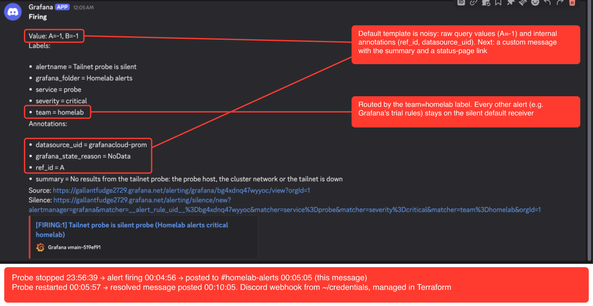

**Findings.**

| Finding | Detail |
|---|---|
| Routing works | Only `team=homelab` alerts reach Discord; the root policy stays on the silent `empty` receiver, so trial rules never post |
| Stop → Discord ≈ 8.5 min | 7 min detection (Test 5) + `for` + 30 s group wait |
| Default message is noisy | Shows `Value: A=-1, B=-1`, every label and internal annotations (`ref_id`, `datasource_uid`). A custom notification template with the summary and a dashboard link would read better on a phone |
| Phone push not yet tested | Needs the Grafana IRM app installed and linked (O5) |


### Current quota use

After the tests, with the canary removed:

| Check | Type | Locations | Frequency | Runs/month |
|---|---|---|---|---|
| jellyfin-health, immich-health, harbor-health | HTTP | tailnet probe | 5 min | 3 × 8,928 = 26,784 |
| media-health (5 steps) | Scripted | tailnet probe | 5 min | 8,928 |
| jellyfin-, navidrome-, immich-login | Scripted | tailnet probe | 15 min | 3 × 2,976 = 8,928 |
| audiobookshelf-login | Scripted | Oregon, Ohio | 15 min | 2 × 2,976 = 5,952 |
| **API total** | | | | **50,592 of 100,000** |
| audiobookshelf-browser | Browser | Oregon, Ohio | 15 min | **5,952 of 10,000** |

`media-health` is superseded by the login checks; dropping it frees 8,928 runs.
