# ADR 0001 Research: Outside-In Monitoring, SLOs and Alerting

**Purpose**: Record the research behind choosing tools for outside-in monitoring, uptime SLOs, phone alerting and status pages for the homelab cluster

**Scope**: Goals and constraints, per-service smoke-test definitions, vendor free tiers (SaaS and self-hosted), candidate tool combinations scored against the goals, and the proposed plan. The decision itself is recorded separately once proofs of concept finish

**Overview**: The cluster runs services that need to stay up (Jellyfin, Audiobookshelf, Immich, Navidrome,
    Golden Rules Studio → k2 → Azure, Harbor), and nothing alerts when they, or the whole cluster, go
    down. This document states the outcomes the monitoring has to deliver, then compares 25+ vendors and
    open-source tools against them under a hard $0 budget. A single vendor does not cover every outcome
    on a free tier, so candidates are scored as **combinations** of tools. Each pricing claim that drives
    a conclusion links to an annotated screenshot of the vendor's own pricing page. The document ends with
    the proposed architecture and the questions the proofs of concept must answer

**Dependencies**: `.ai/docs/CLUSTER_HA_AUDIT.md` (SPOF inventory and the measurement section this builds on), `otel-operator/` (existing OTel collector), `.ai/howto/how-to-create-tailscale-ci-oauth.md`

**Exports**: Requirements, smoke-test definitions, comparison tables, recommended tool combination, POC checklist

**Related**: `.ai/docs/CLUSTER_HA_AUDIT.md`, `.ai/howto/how-to-use-radar.md`

---

## Contents

1. [Summary](#1-summary)
2. [Goals](#2-goals)
3. [What "up" means: smoke tests per service](#3-what-up-means-smoke-tests-per-service)
4. [Findings that shape the design](#4-findings-that-shape-the-design)
5. [Candidate solutions](#5-candidate-solutions)
6. [Scorecard: goals × solutions](#6-scorecard-goals--solutions)
7. [Pros and cons](#7-pros-and-cons)
8. [Pricing evidence (annotated)](#8-pricing-evidence-annotated)
9. [Free-tier reference tables](#9-free-tier-reference-tables)
10. [Debugging: BubbleUp, RUM and cardinality](#10-debugging-bubbleup-rum-and-cardinality)
11. [Proposed plan](#11-proposed-plan)
12. [POC checklist and open questions](#12-poc-checklist-and-open-questions)
13. [Cluster observations made during research](#13-cluster-observations-made-during-research)
14. [Sources](#14-sources)

---

## 1. Summary

| Question | Answer |
|---|---|
| Does one free tool do everything? | **No.** Every vendor misses at least one of: free phone alerting, real SLOs, reaching Tailscale-only services, or a status page |
| Recommended combination | **Grafana Cloud Free** (synthetics, SLOs, alerting, on-call app, telemetry, MCP) + **Healthchecks.io** (dead man's switch) + **Instatus Starter** (public Audiobookshelf page), with private checks run by an **in-cluster probe** that has a Tailscale sidecar, and an hourly **GitHub Actions** check as an outside cross-check |
| Optional add-on | **Honeycomb Free** as a debugging layer (real BubbleUp, free MCP), fed by a second exporter on the existing OTel collector |
| Runner-up | New Relic Free (real SLOs, 100 GB), held back by one full user and a platform lockout on overage |
| Self-hosted fallback | Gatus + VictoriaMetrics + vmalert + Sloth on the NAS, with ntfy.sh and Healthchecks.io |
| Biggest unknowns | Whether Grafana's free tier allows private probes, and how an SLO behaves when its window is longer than the 14-day retention |

---

## 2. Goals

Priority: **Must** = a solution that misses it is out; **Should** = strongly preferred; **Nice** = tie-breaker.

| # | Outcome | Priority | Notes |
|---|---|---|---|
| G1 | **Costs $0** | Must | Free tiers only; self-hosting on owned hardware is fine |
| G2 | **Alerts when the whole cluster or home internet is down** | Must | The reason for outside-in: in-cluster alerting dies with the cluster |
| G3 | **Smoke-tests real user behaviour** per service (section 3) | Must | Log in, browse, play ~2 s of media, open a photo, run the Studio → k2 → Azure flow, push/pull an image |
| G4 | **Reaches Tailscale-only services** (`*.priv.mlops-club.org`) | Must | Jellyfin, Immich, Navidrome, k2 and Harbor are private |
| G5 | **SLOs with error budgets**, per service, starting at 99.9% | Must | Targets can differ per service |
| G6 | **Burn-rate and N-consecutive-failure alerts** | Should | Alerts fire only on user-facing behaviour |
| G7 | **Phone notifications** via a mobile app (SMS acceptable) | Must | |
| G8 | **Discord** notifications (MLOps Club server) | Should | Slack later for collaborators |
| G9 | **Per-service quiet hours** | Should | Some services can wake you, some cannot |
| G10 | **Public status page** (Audiobookshelf) | Should | |
| G11 | **Private status page** (you + collaborators) | Nice | |
| G12 | **Code-first** config (Terraform, CLI or scripts in this repo) | Must | Claude Code authors, dry-runs and verifies checks, SLOs and alerts |
| G13 | **Dry-run / local test** of checks before deploying | Should | |
| G14 | **MCP server or API** so Claude can investigate incidents | Should | |
| G15 | **Telemetry path** (logs, metrics, traces) that can be correlated with check failures | Should | Answer whether it's possible; implementing it is out of scope |
| G16 | **BubbleUp-style comparison view** | Nice | Baseline vs. selection, attributes ranked by difference |
| G17 | **Collect but don't alert on** K8s API `/readyz` and an NFS write/read heartbeat | Nice | |
| G18 | **Grows with new services** via a repeatable per-service pattern | Should | |

---

## 3. What "up" means: smoke tests per service

Probe frequency: cheap checks every 1–5 minutes, the slow Studio → k2 flow hourly (runs take 1–5 minutes). Writes are allowed only when they're cleaned up.

| Service | Reachable at | Smoke test | Credential | Writes |
|---|---|---|---|---|
| Jellyfin | Private (+ LAN) | Log in → list a library → fetch ~2 s of video with a `Range` request on `/Videos/{id}/stream?static=true` | Non-admin user with a fixed device ID (API keys are admin-level) | None |
| Audiobookshelf | **Public** | API key → list libraries → `Range` request on `/api/items/{id}/file/{ino}` (not `/play`, which records a session) | API key | None |
| Immich | Private | API key → list assets → fetch one thumbnail | Read-only scoped API key | None |
| Navidrome | Private | Subsonic `ping` → random song → `stream` with `maxBitRate`, a few seconds | Non-admin user, token + salt auth | None |
| Golden Rules Studio (read path) | **Public** | Log in → list catalogs → open one catalog's rules. Reads Azure Blob through SAS tokens, which expire silently | Shared Studio password | None |
| Studio → k2 → Azure (end to end) | Public + in-cluster | Start Generate on a **canary catalog** → poll the run until a terminal state (`finished`, `failed`, `timed_out`…) → check the result | Shared Studio password | One ruleset version on the canary catalog (pending decision) |
| Harbor | Private (`cr.priv`) | Push a tiny image to a `monitoring` project → pull it → delete it | Robot account limited to that project | Cleaned up |
| Pebble webhook | Public | Out of scope | — | — |
| K8s API `/readyz`, NFS heartbeat | In-cluster | Collected, no alerts | — | NFS temp file, deleted |

Alerting rule for Golden Rules: per-step results feed the status page; only the **end-to-end** result counts toward the SLO and pages.

---

## 4. Findings that shape the design

| # | Finding | Consequence |
|---|---|---|
| F1 | No SaaS free tier can reach Tailscale-only endpoints directly. Checkly private locations cost $64/mo, OpenStatus $100/mo; New Relic includes them but caps synthetic runs at 500/mo; Grafana's free tier **might** allow private probes (unverified) | Run private checks **from inside the cluster** and push results out, or from a runner that joins the tailnet |
| F2 | A probe inside the cluster still catches a whole-cluster outage if the outside tool alerts on **missing data** and a heartbeat | Inside-out probing satisfies G2 when paired with a dead man's switch |
| F3 | A probe pod with a **Tailscale sidecar** calling `https://<svc>.priv.mlops-club.org` covers public DNS → Tailscale → Tailscale proxy pod → traefik-private → app | Nearly the same path a phone uses; a probe calling the ClusterIP would miss the Tailscale proxy (a SPOF in the HA audit) |
| F4 | At 15-minute probes, 99.9%/30d gives 2,880 probes/month, so **one failed probe spends ~35% of the budget** and every burn-rate tier fires | Probe cheap checks every 1–5 min; page on 2–3 consecutive failures; give the hourly Studio flow its own, looser SLO |
| F5 | Grafana Cloud Free keeps **14 days** of data | Use 14-day SLO windows (99.9% ≈ 20 min of budget), plus a daily export job for a long-term record |
| F6 | **No SaaS free tier has a private status page** (~$50/mo everywhere) | Private view = a logged-in Grafana dashboard (3 users) |
| F7 | This repo is **public**: Actions minutes are free, but workflow logs are public, scheduled runs can be delayed or dropped, and schedules turn off after 60 days without repo activity | GitHub Actions is a backup runner only; it checks health endpoints (no credentials), hides hostnames, and pings a heartbeat |
| F8 | Breaking through iOS Do Not Disturb needs Pushover ($4.99 one-time) or a paid vendor tier; ntfy, Discord and the Grafana app send normal push for free | Normal push is the $0 baseline |
| F9 | Cluster telemetry is small: ~56 MB/day of logs (half from one failing exporter), NAS ~22.5 TB free | Volume doesn't decide the choice; any free tier or the NAS fits |
| F10 | Golden Rules Generate publishes a new ruleset version to shared data, and the only undo is a revert that adds another version | A true end-to-end check needs a dedicated canary catalog; otherwise start-then-cancel proves only that k2 spawns |

---

## 5. Candidate solutions

Columns in the scorecard are **combinations**, so a strong tool isn't excluded for lacking something a second free tool covers.

| ID | Combination | Private checks run by | Status page | Dead man's switch |
|---|---|---|---|---|
| **A** | **Grafana Cloud Free + Healthchecks.io + Instatus Starter** | In-cluster Grafana private probe (or k6 runner) with Tailscale sidecar; GitHub Actions hourly cross-check | Instatus (public), Grafana dashboard (private) | Healthchecks.io + Grafana no-data alerts |
| **B** | **A + Honeycomb Free** (debugging layer) | Same as A | Same as A | Same as A |
| **C** | Better Stack Free + Healthchecks.io | In-cluster probe pushing heartbeats | Better Stack (1 public page) | Better Stack heartbeats + Healthchecks.io |
| **D** | Checkly Hobby + Healthchecks.io + ntfy.sh/Discord webhooks | In-cluster probe pushing heartbeats (Checkly can't reach private services free) | Checkly (public, no custom domain) | Healthchecks.io |
| **E** | New Relic Free + Healthchecks.io + Instatus Starter | In-cluster probe pushing custom events | Instatus (public) | Healthchecks.io + NR no-data alerts |
| **F** | Self-hosted on the NAS: Gatus + VictoriaMetrics + vmalert + Sloth + ntfy.sh, with Healthchecks.io and Upptime | Gatus on the NAS over Tailscale | Upptime on GitHub Pages (public), Gatus (private) | Healthchecks.io |

---

## 6. Scorecard: goals × solutions

✅ meets it · ⚠️ meets it with a caveat · ❌ doesn't meet it. Split into themed tables so each stays narrow.

### 6.1 Budget, reach and checks

| Goal | A | B | C | D | E | F |
|---|---|---|---|---|---|---|
| G1 $0 | ✅ | ✅ | ✅ | ✅ | ✅ | ✅ |
| G2 Whole-cluster outage alert | ✅ no-data + heartbeat | ✅ | ✅ heartbeats | ✅ Healthchecks | ✅ | ⚠️ NAS shares power and internet with the cluster; Healthchecks covers it |
| G3 Real smoke tests | ✅ k6 scripted + browser | ✅ | ⚠️ 10 monitors total | ⚠️ multi-step requests each count as a run | ⚠️ in-cluster probe only; 500 synthetic runs | ⚠️ Gatus Suites are alpha; k6 for complex flows |
| G4 Tailscale-only services | ⚠️ in-cluster probe; free private probes unverified | ⚠️ same | ⚠️ yes/no heartbeats only | ⚠️ heartbeats only | ✅ custom events from probe | ✅ |
| G17 Collect `/readyz` + NFS heartbeat | ✅ | ✅ | ⚠️ monitor slots | ⚠️ monitor slots | ✅ | ✅ |

### 6.2 SLOs and alerting

| Goal | A | B | C | D | E | F |
|---|---|---|---|---|---|---|
| G5 SLOs with error budgets | ⚠️ Grafana SLO; 14-day window | ⚠️ same | ❌ uptime % only | ❌ | ✅ service levels | ✅ Sloth rules |
| G6 Burn-rate + consecutive failures | ✅ | ✅ | ⚠️ consecutive only | ⚠️ consecutive only | ⚠️ burn-rate on free unverified | ✅ |
| G7 Phone (app push / SMS) | ✅ IRM app, 3 users | ✅ | ❌ push/SMS need $29/mo | ⚠️ via ntfy webhook | ⚠️ NR mobile app, unverified | ✅ ntfy.sh |
| G8 Discord | ✅ | ✅ | ⚠️ webhook | ⚠️ webhook | ⚠️ webhook | ✅ |
| G9 Per-service quiet hours | ✅ notification policies | ✅ | ⚠️ paid on-call | ⚠️ manual | ✅ | ✅ Alertmanager / maintenance windows |

### 6.3 Status pages

| Goal | A | B | C | D | E | F |
|---|---|---|---|---|---|---|
| G10 Public page (Audiobookshelf) | ✅ Instatus | ✅ | ✅ 1 page | ⚠️ no custom domain | ✅ Instatus | ✅ Upptime |
| G11 Private page | ⚠️ Grafana dashboard | ⚠️ same | ❌ $50/mo | ❌ Team plan | ⚠️ NR dashboard, 1 user | ✅ second Gatus instance |

### 6.4 Code-first and AI

| Goal | A | B | C | D | E | F |
|---|---|---|---|---|---|---|
| G12 Code-first | ✅ Terraform + k6 | ✅ | ✅ Terraform | ✅ CLI / Terraform / Pulumi | ✅ Terraform | ✅ YAML + Sloth |
| G13 Local dry run | ✅ `k6 run` | ✅ | ❌ | ⚠️ `checkly test` runs in their cloud | ⚠️ | ⚠️ Gatus has none; `promtool test rules` for SLOs |
| G14 MCP / API | ✅ `mcp-grafana` | ✅ + Honeycomb MCP | ✅ | ⚠️ MCP on Hobby unverified | ✅ | ✅ VictoriaMetrics MCP |
| G18 Repeatable per-service pattern | ✅ | ✅ | ⚠️ slot limit | ⚠️ quota | ✅ | ✅ |

### 6.5 Telemetry and debugging

| Goal | A | B | C | D | E | F |
|---|---|---|---|---|---|---|
| G15 Telemetry + check correlation | ✅ 50 GB logs/traces, 10k series, `traceparent` from checks | ✅ | ⚠️ 3 GB / 3 days | ❌ traces Enterprise-only | ✅ 100 GB | ✅ on NAS disk; correlate by labels and `trace_id` |
| G16 BubbleUp-style view | ⚠️ Traces Drilldown, traces only | ✅ real BubbleUp | ⚠️ exists, hard to use | ❌ | ⚠️ | ❌ |

### 6.6 Totals

| | A | B | C | D | E | F |
|---|---|---|---|---|---|---|
| ✅ | 14 | 15 | 5 | 3 | 11 | 14 |
| ⚠️ | 4 | 3 | 9 | 11 | 7 | 3 |
| ❌ | 0 | 0 | 4 | 4 | 0 | 1 |
| Musts missed | 0 | 0 | 2 (G5, G7) | 1 (G5) | 0 | 0 |

Counts weight every goal equally; "Musts missed" is the filter. A and F score about the same. A wins on effort (nothing to run or patch) and on unverified items being fewer for phone and Discord. F wins on independence from vendor pricing and on a private status page. E is the managed runner-up.

---

## 7. Pros and cons

| Solution | Pros | Cons |
|---|---|---|
| **A** Grafana + Healthchecks + Instatus | <ul><li>Only free tier with SLOs, burn-rate alerts, free phone push/SMS and Discord together</li><li>Same k6 script runs locally and as a deployed check</li><li>Terraform for everything; official MCP</li><li>50 GB logs, 50 GB traces; checks inject `traceparent`</li><li>No credit card, so a hard $0 cap</li></ul> | <ul><li>14-day retention: 30-day SLO windows unlikely</li><li>10k metric series: needs an allowlist</li><li>3 users</li><li>Free private probes unverified</li><li>Three vendors to configure</li><li>Pricing page carries a "pricing is changing" banner</li></ul> |
| **B** A + Honeycomb | <ul><li>Everything in A</li><li>Real BubbleUp and a free hosted MCP that exposes it</li><li>Attributes aren't billed (per-event pricing)</li></ul> | <ul><li>A fourth vendor</li><li>Data in two places</li><li>Only worth it once Studio and k2 emit traces</li></ul> |
| **C** Better Stack | <ul><li>Account already exists</li><li>Uptime, heartbeats, status page and telemetry in one product</li><li>Terraform and MCP</li></ul> | <ul><li>Free alerts are email and Slack only; push/SMS/phone cost $29/mo</li><li>No SLOs</li><li>10 monitors + heartbeats in total</li><li>3 GB / 3-day telemetry</li><li>Comparison view is painful to use</li></ul> |
| **D** Checkly | <ul><li>Best check-authoring tooling: Playwright, CLI, Terraform/Pulumi</li><li>MCP server</li><li>Free status page</li></ul> | <ul><li>Can't reach private services without $64/mo</li><li>No SLOs</li><li>No free SMS/phone</li><li>Each request in a multi-step check is a billed run (10k API / 1k browser)</li><li>1 user, 7-day raw data</li></ul> |
| **E** New Relic | <ul><li>Real SLOs</li><li>100 GB/mo across all signals</li><li>MCP generally available</li></ul> | <ul><li>1 full user</li><li>Overage locks you out of the platform, alerting included</li><li>500 synthetic runs/mo</li><li>Burn-rate alerts and mobile push on free unverified</li></ul> |
| **F** Self-hosted on NAS | <ul><li>No vendor limits or pricing risk</li><li>Private status page possible</li><li>Unlimited retention on NAS disk</li><li>SLO rules testable with `promtool`</li></ul> | <ul><li>You run and patch it</li><li>NAS shares power/internet with the cluster</li><li>Gatus Suites alpha, no dry run</li><li>No BubbleUp</li><li>UGOS Docker support on your NAS model unverified</li></ul> |

---

## 8. Pricing evidence (annotated)

Screenshots are cropped from each vendor's public pricing page and annotated to show the facts behind the scorecard. Pricing pages change; re-check before relying on a number.

### 8.1 Grafana Cloud: 14-day retention on Free

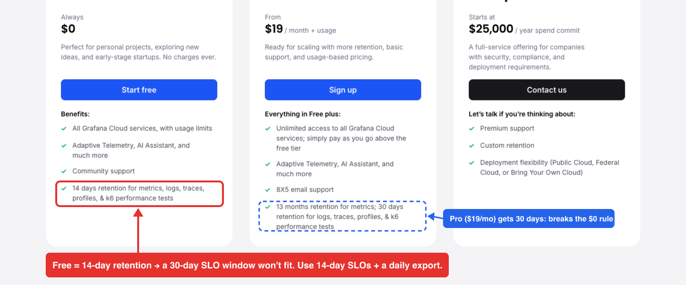

Retention is the reason SLO windows are 14 days in the plan (F5).

### 8.2 Grafana Cloud: synthetic monitoring quota

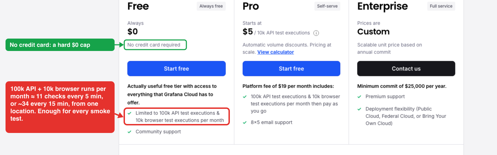

100k API runs/month covers about 11 checks every 5 minutes, or about 34 every 15 minutes, from one location.

### 8.3 Grafana Cloud: 10k active metric series

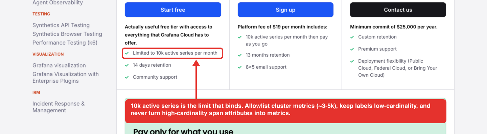

The metric series cap, not GB, is the limit to manage (section 10.3).

### 8.4 Grafana Cloud: on-call for 3 users

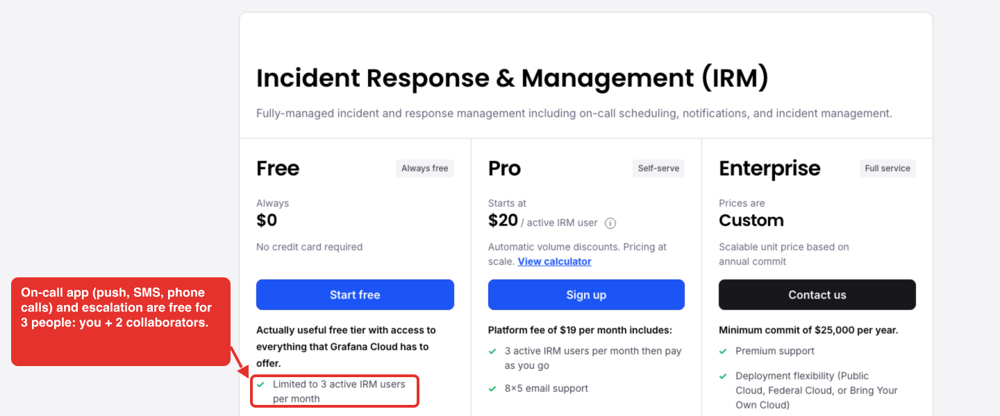

### 8.5 Better Stack: free alerts are email and Slack only

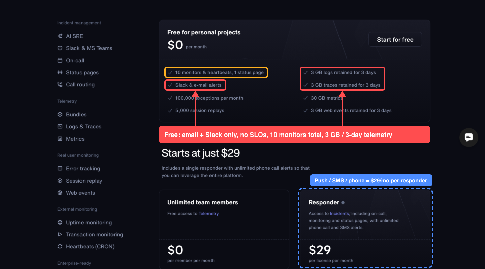

### 8.6 Checkly: no private locations below Team

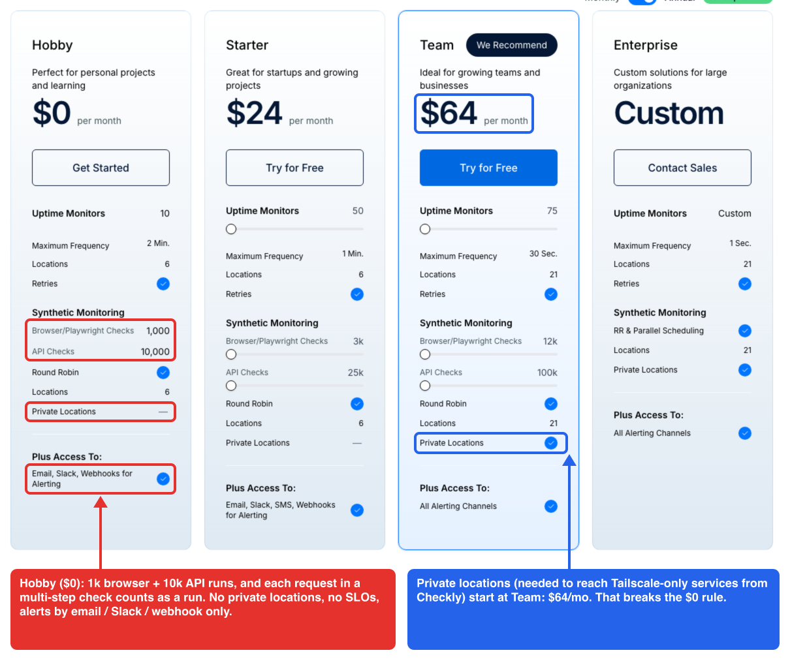

### 8.7 Honeycomb: BubbleUp and MCP on Free, SLOs on Pro

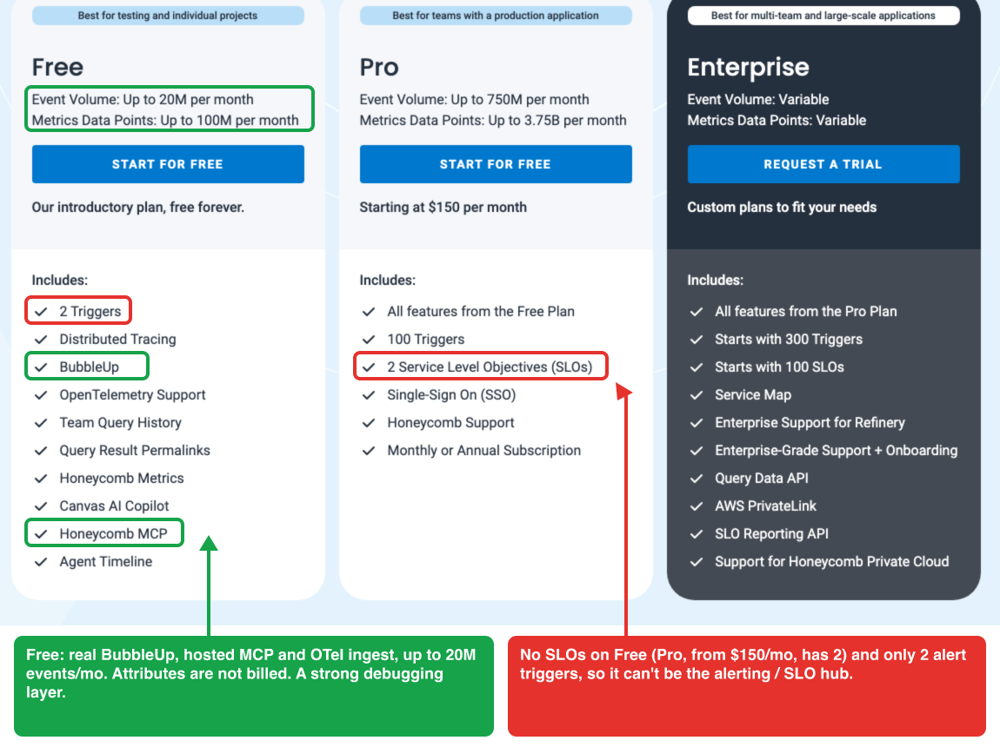

### 8.8 New Relic: 100 GB, one full user

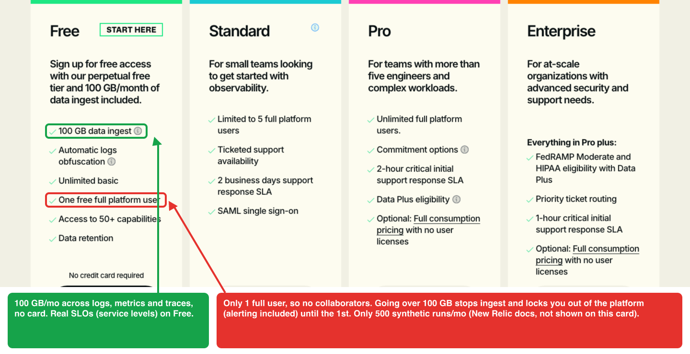

### 8.9 Instatus: free public status page

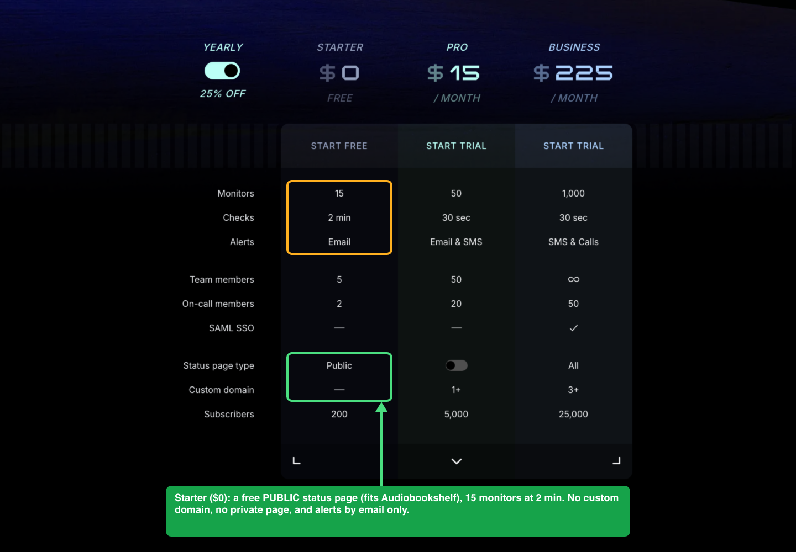

### 8.10 Healthchecks.io: 20 free checks

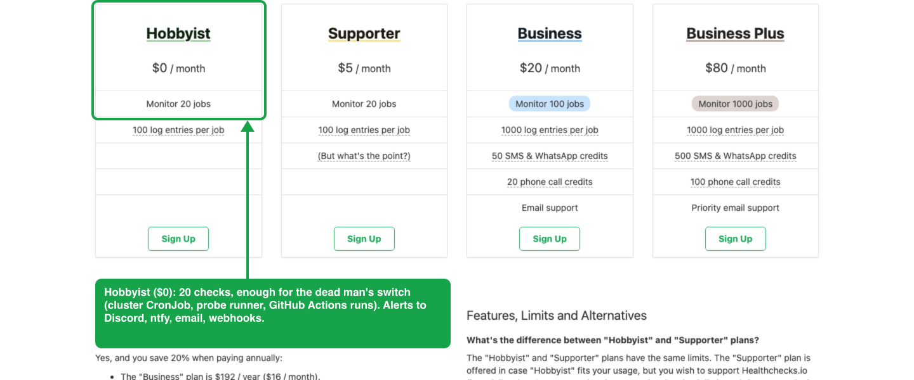

### 8.11 GitHub Actions: scheduled workflow caveats

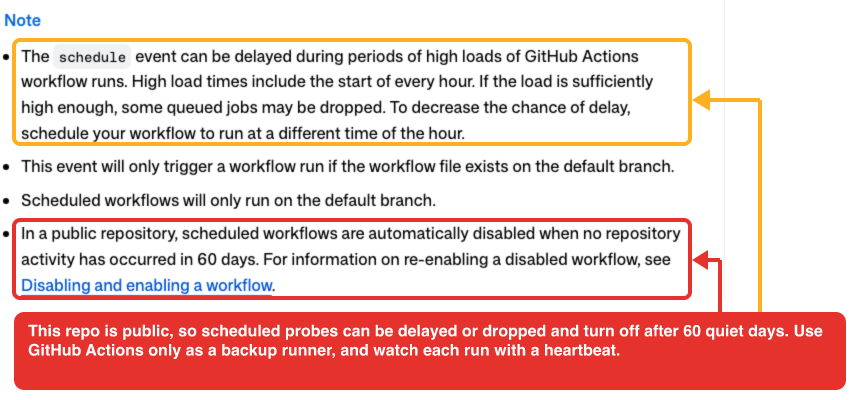

### 8.12 Grafana Traces Drilldown: the closest built-in BubbleUp

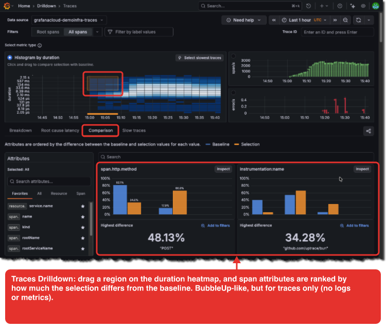

---

## 9. Free-tier reference tables

### 9.1 Uptime, synthetics and alerting

| Vendor | Free checks | Private endpoints | Real SLOs | Free phone / Discord | Status page | Code-first |
|---|---|---|---|---|---|---|
| **Grafana Cloud** | 100k API + 10k browser runs/mo | Private probe agent (free tier unverified) | ✅ burn-rate | App push, SMS/phone (+1), 3 users / ✅ | ❌ (dashboards) | Terraform, k6 |
| **Checkly Hobby** | 10 uptime monitors (2 min), 10k API, 1k browser | ❌ ($64/mo Team) | ❌ | ❌ / webhook | ✅ public, no custom domain | CLI, Terraform, Pulumi |
| **Better Stack** | 10 monitors + heartbeats (3 min) | Heartbeats only | ❌ | ❌ ($29/mo) / ❌ | ✅ 1 public | Terraform |
| **New Relic** | 500 synthetic runs (pings free) | ✅ but counts against 500 | ✅ | App (unverified) / webhook | ❌ | Terraform |
| **UptimeRobot** | 50 monitors (5 min), single request | ❌ | ❌ | Limited / ✅ | ✅ basic public | Community Terraform |
| **Healthchecks.io** | 20 push checks | ✅ (push) | ❌ | via ntfy / ✅ | ❌ (badges) | API |
| **Instatus Starter** | 15 monitors (2 min) | Heartbeats | ❌ | Email only | ✅ public, no custom domain | API |
| **incident.io Basic** | — | — | ❌ | Unverified | ✅ public, custom domain | No API on free |
| **PagerDuty Free** | — | — | ❌ | Push + limited SMS/calls, 5 users | ❌ | Terraform |
| **OpenStatus** | Public checks | ❌ ($100/mo Pro) | ⚠️ | ⚠️ | ✅ | CLI with `--dry-run` |

### 9.2 Telemetry backends

| Vendor | Free ingest | Retention | Synthetics | SLOs | MCP | Gotcha |
|---|---|---|---|---|---|---|
| **Grafana Cloud** | 50 GB logs, 50 GB traces, 10k series | 14 days | ✅ | ✅ | ✅ | Series cap; new series silently dropped at the limit |
| **New Relic** | 100 GB all signals | 8+ days | 500 runs | ✅ | ✅ | Overage locks you out until the 1st |
| **Honeycomb** | 20M events, 100M metric points | 60 days (unverified) | ❌ | ❌ (Pro) | ✅ | Span events and links each count as events |
| **Better Stack** | 3 GB logs, 3 GB traces, 30 GB metrics | 3 days | ✅ | ❌ | ✅ | Tiny log/trace allowance |
| **Axiom Personal** | 500 GB/mo ingest, 25 GB stored | 30 days | ❌ | ❌ | ✅ | Log store only |
| **Sentry Free** | Errors + 1 uptime monitor | 30 days | 1 monitor | ❌ | ✅ | Uptime checks become trace spans |

### 9.3 Excluded

| Vendor | Reason |
|---|---|
| Dash0 | Consumption pricing / trial; fails $0 |
| SigNoz Cloud | $49/mo minimum |
| Coralogix, Elastic Cloud, Logz.io, Observe, Kloudfuse | Trial-only or paid |
| Datadog | No free synthetics; free infra is 5 hosts, 1-day retention |
| Middleware.io | Free plan requires a card |
| Highlight.io | Shut down (moved into LaunchDarkly) |
| Freshping | Shut down |
| Pingdom, Uptime.com | No free plan |
| Cloudflare Health Checks | Not on the Free plan |
| Nobl9 | No free tier |
| HyperDX / ClickStack Cloud | 3 GB / 3-day free tier (self-hosted ClickStack remains an option) |

### 9.4 Self-hosted open source

| Tool | Role | Verdict |
|---|---|---|
| **Gatus** | Checks, status page, `failure-threshold`, maintenance windows, Prometheus metrics | Best lightweight prober; Suites (multi-step) alpha; no SLOs, no dry run |
| **Grafana k6 OSS** | Scripted checks (JS), browser module, `k6 run` locally | Best check-authoring format; pairs with Grafana Cloud or any push target |
| **Uptime Kuma** | Checks + status pages | No multi-step checks, no password on status pages |
| **OneUptime** | All-in-one with SLOs, Playwright, Terraform | Needs ≥ 8 GB RAM |
| **Upptime** | GitHub Actions + Pages status site | Good public page; single-request checks only |
| **Healthchecks** (self-host) | Dead man's switch | Use the hosted free tier instead, so it survives a home outage |
| **Sloth / Pyrra** | SLO rules as code | Sloth + `promtool test rules` is the testable path |
| **VictoriaMetrics + VictoriaLogs** | Small-footprint telemetry storage | Best fit for the NAS's own disk |
| **SigNoz, ClickStack, Uptrace** | Full observability stacks | Too heavy for the NAS (ClickStack: ≥ 4 GB RAM; has Event Deltas) |
| **ntfy.sh** | Free phone push (iOS + Android) | Normal priority only; iOS critical alerts not released |
| Statping-ng, Cachet | Status pages | Stalled; avoid |

---

## 10. Debugging: BubbleUp, RUM and cardinality

### 10.1 BubbleUp-style comparison views

| Tool | Feature | Free? | Notes |
|---|---|---|---|
| Honeycomb | BubbleUp | ✅ | The reference implementation; also exposed through Honeycomb MCP |
| Grafana Cloud | Traces Drilldown → Breakdown / Comparison | ✅ | Traces only; presets for slow spans (> p90) and errors; one top value per attribute until you click Inspect |
| ClickStack / HyperDX | Event Deltas | ✅ self-hosted | ClickHouse + HyperDX, ≥ 4 GB RAM |
| Dash0 | Triage | ❌ paid | Box a heatmap region, compare against baseline |
| Better Stack | Comparison view | ⚠️ | Exists; reported as painful to use |

Off-the-shelf apps (Jellyfin, Immich, Navidrome, Audiobookshelf) aren't instrumented, so comparisons there use Traefik request spans. Golden Rules Studio and k2 can be instrumented end to end, which is where a comparison view pays off.

### 10.2 Browser metrics (Web Vitals / RUM)

| Option | What it is | Free allowance |
|---|---|---|
| Grafana Faro | Open-source browser SDK feeding Frontend Observability (Web Vitals, errors, sessions, traces) | 50k sessions/mo |
| Honeycomb web SDK (`@honeycombio/opentelemetry-web`) | OpenTelemetry JS distribution with Web Vitals on by default; takes a custom `endpoint` | Spans count against 20M events/mo |
| k6 browser checks | Web Vitals per synthetic run | Within 10k browser runs/mo |

Page-load auto-instrumentation creates a span per fetched resource (30–100 per page). At household traffic (~100 page loads/day) that's ~150k events/month, under 1% of Honeycomb Free. Sending browser telemetry to a Traefik-fronted collector endpoint keeps vendor keys out of the browser and lets the collector fan out to any backend.

### 10.3 How high cardinality is priced

| Vendor | Many attributes on a span | Watch out for |
|---|---|---|
| Grafana Cloud | Traces/logs priced by GB: attributes only add bytes | Metrics priced by active series. Span metrics / Application Observability and high-cardinality **Loki labels** multiply series. Free tier drops new series at the cap. Track `grafanacloud_traces_instance_metrics_generator_active_series` |
| Honeycomb | Priced per event; attributes free up to 2,000 fields / 1 MB per event | Span events and links are separate events; metrics cardinality does count |
| New Relic | Priced by GB | Overage lockout |
| Better Stack | Priced by GB | 3 GB free |

Rule of thumb: rich context goes on **spans**; metric labels and Loki labels stay low-cardinality (service, route template, status).

---

## 11. Proposed plan

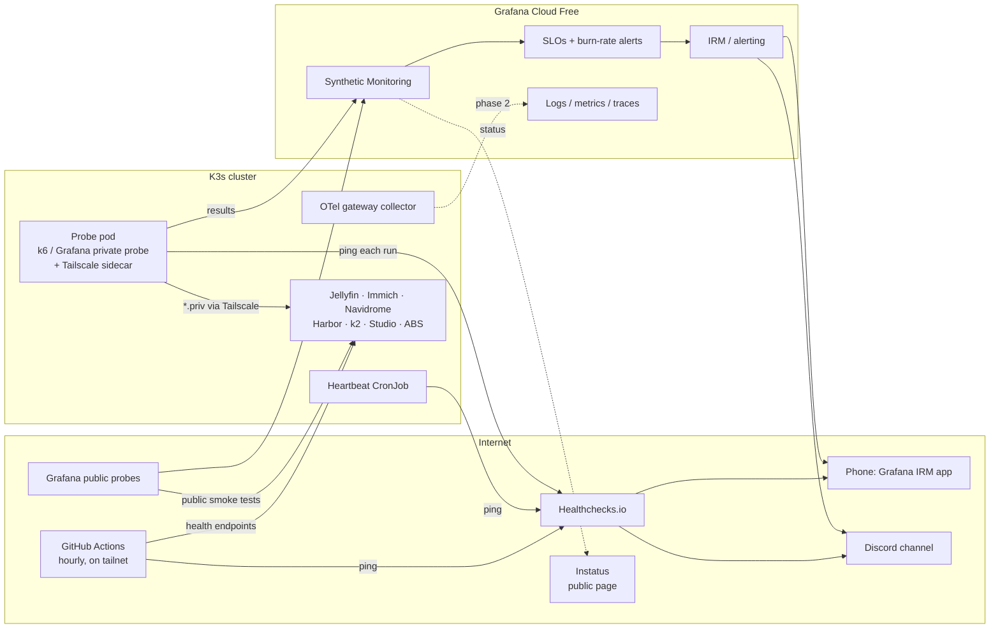

| Layer | Tool | Frequency | Alerts? |
|---|---|---|---|
| Public smoke tests (Audiobookshelf, Studio read path) | Grafana public probes | 5 min | Yes (SLO) |
| Private smoke tests (Jellyfin, Immich, Navidrome, Harbor) | In-cluster probe with Tailscale sidecar | 1–5 min | Yes (SLO) |
| Studio → k2 → Azure | In-cluster probe | Hourly | Yes (own SLO) |
| Private health endpoints from outside | GitHub Actions on the tailnet | Hourly | Only if it disagrees with the in-cluster probe for a sustained period |
| Cluster / home / probe alive | Healthchecks.io + Grafana no-data alerts | Continuous | Yes |
| `/readyz`, NFS heartbeat | In-cluster probe | 5 min | No |
| Long-term SLO record | Daily GitHub Actions job exporting yesterday's success ratios | Daily | No |

Alerting policy:

| Setting | Value |
|---|---|
| SLO target | 99.9% per service to start; per-service overrides allowed |
| SLO window | 14 days (free-tier retention) |
| Page when | 2–3 consecutive failures, or fast burn (1 h / 5 min windows) |
| Ticket / Discord only | Slow burn |
| Missing probe data | Treated as unknown for the SLO; separate "probe down" alert |
| Quiet hours | Per-service notification policies; critical services page 24/7 |
| Probe placement | Off the GPU node; anti-affinity if run with 2 replicas |

Proposed repo layout (to be confirmed in the ADR):

```text
monitoring/
  checks/<service>.js        # k6 scripts, runnable locally with `k6 run`
  terraform/                 # Grafana checks, SLOs, contact points, Healthchecks checks
  probe/                     # Helm values / manifests for the in-cluster probe + Tailscale sidecar
```

---

## 12. POC checklist and open questions

### Grafana Cloud spike

- [ ] Private probe agent works on the free tier, and its runs count against the 100k/10k quota as expected
- [ ] How a multi-step (scripted) check is counted: one run, or one per request
- [ ] SLO behaviour when the window exceeds 14-day retention
- [ ] Traces Drilldown Breakdown / Comparison available on the free stack
- [ ] IRM mobile push and quiet hours per notification policy
- [ ] Terraform covers checks, SLOs, contact points and notification policies end to end

### Other vendors

- [ ] Honeycomb pricing page still lists BubbleUp and MCP on Free (one third-party review says MCP is Enterprise-only)
- [ ] Healthchecks.io → Discord and → ntfy integrations
- [ ] Instatus Discord integration on Starter (pricing page shows email alerts only)

### Decisions needed

- [ ] Canary catalog for the hourly Golden Rules Generate check (agreement from the Studio owner)
- [ ] Claude account and quota backing k2 for an hourly run
- [ ] How the k2 agent authenticates to Azure (needed to detect Azure failures specifically)
- [ ] `tag:monitor` Tailscale ACL allowing port 443 on the private ingress
- [ ] Dedicated low-privilege probe users / API keys per service

---

## 13. Cluster observations made during research

Read-only investigation surfaced issues that no alert reported:

| Observation | Relevance |
|---|---|
| cluster-node-4 (GPU worker) NotReady for about 20 days | The exact class of outage this work should catch |
| OTel collector export to Better Stack failing authentication | Half of all container log volume; GPU metrics not arriving |
| No metrics backend reads kube-state-metrics | Inside-in signals have nowhere to go yet |
| NFS PVs mount the NAS by its Tailscale IP | Storage depends on Tailscale on every node (also in the HA audit) |
| Harbor images are pushed from outside the cluster with the admin password | Supports an outside-in push/pull check with a scoped robot account |
| Studio and k2 have no manifests in this repo | Probe design relied on live-cluster discovery |

---

## 14. Sources

Pricing and limits:
- [Grafana Cloud pricing](https://grafana.com/pricing/) · [Grafana Cloud Free tier](https://grafana.com/products/cloud/free-tier/) · [Grafana Synthetic Monitoring billing](https://grafana.com/docs/grafana-cloud/platform/pricing-and-usage/synthetic-monitoring/)
- [Grafana Frontend Observability](https://grafana.com/products/cloud/frontend-observability-for-real-user-monitoring) · [Frontend Observability costs](https://grafana.com/docs/grafana-cloud/platform/cost-management-and-billing/analyze-costs/reduce-costs/frontend-observability-costs/)
- [Grafana metrics-generator billing](https://grafana.com/docs/grafana-cloud/send-data/traces/configure/metrics-generator/) · [Application Observability cost optimization](https://grafana.com/docs/grafana-cloud/observe-and-act/monitor-applications/application-observability/optimize-costs/)
- [Better Stack pricing](https://betterstack.com/pricing) · [Checkly pricing](https://www.checklyhq.com/pricing/) · [Checkly check pricing](https://www.checklyhq.com/docs/monitoring/check-pricing/) · [Checkly private locations](https://www.checklyhq.com/docs/platform/private-locations/overview/)
- [Honeycomb pricing](https://www.honeycomb.io/pricing) · [Honeycomb hosted MCP](https://www.honeycomb.io/blog/hosted-mcp-now-available) · [Honeycomb MCP with BubbleUp](https://www.honeycomb.io/blog/honeycomb-mcp-ga-support-bubbleup-heatmaps-histograms) · [Honeycomb telemetry volume](https://honeycomb.io/resources/understanding-your-telemetry-volume-honeycomb)
- [New Relic pricing](https://newrelic.com/pricing) · [New Relic private locations](https://docs.newrelic.com/docs/synthetics/synthetic-monitoring/private-locations)
- [Healthchecks.io pricing](https://healthchecks.io/pricing/) · [Instatus pricing](https://instatus.com/pricing) · [OpenStatus pricing](https://www.openstatus.dev/pricing)
- [GitHub Actions schedule event](https://docs.github.com/en/actions/reference/workflows-and-actions/events-that-trigger-workflows)

Features:
- [Grafana Traces Drilldown: analyze tracing data](https://grafana.com/docs/grafana-cloud/learn-and-build/visualizations/simplified-exploration/traces/investigate/analyze-tracing-data/)
- [mcp-grafana](https://github.com/grafana/mcp-grafana)
- [ClickStack overview](https://clickhouse.com/docs/clickstack/overview) · [HyperDX](https://github.com/hyperdxio/hyperdx)
- [Dash0 Triage](https://www.dash0.com/docs/dash0/telemetry/tracing/triage)
- [@honeycombio/opentelemetry-web](https://npmjs.com/package/@honeycombio/opentelemetry-web) · [Honeycomb Core Web Vitals with OTel](https://honeycomb.io/blog/core-web-vitals-opentelemetry)
- [Gatus](https://github.com/TwiN/gatus) · [Sloth](https://github.com/slok/sloth) · [Pyrra](https://github.com/pyrra-dev/pyrra) · [Upptime](https://github.com/upptime/upptime) · [OneUptime](https://github.com/OneUptime/oneuptime) · [VictoriaMetrics](https://docs.victoriametrics.com/) · [ntfy](https://ntfy.sh/)
