# ADR 0001 POC: Full-stack OpenTelemetry for the Golden Rules Studio

**Purpose**: Show, end to end, browser + backend OpenTelemetry for the CTDL Golden Rules Studio, viewed per page in
Grafana Cloud, on an isolated copy that cannot touch production

**Scope**: Instrumentation (public repo ctdl-xtra), infrastructure context and deployment (private deploy repo),
the Grafana dashboard (this repo, Terraform), the run that produced the data, the free-tier impact, and teardown

**Overview**: Following Honeycomb's "few, wide spans": one `page_view` span per page, one client span per API call,
one wide server span per request, and sub-spans only for slow work. Everything that says *where* the Studio runs is
injected from outside the public code. The isolated instance serves a local copy of two catalogs and holds no Azure
credentials. Two test users used every page through a scripted browser; the dashboard below is built only on
TraceQL and TraceQL metrics.

**Related**: [Plan](../../../../docs/otel/PLAN.md) · [Teardown](studio-otel-teardown.md) ·
[`monitoring/terraform-studio-otel/`](../../../../monitoring/terraform-studio-otel/) ·
[MONITORING_ACCOUNTS.md](../../MONITORING_ACCOUNTS.md) · raw output in [`evidence/studio-otel/`](evidence/studio-otel/)

---

## At a glance

| What | Where | State |
|---|---|---|
| Isolated Studio | https://studio-otel.priv.mlops-club.org (tailnet only), namespace `golden-rules-studio-otel` | running, image `3b9e67b-otel` |
| Dashboard "Studio OTel POC: pages" | `$GRAFANA_URL/d/studio-otel-pages` | real data on every page |
| One-trace viewer | `$GRAFANA_URL/d/studio-otel-trace?var-trace=<id>` | |
| Instrumentation | ctdl-xtra `feat/otel-instrumentation-poc` (`golden-dataset-studio/`) | 232 Python + 294 web tests pass |
| Deploy | golden-rules-studio-deploy `feat/otel-instrumentation-poc` (`otel/`) | production files untouched |
| Dashboard code, docs | homelab-cluster `feat/studio-otel-poc` | |
| Production | `golden-rules-studio`, pod `golden-rules-studio-694db5bb85-lpjht` | **unchanged** (§8) |

| Acceptance check | Result | Evidence |
|---|---|---|
| Isolated instance reachable; production still serving, same pod | ✅ | §8, `evidence/studio-otel/prod-before.txt`, `prod-after.txt` |
| One connected trace per interaction with user, `ce.*`, `k8s.*`, deployment, vcs | ✅ | §4 screenshot + TraceQL, `connected-trace.txt` |
| Dashboard via Terraform, real data per page, page screenshots | ✅ | §5 |
| ctdl-xtra diff has no infrastructure details | ✅ | §2, `hygiene-grep.txt` |
| Existing tests pass | ✅ 232 + 294 | §2 |
| Branches pushed; reports and teardown | ✅ | handoff |

## 1. How it fits together

```text
             studio-otel.priv.mlops-club.org (traefik-private)
 browser ──┬── /        ──► Studio (FastAPI)  ── OTLP :4318 ──► collector ── traces/backend ──┐
           │  traceparent + baggage(user.id, session.id, ce.page) on every /api call          │ k8s_attributes, k8s.cluster.name,
           └── /otlp/v1/traces ─────────────────────────────► collector :4319 ── traces/browser┤ drop fast polls/assets
                                                                                               ▼
                                                                  Grafana Cloud OTLP gateway → Tempo → dashboard (TraceQL)
```

| Layer | Spans | Made by |
|---|---|---|
| Browser | `page_view` (one per route: ready time, API roll-ups, DOM size); one client span per API call (`GET /api/catalogs/{catalog}/rules`, or `annotate`, `save_profile`… for changes); `FCP` `LCP` `INP` `CLS` `TTFB`; `exception` | app code (`web/src/telemetry/`) + Honeycomb Web SDK 1.5.1 |
| Server | one server span per request, made wide by a middleware; `snapshot.load` (cold extraction load), `golden.publish`, `golden.publish_page`; `score.run`, `catalog.add` as their own traces linked to the request | FastAPI instrumentation + app code (`golden_datasets/telemetry.py`) |
| Collector | adds `k8s.*` to server spans only; drops polls and page assets that were fast and OK | deploy repo `otel/collector.yaml` |

Telemetry is **off unless configured**: without `OTEL_EXPORTER_OTLP_*ENDPOINT` the server initialises nothing and
every helper is a no-op; the OTel packages are an optional extra (`uv sync --extra otel`), so the production image
doesn't even contain them; without a browser endpoint `index.html` is served byte-for-byte as built and the 70 KB
(gzip) OTel chunk is never fetched. The main bundle grows by 2.7 KB, and the app renders one microtask later
(it awaits an already-resolved promise); no other off-path difference.

## 2. The instrumentation (ctdl-xtra)

Diff against the branch point `a78be91`: 23 files (two of them lockfiles). The core is two modules.

**Server** — `src/golden_datasets/telemetry.py`. The request middleware adds who, what and how much when the response
ends (it must do so *before* the last body chunk: the instrumentation ends the span as that chunk goes out):

```python
for k, v in {**who, **_what(scope), **_storage(counters), **_error(state)}.items():
    server_span.set_attribute(k, v)
server_span.set_attribute("http.response.body.size", state["size"])
```

Storage roll-ups come from a decorator on the storage methods, so a request that reads 40 blobs is still one span:

```python
@telemetry.storage_op("read")
def read_bytes(self, path: str) -> bytes: ...          # → ce.stats.storage.azure.reads, .bytes_read, .duration_ms
```

Route code adds what only it knows, e.g. `telemetry.set({"ce.rows.total": len(ordered), "ce.rows.returned": len(out)})`;
the cold-load path gets a sub-span because it is the slow, memory-heavy step behind the 2026-11-12 OOM:

```python
with telemetry.span("snapshot.load", {"ce.extraction.id": ext, "ce.snapshot.rows": incoming, "ce.snapshot.evicted": evicted}):
    snap = Snapshot(ctx, ext)
```

**Browser** — `web/src/telemetry/otel.ts` (lazy chunk). Its own `fetch` wrapper makes the client span, parents it on
the open page view, and injects `traceparent` and baggage, so the server knows the user and page:

```ts
ctx = propagation.setBaggage(ctx, propagation.createBaggage(entries)); // user.id, user.roles, session.id, ce.page, ce.page_view.id
propagation.inject(ctx, headers, { set: (h, k, val) => h.set(k, val) });
```

**Tests**: `tests/test_telemetry.py` (6 tests: off by default, one span per request, baggage allow-list, catalog and
error attributes, excluded URLs, linked background jobs) and `web/src/telemetry/telemetry.test.ts` (15: URL templates, page and action names, off without a config, reading the inlined config).

```text
$ uv run pytest -q                 → 232 passed, 52 deselected
$ npx vitest run                   → Test Files 32 passed, Tests 294 passed
```

**Public-repo hygiene** (`evidence/studio-otel/hygiene-grep.txt`): the added lines contain no hostname, cluster,
registry, tailnet, Grafana stack or endpoint. The only matches are the docstring naming the `k8s.*` namespace in
general and a test's placeholder URL:

```text
$ git diff a78be91..HEAD -- . ':!**/package-lock.json' ':!**/uv.lock' | grep '^+' \
    | grep -iE "mlops-club|grafana\.net|grafana|priv\.|tailnet|ts\.net|homelab|cr\.priv|gallantfudge|harbor|k8s\.|cluster"
+Everything that says where the Studio runs (`service.namespace`, `deployment.*`, `vcs.*`, `cicd.*`, `k8s.*`) comes
$ (lockfiles) grep -ciE "mlops-club|grafana\.net|priv\."   → 0
$ added URLs: http://collector:4318 (test placeholder)
```

## 3. Infrastructure context (deploy repo, `otel/`)

| Attribute family | Set by | How |
|---|---|---|
| `vcs.*`, `cicd.*`, `ce.cicd.triggered_by` | `otel/build-otel.sh` | build arg → image env `OTEL_BUILD_ATTRIBUTES` (from `GITHUB_RUN_ID`, `GITHUB_WORKFLOW`, `GITHUB_TRIGGERING_ACTOR` in Actions; git + shell on a laptop) |
| `deployment.*`, `service.namespace` | `otel/deploy-otel.sh` | `OTEL_DEPLOY_ATTRIBUTES`; the container joins both into `OTEL_RESOURCE_ATTRIBUTES` |
| browser copies of the above | the server | inlined into `index.html` with the browser config |
| `k8s.*`, `container.image.*` | collector `k8s_attributes` (namespaced Role) | by the sending pod's IP; browser pipeline excluded |
| `k8s.cluster.name` | collector `resource` processor | static |

The collector config (`otel/collector.yaml`) has two receivers and two pipelines; the browser's lives behind the
Studio's own origin at `/otlp`, so there is no CORS and the Grafana token never reaches a browser.

## 4. One interaction, one trace

A Rules page view by `OTel Tester`: the browser's `page_view`, its three page-render calls, and the server span
of each, in one trace across two services:

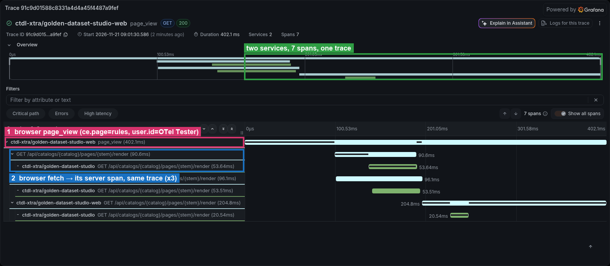

The TraceQL that finds such traces (a browser page view with a server span below it):

```text
{resource.service.name="golden-dataset-studio-web" && name="page_view" && span.ce.page="rules"
 && span.user.id="OTel Tester"} >> {resource.service.name="golden-dataset-studio" && kind=server}
```

The server span of that trace (`evidence/studio-otel/connected-trace.txt`, abridged):

```text
span GET /api/catalogs/{catalog}/pages/{stem}/render
   user.id = OTel Tester            user.roles = ['engineer']       session.id = 2546e1f5ef1674b6544adee38a74a178
   ce.page = rules                  ce.page_view.id = 4982a7c90e3fdd28
   ce.catalog = training-uark-edu-portal-training                    ce.page.stem = …-achieving-quality-asphalt-e-…
   ce.stats.storage.local.local_paths = 2                            http.response.body.size = 14045
resource:
   deployment.environment.name = otel-poc   deployment.name = 6308326-otel   deployment.id = local-20261121T085831Z
   vcs.ref.head.name = feat/otel-instrumentation-poc   vcs.ref.head.revision = 63083266c775…   cicd.pipeline.name = build-otel.sh
   k8s.cluster.name = homelab   k8s.namespace.name = golden-rules-studio-otel   k8s.pod.name = golden-rules-studio-fbb8d6448-vrdr6
   k8s.deployment.name = golden-rules-studio   k8s.node.name = cluster-node-1   container.image.name = cr.priv…/golden-rules-studio/app
```

A change is its own trace: pressing **1** (✓) on a row is `annotate` → `POST /api/catalogs/{catalog}/annotations`,
whose span says what was written, and that it went to the **local** root (`evidence/studio-otel/annotate-trace.txt`):

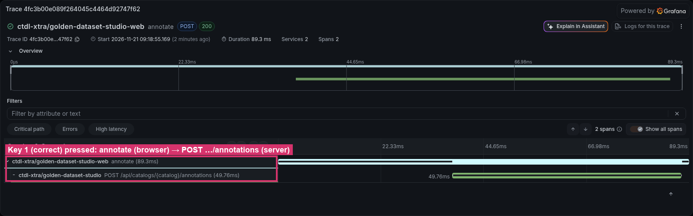

```text
ce.annotation.type = verdict   ce.annotation.verdict = correct   ce.annotation.target_kind = page   ce.rule.id = course-page
ce.stats.storage.local.writes = 1   ce.stats.storage.local.bytes_written = 545   ce.golden.published = False
```

## 5. The dashboard

`monitoring/terraform-studio-otel/` is its own Terraform root (own state, gitignored), with a `./tf` wrapper on the
same `.env` pattern as `monitoring/terraform/`. `./tf apply` created a folder and two dashboards
(`evidence/studio-otel/tf-apply.txt`).

The Rules section, marked up:

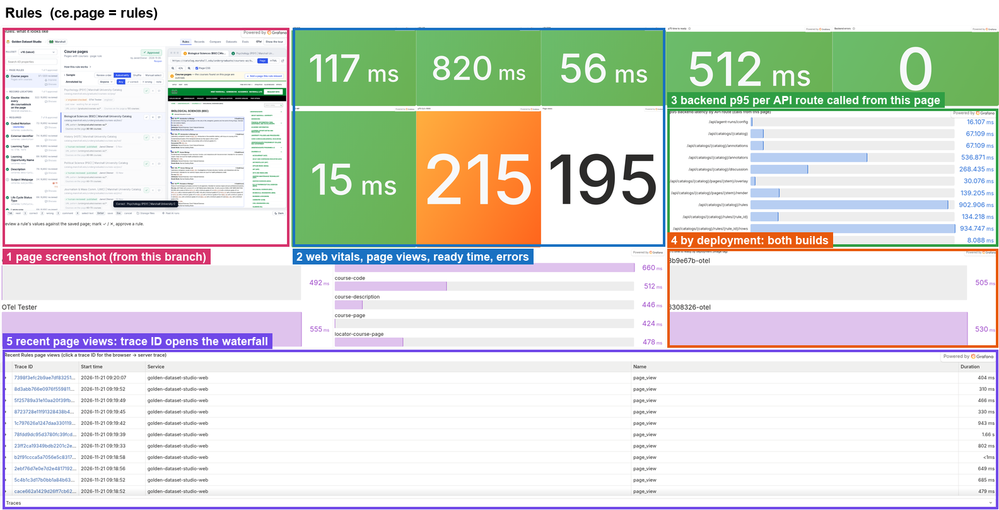

Every other page has the same layout and real data (full size in [`images/studio-otel/dashboard/`](images/studio-otel/dashboard/)):

| Overview | Catalog picker | Records |
|---|---|---|
| 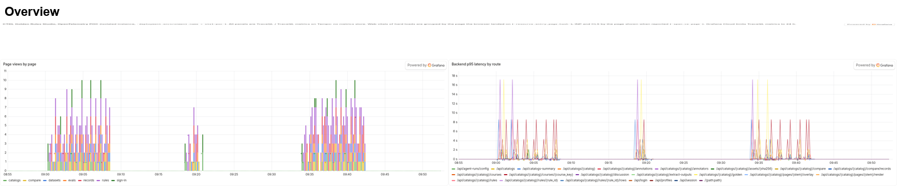 | 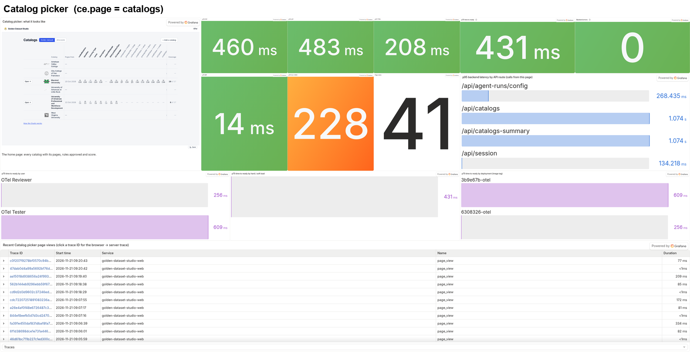 | 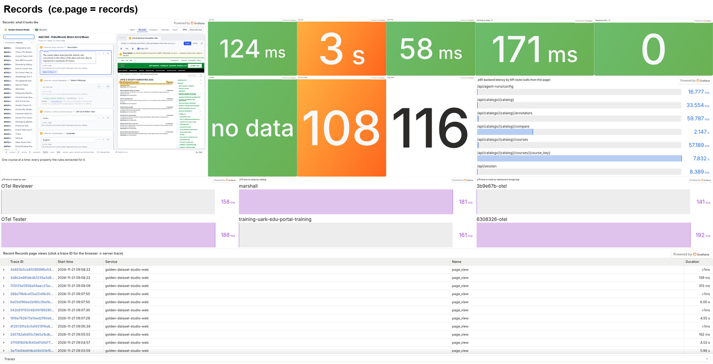 |
| **Compare** | **Datasets** | **Evals** |
| 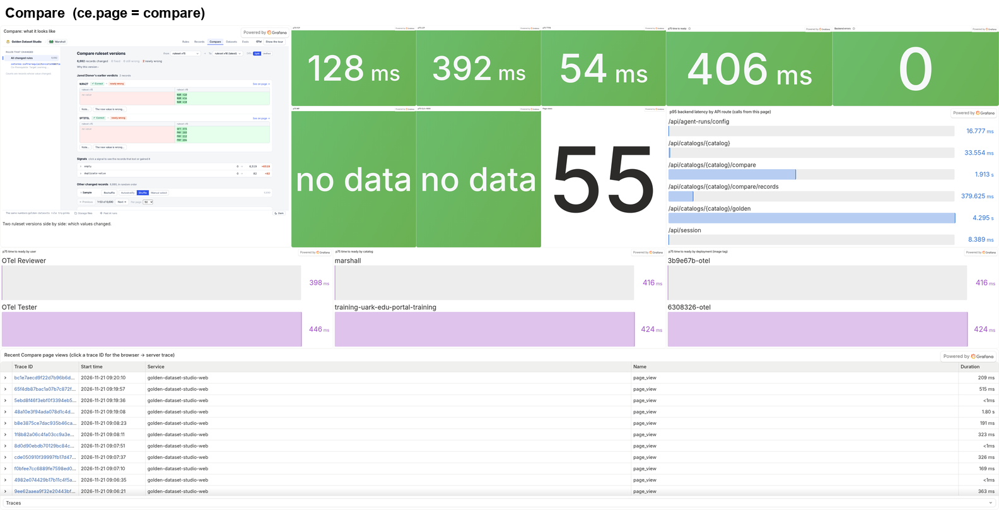 | 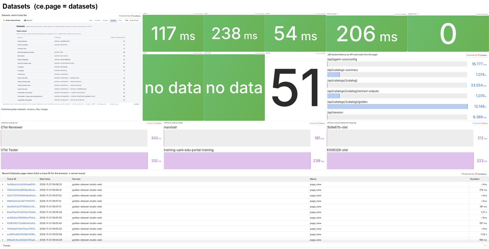 | 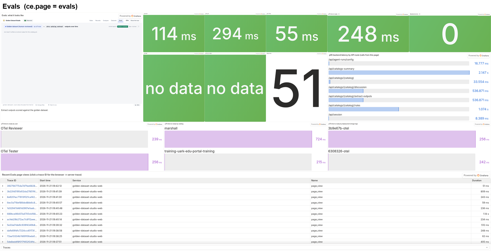 |

What it already shows: **Records** is the slow page (p75 LCP ≈ 3 s; `GET …/courses/{course_key}` p95 7.8 s,
`…/compare` 2.1 s), **Rules** p75 ready ≈ 0.5 s, the catalog picker's `/api/catalogs` p95 ≈ 1.1 s, and CLS
"needs improvement" (≈ 0.2) on Rules and the picker, which matches the first-visit overlays.

Each page section: the page's screenshot (served from this branch on raw.githubusercontent.com, like
`status_dashboard.tf`), p75 FCP / LCP / TTFB of hard loads that landed there, p75 INP / CLS while on it, page views,
p75 time to ready, backend errors and p95 latency per API route of the calls made *from that page* (server spans
carry `ce.page` from the browser's baggage), breakdowns by user, by catalog or rule, and by deployment (image tag),
and a table of recent page-view traces (each trace ID opens the browser → server waterfall).

| Panel | TraceQL (rules page) |
|---|---|
| p75 LCP | `{… && name="LCP" && resource.entry_page.hash =~ "#/c/[^/]+/rules([/?].*)?"} \| quantile_over_time(span.lcp.value, .75)` |
| Page views | `{… && name="page_view" && span.ce.page="rules"} \| count_over_time()` |
| p75 time to ready by rule | `{… && name="page_view" && span.ce.page="rules"} \| quantile_over_time(span.ce.page.ready.duration_ms, .75) by (span.ce.rule.id)` |
| p95 backend latency by route | `{backend && kind=server && span.ce.page="rules"} \| quantile_over_time(duration, .95) by (span.http.route)` |
| Backend errors | `{backend && kind=server && span.ce.page="rules" && (status=error \|\| span.http.response.status_code >= 400)} \| count_over_time()` |
| Recent traces | `{… && name="page_view" && span.ce.page="rules"} \| select(span.user.id, span.ce.catalog, span.ce.page.ready.duration_ms, …)` |

What TraceQL could and couldn't do (all on the free tier, during the trial):

| Need | Result | What we did |
|---|---|---|
| Percentiles of an integer attribute (`lcp.value`) or `duration` | ✅ `quantile_over_time` | — |
| Percentiles of a **float** attribute (`ttfb.value`, `cls.value`) | ❌ returns no series (`avg_over_time` works) | Web app adds integer copies `ce.ttfb.value_us`, `ce.cls.value_milli` (builds from `3b9e67b`); dashboard p75s use them |
| Exact percentiles | ⚠️ quantiles come from log2 buckets (values like 128, 256, 1024 ms) | Good enough to rank pages and spot regressions; not for SLO thresholds |
| Range > 24 h | ❌ Grafana Cloud caps TraceQL metrics at 24 h | Dashboard opens on the last 24 h; longer trends would need span metrics (billable series) |
| Explicit `step` of 5 m on range queries | ❌ silently empty; default step works | No explicit step |
| Structural queries (browser span with a server descendant) | ✅ `>>` | Used to find connected traces |

No span-metrics generation was needed, so the POC adds **no** metric series.

### 5a. Compare a selection (BubbleUp-style), added 2026-11-24

Two ways to ask "what do these requests have in common?":

| | **Traces Drilldown** (built in, `/a/grafana-exploretraces-app`) | **Dashboard `studio-otel-bubbleup`** (this root, `bubbleup.tf`) |
|---|---|---|
| Y-axis | Duration only | Any integer attribute or duration (variable **Y-axis**) |
| Selecting | Drag a box on the heatmap (time × duration) | Type the band (**From** / **To**); drag on the heatmap to narrow the time |
| Comparison | Bar chart per attribute: % of selection vs % of baseline, ranked by difference | Table: each attribute value's spans in / outside the band, sorted by share in the band, next to the overall share |
| Engine | TraceQL `compare()` | TraceQL `compare()` (`{spans} \| compare({y >= from && y <= to}, 10)`) |

Both found the same thing on the Nov 21 run: backend requests over 1 s were course `A&S500` (Records), Golden and
Compare (100 % of their spans), with snapshot cache misses at 67 % against 4 % overall. On the Nov 24 run, page views
whose time to ready was over 600 ms were mostly Marshall's Rules page (50 % of its views against 7.7 % overall).

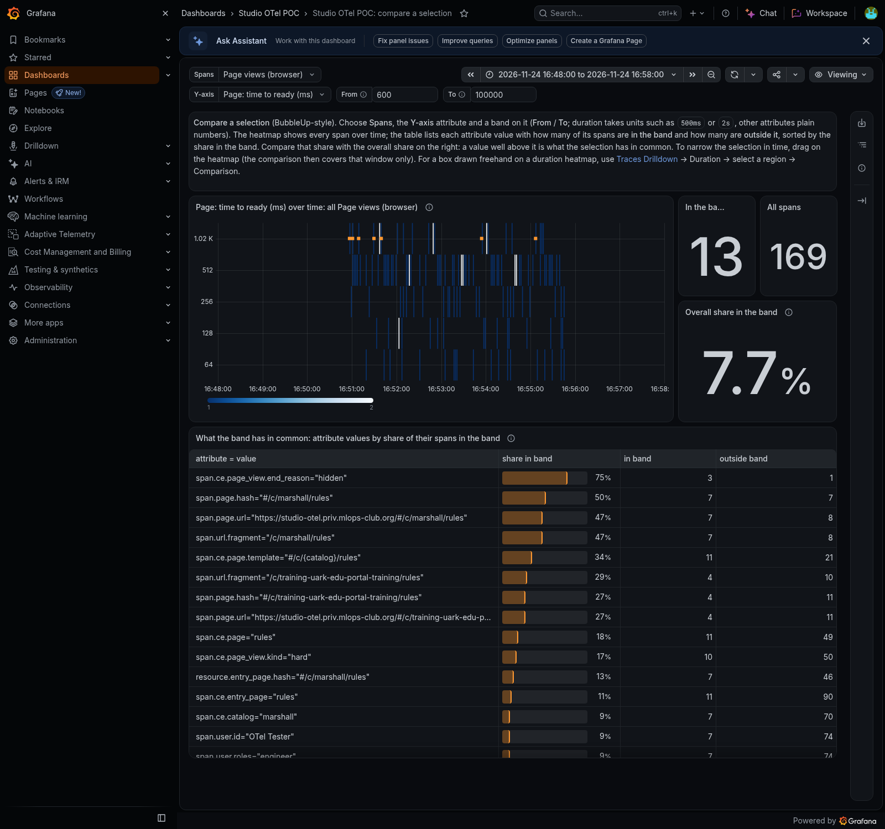

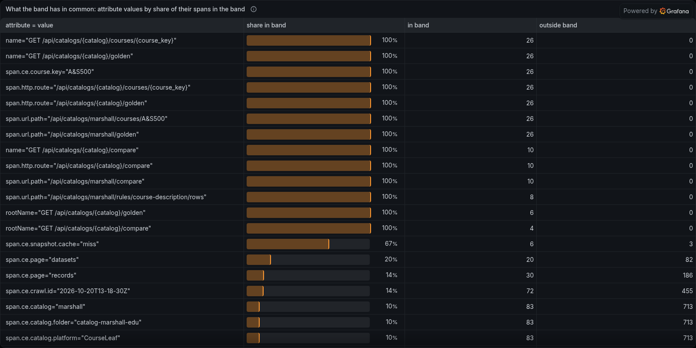

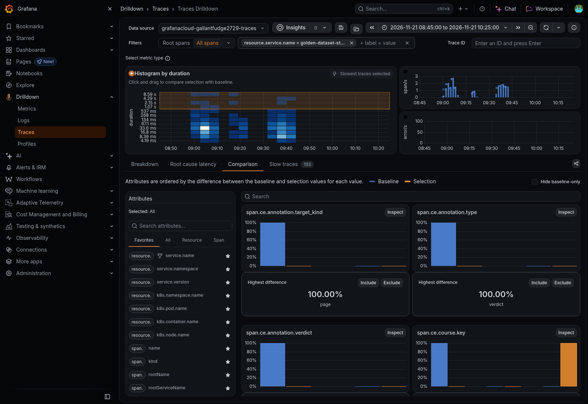

**Every span as a dot** (added the same day): under the heatmap, an XY chart plots one dot per span (TraceQL search,
`tableType: spans`) with the same y-axis; clicking a dot offers "Open this trace" and "Open in Explore". The heatmap
gives the shape, the dots give the individual spans behind it.

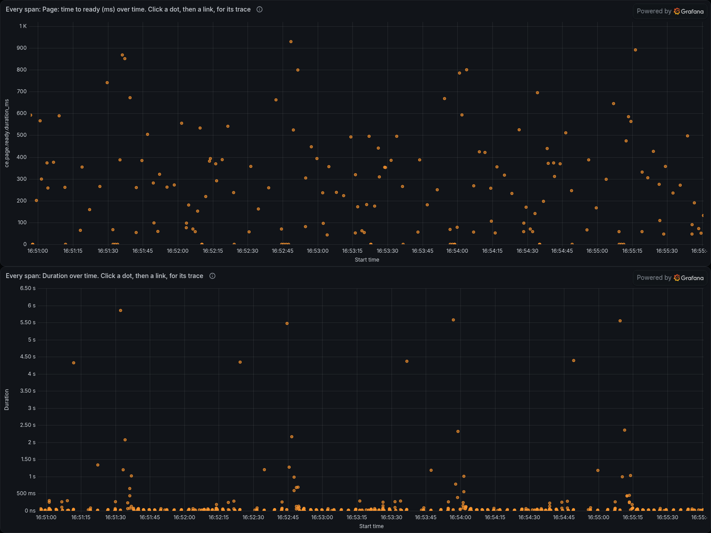

Limits:
- The dot chart can't colour the band's dots separately. The Tempo panel merges both queries into one frame, and the
  XY chart only picks frames by position.
- It shows at most 1,000 traces (100 spans each), so narrow the time range when it's busy.
- Selected attributes come back as text and are converted to numbers in the panel.
- Float attributes can't be the y-axis (TraceQL metrics skip them).
- The counts `compare()` returns are only good as ratios: they come back up to 2× the span count.
- Values seen on fewer than 3 spans in the band are hidden, and so are per-span IDs and numbers.

## 6. The run

`bench/otel_tour.py` (ctdl-xtra) uses the Studio the way a reviewer does: two profiles (`OTel Tester`, engineer;
`OTel Reviewer`, SME), each catalog, every page opened with a hard load (so each gets its own FCP/LCP/TTFB), rules
opened and rows stepped through with the keyboard, a course searched and opened, tabs switched by clicking (soft
navigations), one ✓ verdict per catalog and round, then the tab closed (which reports CLS/INP and flushes spans).

| | Run 1 | Run 2 |
|---|---|---|
| Build (`deployment.name`) | `6308326-otel` | `3b9e67b-otel` (first requests traced, integer TTFB/CLS) |
| When (UTC) | 2026-11-21 09:00–09:23 | 09:34–09:47, plus a screenshot pass |
| Rounds × users × catalogs | 3 × 2 × 2 | 3 × 2 × 2 |

| Page | Page views (OTel Tester / OTel Reviewer) |
|---|---|
| sign-in | 28 (before a profile is picked) |
| catalogs | 23 / 18 |
| rules | 105 / 90 |
| records | 62 / 54 |
| compare | 29 / 26 |
| datasets | 27 / 24 |
| evals | 27 / 24 |
| **total** | **537** (197 hard loads, 340 soft navigations) |

Also recorded: 12 cold extraction loads (`snapshot.load`: p50 67 ms, p95 2.1 s), 2 `annotate` traces (the scripted ✓
only lands when a row is selected; enough to prove the path), 0 server errors from the tour (the only 2 are my
unauthenticated curl checks, 401). Raw counts: `evidence/studio-otel/run-stats.txt`, `volume.json`.

### Page screenshots

Taken by the tour (round 1, `OTel Tester`, Marshall) and used by the dashboard's page sections. The Rules page,
marked up with what each part of it sends:

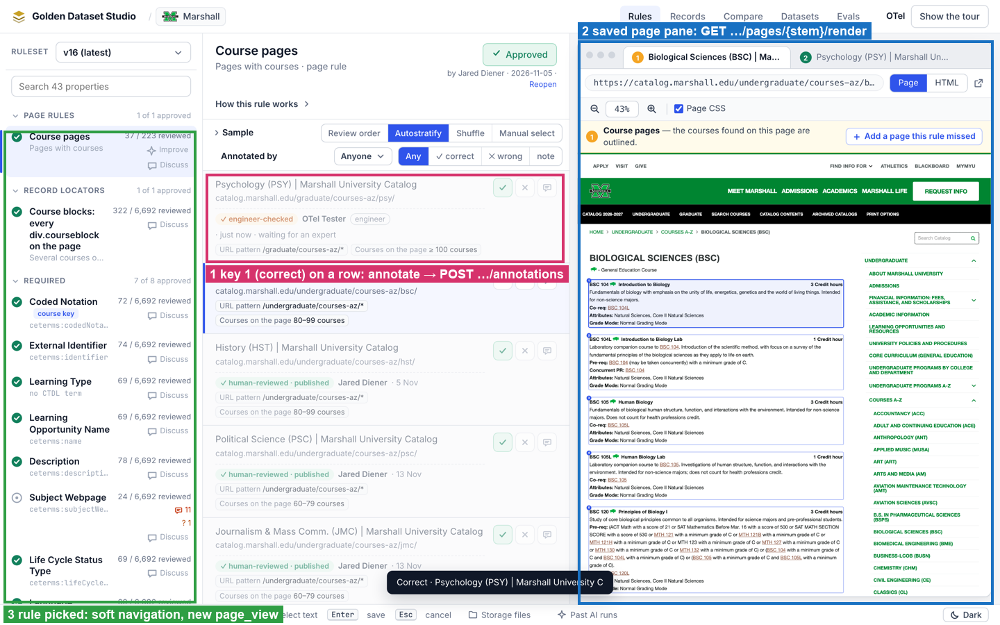

| Catalog picker | Records | Compare |
|---|---|---|
| 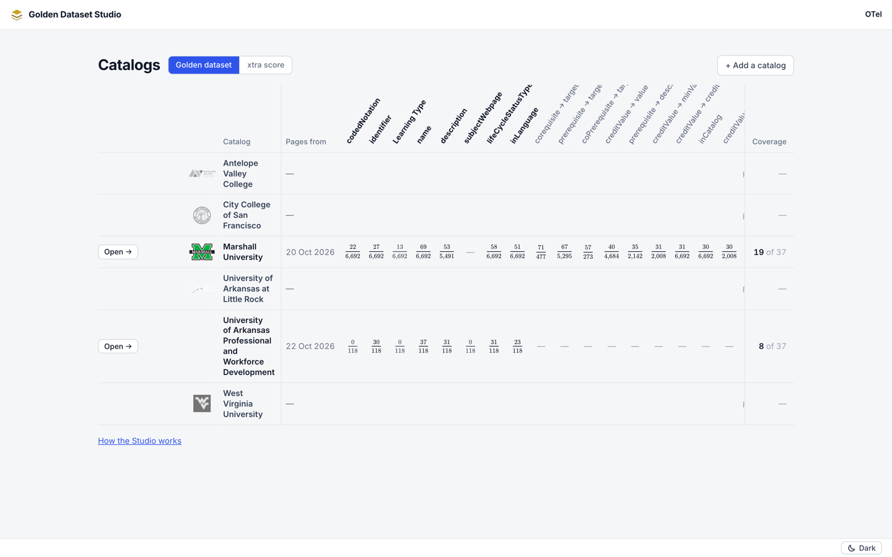 | 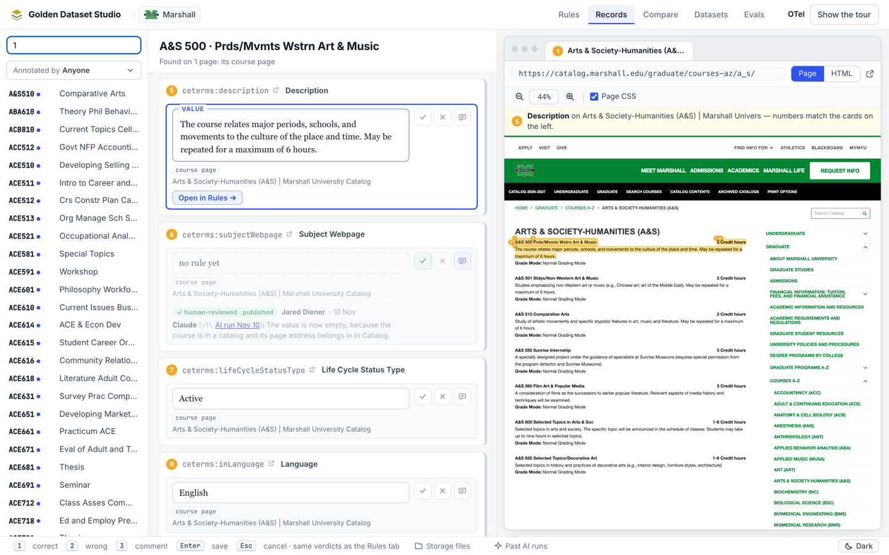 | 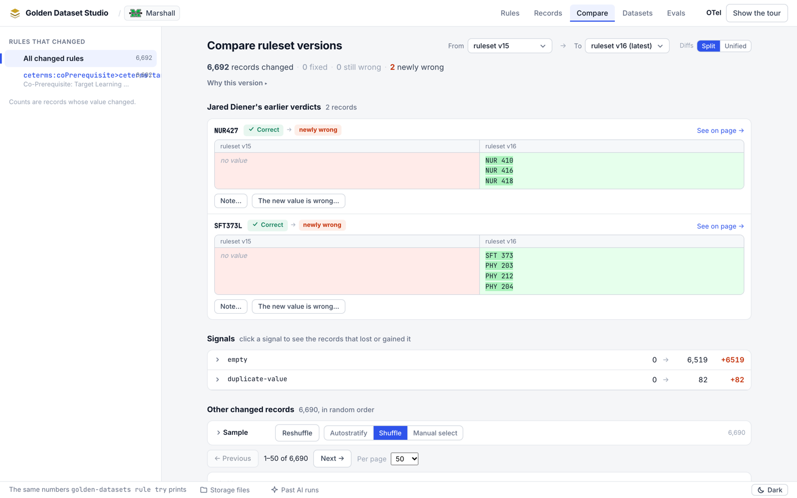 |
| **Datasets** | **Evals** | **Rules** |
| 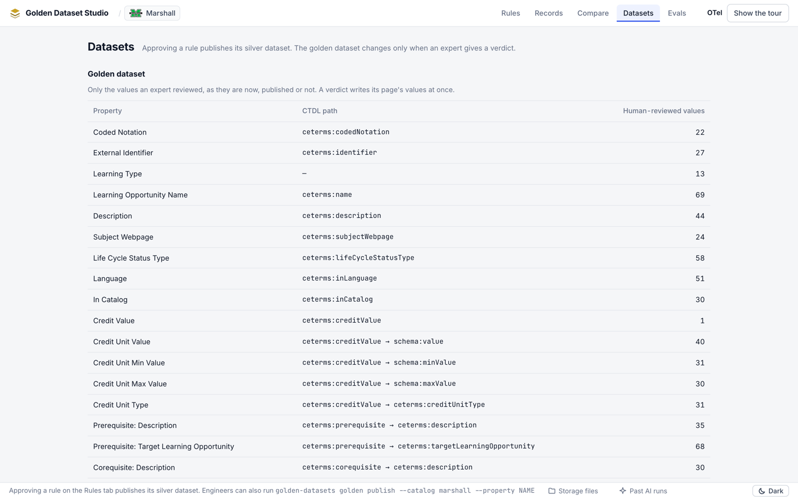 | 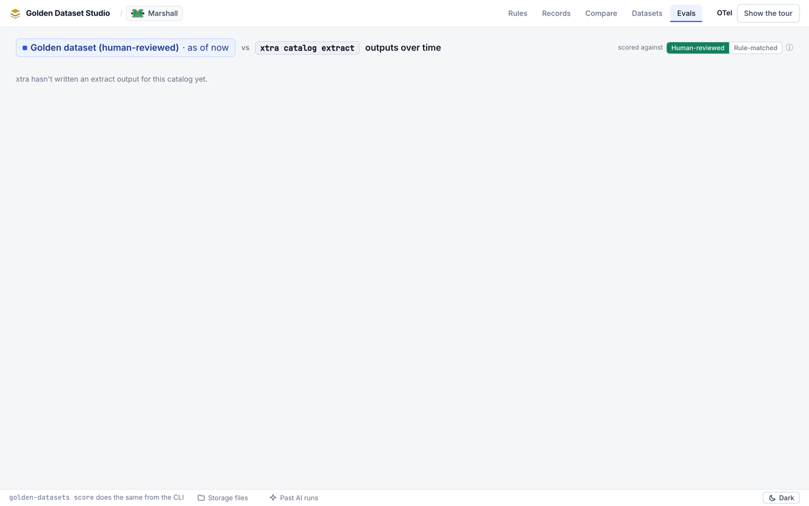 | 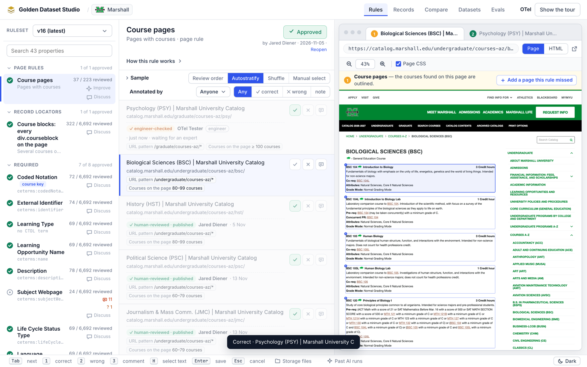 |

Evals is empty on purpose: the POC copy has no xtra-cli extract outputs (`GOLDEN_DATASETS_XTRA_SOURCE` is an empty
folder), so nothing is scored.

## 7. Free-tier impact

Measured over the whole POC window (08:55–09:48 UTC), from TraceQL counts and Grafana Cloud's own usage metric
`grafanacloud_traces_instance_bytes_received_per_second` (`evidence/studio-otel/volume.json`):

| Measure | Value |
|---|---|
| Spans stored | **5,625** (3,298 browser, 2,327 server) |
| Bytes received by Tempo | **6.83 MB** (≈ 1.2 KB per span) |
| Page views | 537 → **10.5 spans and 12.7 KB per page view** |
| Timer polls (`agent-runs/current`, every 3 s per tab) | 0 stored: dropped by the collector unless slow or failing (≈ 1.4 MB per open tab-hour if kept) |
| Page assets (`…/assets/{sha256}`) | 1 stored (the only slow one) |
| Metrics series added | **0** (no span metrics: everything is TraceQL) |
| Logs | 0 |

Monthly estimate for a handful of users (5 reviewers × 22 working days × 150 page views a day, generous: a reviewer
stepping through rows creates spans, not page views, and those are in the per-page-view figure):

| | Volume | Free tier (50 GB traces, 14-day retention) |
|---|---|---|
| Estimate | 16,500 page views ≈ **0.21 GB / month** | **0.4 %** |
| 10× that | ≈ 2.1 GB | 4 % |
| Without the poll filter, add | 5 users × 6 tab-hours × 22 days ≈ 0.96 GB | +2 % |

Traces are far below the limit; the binding limits are TraceQL metrics' 24 h range and the 14-day retention.
Synthetic-monitoring quota is not touched (the tour ran from the laptop). Free-tier verdicts were observed during
the 14-day **trial**; nothing here used a paid-only feature (no Application Observability, no span metrics).

## 8. Isolation: how production was kept out of it

| Write path | Production | This instance | Verified by |
|---|---|---|---|
| Annotations, rulesets, manifest, profiles, scores, pending scores | Azure `xtra-cli-output/zz-scratch-review-ui-v3` | `/data/root` on PVC `studio-data` | `GOLDEN_DATASETS_ROOT=/data/root`; annotate span shows `ce.stats.storage.local.writes` |
| Golden publishing (approve, verdicts, reset) | Azure `xtra-golden-sets` | `/data/golden` | `GOLDEN_DATASETS_GOLDEN_ROOT`; seeded manifest repointed (`to: /data/golden`, 15 entries) |
| Score inputs | `xtra-cli-output` | empty `/data/xtra-source` | env |
| Catalog adds | `xtra-cli-output` crawls | `/data/root` | env |
| AI runs (K2) | in-cluster K2 | off (no key; a local root turns them off in code) | no `k2-api` Secret |
| Credentials | `azure-sas` (read/write), `k2-api`, `studio-password` | **none of them**; own `studio-password` | `evidence/studio-otel/isolation.txt`: 0 Azure/K2 variables in the pod |

The seed (`evidence/studio-otel/seed-sync.txt`): `golden-datasets sync` from production to a laptop folder, and a copy
of the two catalogs' golden datasets, both under a guard that replaces every `AzureRoot` write method with one that
raises. Production's SAS was used only in that local process. The copy (425 MB + 125 MB) went to the PVC with
`otel/seed-otel.sh`.

Production, before and after (`evidence/studio-otel/prod-before.txt`, `prod-after.txt`):

```text
                     before (2026-11-21T07:57:55Z)                after (2026-11-21T09:48:17Z)
pod                  golden-rules-studio-694db5bb85-lpjht         golden-rules-studio-694db5bb85-lpjht
started              2026-11-20T19:37:20Z                         2026-11-20T19:37:20Z
restarts             0                                            0
image                …/golden-rules-studio/app:a78be91            …/golden-rules-studio/app:a78be91
deployment gen.      84 / 84                                      84 / 84
/api/health          200 (0.22 s)                                 200 (0.56 s)
events in namespace                                               none since the POC began
$ diff <pods before> <pods after>  →  PODS IDENTICAL
```

## 9. Decisions made under ambiguity

| # | Ambiguity | Decision | Why |
|---|---|---|---|
| D1 | How to keep the instance from writing to production storage | **Local root on its own PVC, no Azure credentials in the pod at all** (not a read-only SAS, not a prefix) | Enforced by missing credentials, not by code paths. Every write path (annotations, rulesets, manifest, profiles, golden publishing, scores, catalog adds, AI runs) lands on the PVC or is off |
| D2 | How to seed it without `az login` (expired; interactive) | `golden-datasets sync` + a golden-dataset copy, run **on the laptop** with production's SAS in one process, under a guard that replaces every `AzureRoot` write method with one that raises | The production SAS never reaches the cluster namespace; a write attempt would have crashed the seed instead of writing |
| D3 | Which catalogs | Marshall (367 MB) and U. Arkansas PWD (66 MB) | Small enough to copy; two catalogs give a real `ce.catalog` breakdown |
| D4 | Isolated instance's password | A new one (hash in its own Secret), not production's | Production's password stays unknown to the POC, and the instance can be shared without sharing production access |
| D5 | Where `user.id` comes from | The Studio's profile name ("Who are you?"), sent by the browser as W3C baggage and copied by the server onto its span (allow-listed keys, capped lengths) | The Studio has no per-user login: the profile is what it records as each annotation's author. Baggage is client-supplied, so `user.id` is what the browser says, as everywhere else in the Studio |
| D6 | `user.id` vs `enduser.id` | `user.id`, `user.roles`, `session.id` | semconv 1.45 deprecates `enduser.*` |
| D7 | Custom prefix | `ce.` everywhere, roll-ups as `ce.stats.*`, timings `*.duration_ms` | The brief; Honeycomb's agent-skills naming |
| D8 | Browser auto-instrumentation | Honeycomb SDK for vitals, errors, browser and session; **no** fetch/XHR/document-load/click auto-instrumentation (and no Zone.js). The app makes one `page_view` span per route and one client span per API call itself | Few, wide spans; the auto fetch spans can't carry page context or roll-ups, and click spans are noisy. Our own fetch wrapper injects `traceparent` and baggage |
| D9 | Web vitals in a hash-routed SPA | FCP/LCP/TTFB belong to hard loads: grouped by the SDK's `resource.entry_page.hash` (TTFB arrives before the app's first page view, so `span.ce.entry_page` can be missing). INP/CLS by `ce.page` at report time. Soft navigations get `page_view.ce.page.ready.duration_ms` instead | Browsers report FCP/LCP once per document; the tour hard-loads every page so each has its own |
| D10 | Telemetry off by default | Server: no endpoint → no SDK init, helpers no-op; `otel` is an optional extra (production image unchanged). Browser: the server inlines its config in `index.html` only when browser telemetry is configured; off, the file is served as built and the 70 KB (gzip) OTel chunk is never fetched; main bundle +2.7 KB | Production and local dev behave as before |
| D11 | Browser → collector route | Same origin `/otlp` → collector's browser receiver (`traces_url_path: /otlp/v1/traces`); token stays in the collector | No CORS, no token in the browser. Trade-off: `/otlp` is unauthenticated (tailnet-only here). Production would want it behind the Studio's session (see Next) |
| D12 | `k8s.*` on browser spans | Separate receivers/pipelines; `k8s_attributes` only on the backend pipeline | Browser spans arrive from the ingress controller: pod association would be wrong |
| D13 | Polls and page assets (most server requests) | App marks them `ce.request.type`; the collector drops those that were fast (< 1 s) and OK; the browser counts polls on `page_view` instead of making spans | Volume (agent-run polls every 3 s per open tab) without losing slow or failing ones |
| D14 | Grafana OTLP token without a Grafana Cloud API token | Created through the stack's own `grafana-auth-app` proxy with the Admin SA token (`otlp-token.sh`), 30-day expiry, write scopes on this stack only | `grafana_cloud_access_policy` in Terraform needs a cloud-level token the repo doesn't have; the browser session (chrome-mcp) was held by another session |
| D15 | Dashboard data source | TraceQL / TraceQL metrics only (no span-metrics generation) | Everything the brief asked for is expressible; span metrics would add billable series. Limits: 24 h range, quantiles are log2-bucketed (see findings) |
| D16 | Image push | Built on the laptop, pushed **inside the cluster** (crane → `harbor-core` Service) | Laptop pushes of the 933 MB venv layer through the private ingress fail with 499 (read timeout); changing shared Traefik timeouts was out of scope |
| D18 | When the browser starts telemetry | Before the first render, waiting at most 1.5 s, from a config inlined in `index.html` (first version: fetched `/api/telemetry` after render) | The first version left a hard load's first API calls without a parent, user or page: the catalog picker's backend panel was empty. Found in the dashboard, fixed in build `3b9e67b` |
| D17 | GitHub Actions | `deploy-otel.yml` written (CI fills `GITHUB_*` → `cicd.*`), not run | It needs a kubeconfig for the new namespace; the POC ran the same scripts from the laptop (`cicd.worker.name=laptop`) |

## 10. Findings and what's next

**What the POC showed**

| Finding | So what |
|---|---|
| One wide span per request carries everything a question needs: who, which catalog/rule/page, how much storage work, what failed | Most questions are one TraceQL query; no metrics store, no joins |
| Browser → server context works with plain W3C `traceparent` + `baggage` from a 100-line fetch wrapper; no Zone.js, no auto-instrumentation | Small, readable instrumentation; the server knows the user and page of every request |
| A lazily started browser SDK misses a hard load's first requests (fixed: config inlined, telemetry starts before first render) | Start browser telemetry before the app's first fetch |
| TraceQL `quantile_over_time` skips float attributes; quantiles are log2-bucketed; metrics range ≤ 24 h | Emit integer copies of float measures; use span metrics only if 30-day trends are needed |
| The client span is ~40 ms longer than its server span for a page render (90 vs 54 ms) | That gap is network + ingress: visible only because both sides are in one trace |
| Laptop pushes of the ~1 GB venv layer fail at the private ingress (HTTP 499) | `otel/push-in-cluster.sh`; or slim the image (the venv) |
| `k8s_attributes` in collector 0.165 no longer emits `container.image.tag` | Use `container.image.tags` |
| TTFB from the scripted browser was sub-millisecond on the first build and 30–285 ms on the second; I did not find out why (the change, starting telemetry before the first render, shouldn't move TTFB) | Treat synthetic vitals as a smoke test; real users' vitals need real sessions, and this is worth one more look before trusting TTFB |

**Next**

1. Before production: put `/otlp` behind the Studio's session (a small authenticated proxy route in the Studio, or
   a Traefik forwardAuth on `/api/session`); today it is unauthenticated, though tailnet-only.
2. Production rollout is the same image plus environment: on Azure, `ce.stats.storage.azure.downloads` and
   `snapshot.load` spans will show cache misses and cold loads (the OOM path) directly.
3. Run `Deploy OTel POC` in Actions (needs `KUBECONFIG_OTEL_B64`) so `cicd.pipeline.run.url.full` and the
   triggering actor come from CI rather than the laptop.
4. Alert on TraceQL: e.g. p95 of `snapshot.load` or of `page_view` ready time per page, and server errors per route.
5. Move the access policy into Terraform once a Grafana Cloud access-policy token exists; rotate the 30-day token.
6. Logs: send the server's stdout through the OTel logs bridge with trace IDs, so a span links to its log lines.

## Appendix: every span attribute

Stability is per semantic conventions **v1.45.0**. "Web SDK" = `@honeycombio/opentelemetry-web` 1.5.1. Spans: **PV** `page_view`, **CL** browser API client span, **WV** web-vital spans (`FCP` `LCP` `INP` `CLS` `TTFB`), **EX** browser `exception`, **SV** server span (one per request), **SUB** server sub-spans (`snapshot.load`, `golden.publish`, `golden.publish_page`), **JOB** background roots (`score.run`, `catalog.add`). "all web" = PV, CL, WV, EX; "all backend" = SV, SUB, JOB.

#### Resource attributes (who sent the span)

| Attribute | Example value | Convention (group, stability) | Spans | Injected by |
|---|---|---|---|---|
| `service.name` | `golden-dataset-studio` / `golden-dataset-studio-web` | service, stable | all | app code default; `OTEL_SERVICE_NAME` (deploy) |
| `service.version` | `0.1.0` | service, stable | all | app code (package version); web gets it from the config the server inlines in index.html |
| `service.namespace` | `ctdl-xtra` | service, development | all | deploy env (`OTEL_RESOURCE_ATTRIBUTES`, deploy-otel.sh); web via the inlined config |
| `service.instance.id` | `d55e31dd-…` | service, development | all backend | Python SDK (random per process) |
| `deployment.environment.name` | `otel-poc` | deployment, stable | all | deploy env; web via the inlined config |
| `deployment.id` | `local-20261121T085831Z` (GitHub run id in CI) | deployment, development | all | deploy-otel.sh |
| `deployment.name` | `6308326-otel` (image tag) | deployment, development | all | deploy-otel.sh |
| `vcs.repository.url.full` | `https://github.com/CredentialEngine/ctdl-xtra` | vcs, release candidate | all | build arg (build-otel.sh) → image env |
| `vcs.repository.name` | `ctdl-xtra` | vcs, release candidate | all | build arg |
| `vcs.owner.name` | `CredentialEngine` | vcs, release candidate | all | build arg |
| `vcs.provider.name` | `github` | vcs, release candidate | all | build arg |
| `vcs.ref.head.name` | `feat/otel-instrumentation-poc` | vcs, release candidate | all | build arg |
| `vcs.ref.head.revision` | `63083266c775…` | vcs, release candidate | all | build arg |
| `vcs.ref.head.type` | `branch` | vcs, release candidate | all | build arg |
| `cicd.pipeline.name` | `build-otel.sh` (workflow name in CI) | cicd, release candidate | all | build arg from `GITHUB_WORKFLOW` or the script |
| `cicd.pipeline.run.id` | `local-20261121T084950Z` (`GITHUB_RUN_ID` in CI) | cicd, release candidate | all | build arg |
| `cicd.pipeline.run.url.full` | `https://github.com/…/actions/runs/<id>` (CI only) | cicd, release candidate | all | build arg (CI only; not set on the laptop run) |
| `cicd.worker.name` | `laptop` / `github-actions` | cicd, release candidate | all | build arg |
| `ce.cicd.triggered_by` | `phitoduck` (`GITHUB_TRIGGERING_ACTOR` in CI) | custom (ce.): semconv has no "triggered by" | all backend | build arg |
| `k8s.cluster.name` | `homelab` | k8s, development | all backend | collector `resource` processor |
| `k8s.namespace.name` | `golden-rules-studio-otel` | k8s, stable | all backend | collector `k8s_attributes` |
| `k8s.pod.name` / `k8s.pod.uid` | `golden-rules-studio-fbb8d6448-vrdr6` / `b34513cf-…` | k8s, stable | all backend | collector `k8s_attributes` |
| `k8s.pod.start_time` | `2026-11-21T08:59:49Z` | k8s, development | all backend | collector `k8s_attributes` |
| `k8s.deployment.name` / `k8s.replicaset.name` | `golden-rules-studio` / `…-fbb8d6448` | k8s, stable | all backend | collector `k8s_attributes` |
| `k8s.node.name` | `cluster-node-1` | k8s, stable | all backend | collector `k8s_attributes` |
| `k8s.container.name` | `golden-rules-studio` | k8s, stable | all backend | collector `k8s_attributes` |
| `container.image.name` | `cr.priv…/golden-rules-studio/app` | container, stable | all backend | collector `k8s_attributes` (`container.image.tags` from the next deploy) |
| `process.pid`, `process.runtime.name`, `process.runtime.version` | `1`, `cpython`, `3.12.16` | process, development / release candidate | all backend | app code |
| `telemetry.sdk.name` / `.language` / `.version` | `opentelemetry` / `python`·`webjs` / `1.45.2`·`2.9.0` | telemetry, stable | all | SDKs |
| `telemetry.distro.name` / `.version` | `@honeycombio/opentelemetry-web` / `1.5.1` | telemetry, development | all web | Web SDK |
| `honeycomb.distro.version` / `.runtime_version` | `1.5.1` / `browser` | vendor (Honeycomb) | all web | Web SDK |
| `user_agent.original` | `Mozilla/5.0 … HeadlessChrome/159…` | user-agent, stable | all web (resource), SV (span) | Web SDK; FastAPI instrumentation |
| `browser.name`, `browser.version`, `browser.brands`, `browser.platform`, `browser.language`, `browser.mobile`, `browser.touch_screen_enabled` | `Chrome Headless`, `159.0.8154.6`, …, `macOS`, `en-US`, `false`, `false` | browser, development (`name`/`version`/`touch_screen_enabled`: Honeycomb) | all web | Web SDK |
| `device.type` | `desktop` | vendor (Honeycomb) | all web | Web SDK |
| `network.effectiveType` | `4g` | vendor (Honeycomb) | all web | Web SDK |
| `screen.width`, `screen.height`, `screen.size` | `1440`, `900`, `large` | vendor (Honeycomb) | all web | Web SDK |
| `entry_page.path`, `entry_page.hash`, `entry_page.hostname`, `entry_page.referrer` | `/`, `#/c/marshall/rules`, `studio-otel.priv…`, `` | vendor (Honeycomb) | all web | Web SDK |

#### Span attributes: who and where (on every span of a request)

| Attribute | Example value | Convention | Spans | Injected by |
|---|---|---|---|---|
| `user.id` | `OTel Tester` | user, development (replaces deprecated `enduser.id`) | all web, SV, SUB, JOB | web app (the profile on "Who are you?"); server reads it from W3C `baggage` |
| `user.roles` | `["engineer"]` | user, development | all web, SV, SUB | as `user.id` (baggage value `engineer\|sme`) |
| `session.id` | `2546e1f5ef1674b6…` | session, development | all web, SV, SUB | Web SDK session manager (localStorage, 30 min idle, 12 h max); server via baggage |
| `ce.page` | `rules` | custom (ce.) | all web, SV, SUB | web app (route); server via baggage |
| `ce.page.template` | `#/c/{catalog}/rules/{id}` | custom (ce.) | all web | web app |
| `ce.page_view.id` | `4982a7c90e3fdd28` | custom (ce.) | all web, SV | web app (the page view's span id); server via baggage |
| `ce.entry_page` | `rules` | custom (ce.) | all web | web app (page of the hard load, once the first page view opens) |
| `ce.catalog` | `marshall` | custom (ce.) | all web, SV, SUB | web app (route); server: path parameter |
| `ce.catalog.folder`, `ce.catalog.platform` | `catalog-marshall-edu`, `CourseLeaf` | custom (ce.) | SV, SUB, JOB | server middleware (catalog registry) |
| `ce.rule.id` | `course-description` | custom (ce.) | PV, CL, SV, SUB | web app (route id); server: path/query parameter |
| `ce.course.key` | `GEOG222` | custom (ce.) | PV (Records), SV | web app (route id); server: path parameter / annotation target |
| `page.url`, `page.hash`, `page.route`, `page.hostname`, `page.search` | `…/#/c/marshall/rules`, `#/c/marshall/rules`, `/`, … | vendor (Honeycomb) | all web | Web SDK (per span) |
| `browser.width`, `browser.height`, `browser.page.visibility` | `1440`, `900`, `visible` | vendor (Honeycomb) | all web | Web SDK (per span) |
| `url.path` | `/` (web) · `/api/catalogs/marshall/rules` (CL, SV) | url, stable | all web, CL, SV | Web SDK; web app; FastAPI instrumentation |
| `SampleRate` | `1` | vendor (Honeycomb) | all web | Web SDK sampler |

#### Span attributes: browser spans

| Attribute | Example value | Convention | Spans | Injected by |
|---|---|---|---|---|
| `url.fragment` | `/c/marshall/rules` | url, stable | PV | web app |
| `ce.page_view.kind` | `hard` / `soft` | custom (ce.) | PV | web app |
| `ce.page_view.end_reason` | `ready` / `navigated` / `hidden` / `timeout` | custom (ce.) | PV | web app |
| `ce.page.ready.duration_ms` | `402` | custom (ce.), Honeycomb `*.duration_ms` | PV | web app |
| `ce.page.dom_nodes` | `3524` | custom (ce.) | PV | web app |
| `ce.stats.api.calls` / `.errors` / `.polls` / `.inflight` | `9` / `0` / `1` / `0` | custom (ce.), Honeycomb `stats.*` roll-up | PV | web app |
| `ce.stats.api.bytes` / `.duration_ms` / `.slowest_ms` | `200245` / `204` / `72` | custom (ce.) | PV | web app |
| `http.request.method` | `GET` | http, stable | CL, SV | web app; FastAPI instrumentation |
| `url.full` | `https://studio-otel…/api/catalogs/marshall/rules` | url, stable | CL | web app |
| `url.template` | `/api/catalogs/{catalog}/rules/{rule_id}/rows` | url, development | CL | web app (same templates as `http.route`) |
| `server.address` | `studio-otel.priv.mlops-club.org` | server, stable | CL, SV | web app; FastAPI instrumentation |
| `http.response.status_code` | `200` | http, stable | CL, SV | web app; FastAPI instrumentation |
| `http.response.body.size` | `14045` | http, development | CL (when Content-Length), SV | web app; server middleware |
| `error.type` | `404` / `TypeError` | error, stable | CL, SV, SUB, JOB | web app; FastAPI instrumentation; `telemetry.error()` |
| `ce.action` | `annotate`, `save_profile`, `sign_in` | custom (ce.) | CL (POST/DELETE) | web app |
| `ce.request.aborted` | `true` | custom (ce.) | CL | web app |
| `fcp.*`: `value delta rating id load_state time_to_first_byte time_since_first_byte navigation_{id,type,url,start_time}` | `fcp.value=180`, `fcp.rating=good` | vendor (Honeycomb; semconv's equivalent is the `browser.web_vital` event, development) | WV `FCP` | Web SDK |
| `lcp.*`: `value delta rating id element element_render_delay resource_load_{delay,duration,time} time_to_first_byte url navigation_*` | `lcp.value=180`, `lcp.element=#root>div…>h1` | vendor (Honeycomb) | WV `LCP` | Web SDK |
| `inp.*`: `value delta rating id duration element event_type input_delay interaction_{target,time,type} load_state next_paint_time presentation_delay processing_duration navigation_*`, `inp.element.data.tab` | `inp.value=48`, `inp.event_type=pointerdown` | vendor (Honeycomb) | WV `INP` | Web SDK |
| `cls.*`: `value delta rating id element had_recent_input largest_shift_{target,time,value} load_state navigation_*`, `cls.largestShift.element.data.tour` | `cls.value=0.002` | vendor (Honeycomb) | WV `CLS` | Web SDK |
| `ttfb.*`: `value delta rating id {cache,connection,dns,request,waiting}_{duration,time} navigation_*` | `ttfb.value=101.3` | vendor (Honeycomb) | WV `TTFB` | Web SDK |
| `ce.ttfb.value_us` | `101300` | custom (ce.): integer copy of `ttfb.value` in µs, for TraceQL quantiles | WV `TTFB` | web app (SDK `applyCustomAttributes`) |
| `ce.cls.value_milli` | `101` | custom (ce.): integer copy of `cls.value` ×1000 | WV `CLS` | web app (SDK `applyCustomAttributes`) |
| `exception.type`, `exception.message`, `exception.stacktrace` | `TypeError`, … | exception, stable | EX, SV, SUB | Web SDK global errors; FastAPI instrumentation; `telemetry.error()` |

#### Span attributes: server spans

| Attribute | Example value | Convention | Spans | Injected by |
|---|---|---|---|---|
| `http.route` | `/api/catalogs/{catalog}/rules/{rule_id}/rows` | http, stable | SV | FastAPI instrumentation |
| `url.scheme`, `url.query` | `http`, `limit=200` | url, stable | SV | FastAPI instrumentation |
| `server.port`, `client.address`, `client.port`, `network.protocol.version` | `8000`, `10.42.0.5`, `51234`, `1.1` | server/client/network, stable | SV | FastAPI instrumentation |
| `ce.extraction.id`, `ce.ruleset.version`, `ce.crawl.id` | `rs-0016`, `16`, `2026-10-20T13-18-30Z` | custom (ce.) | SV | app code (`_review`, query `ext`) |
| `ce.page.stem` | `…-course-achieving-quality-asphalt-e-0e9876ffd8` | custom (ce.) | SV, SUB | middleware (path parameter) / app code |
| `ce.query.q`, `ce.query.offset`, `ce.query.limit` | `GEOG`, `0`, `200` | custom (ce.) | SV | middleware (query parameters) |
| `ce.compare.a` / `.b` | `15` / `16` | custom (ce.) | SV | middleware (query) |
| `ce.score.basis`, `ce.golden.version`, `ce.golden.table`, `ce.golden.tree`, `ce.score.column`, `ce.agent_run.id`, `ce.score.id`, `ce.asset.sha256` | `human-reviewed`, `ruleset-v3`, `lineage`, … | custom (ce.) | SV | middleware (path/query parameters) |
| `ce.request.type` | `poll` / `asset` | custom (ce.) | SV | middleware (the collector drops fast, OK ones) |
| `ce.error.detail` | `catalog-x: no extraction yet` | custom (ce.) | SV, JOB | middleware (4xx/5xx JSON `detail`); jobs |
| `ce.stats.storage.<local\|azure>.{reads,writes,stats,local_paths}` | `ce.stats.storage.local.reads=1` | custom (ce.), Honeycomb `stats.*` | SV | `@telemetry.storage_op` on storage methods |
| `ce.stats.storage.<…>.duration_ms`, `.bytes_read`, `.bytes_written` | `2.1`, `14045` | custom (ce.) | SV | as above |
| `ce.stats.storage.azure.downloads`, `.bytes_downloaded` | (production only: Azure cache misses) | custom (ce.) | SV | `AzureRoot.local_path` |
| `ce.snapshot.cache` | `hit` / `miss` / `waited` | custom (ce.) | SV | app code (`Loader.snapshot`) |
| `ce.snapshot.wait.duration_ms`, `ce.snapshot.rows`, `ce.snapshot.evicted` | `0.0`, `6692`, `0` | custom (ce.) | SV, SUB `snapshot.load` | app code |
| `ce.catalogs.count` / `.ready` / `.adding` | `6` / `2` / `0` | custom (ce.) | SV `GET /api/catalogs` | app code |
| `ce.rules.count`, `ce.rules.groups` | `43`, `4` | custom (ce.) | SV | app code |
| `ce.rows.total`, `.returned`, `.missing`, `.order`, `.strata_filters`, `.annotated_by`, `.verdict_filter`, `.focus_index` | `223`, `200`, `0`, `review`, `0`, … | custom (ce.) | SV `…/rows`, compare records | app code |
| `ce.compare.changed_rules`, `.rules_shown`, `.records_changed`, `.records_total` | `5`, `5`, `120`, `120` | custom (ce.) | SV | app code |
| `ce.golden.versions` | `4` | custom (ce.) | SV | app code |
| `ce.evals.outputs`, `ce.evals.scores` | `0`, `0` | custom (ce.) | SV | app code |
| `ce.annotation.type`, `.verdict`, `.target_kind`, `.author_role`, `.id` | `verdict`, `correct`, `match`, `engineer`, `…` | custom (ce.) | SV `POST …/annotations` | app code |
| `ce.golden.published`, `.publication`, `.publish_error`, `.files`, `.reason` | `true`, `ruleset-v16`, … | custom (ce.) | SV, SUB `golden.publish*` | app code |
| `ce.score.reason`, `.by`, `.process`, `.status` | `a column was published`, …, `true`, `done` | custom (ce.) | JOB `score.run` | app code |
| `ce.crawl.pages` | `550` | custom (ce.) | SV, JOB `catalog.add` | app code |
| `process.exit.code` | `0` | process, development | JOB `score.run` | app code (score subprocess) |
| `gen_ai.operation.name`, `gen_ai.agent.name` | `invoke_agent`, `golden-rules` | gen_ai (moved to semantic-conventions-genai, development) | SV `POST …/agent-runs` | app code (not exercised: AI runs are off in the POC) |
| `ce.agent_run.scope`, `.rules`, `.queue_place`, `.working`, `.cap` | `rules`, `2`, `1`, `0`, `2` | custom (ce.) | SV `POST …/agent-runs` | app code (not exercised) |
