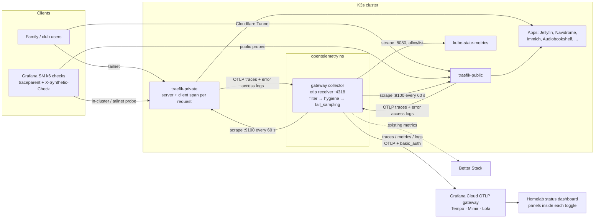

# ADR 0001 Design: Minimal Cluster Telemetry into Grafana Cloud

**Purpose**: Design the smallest telemetry setup that sends one trace per request for every service, plus a few
metrics and logs, from the K3s cluster to the Grafana Cloud stack `gallantfudge2729.grafana.net`, and shows it inside
the per-service toggles of the "Homelab status" dashboard

**Scope**: Traefik (both instances) as the only trace source, the in-cluster OpenTelemetry gateway collector, a
metrics allowlist (Traefik request metrics, a kube-state-metrics subset), error-only access logs, sampling, attribute
hygiene, dashboard queries for the toggle panels, k6 trace propagation, rollout, free-tier arithmetic. No app code
changes. This is a design: it changes nothing on the cluster or in Grafana

**Overview**: Both Traefik instances sit in front of every app, so turning on Traefik's native OTLP tracing gives a
server span and a client span for every request with zero app changes. Traefik sends spans to the existing
`gateway` collector (namespace `opentelemetry`), which strips personal data, tail-samples (all errors, all slow
requests, all synthetic-check requests, 10 % of the rest) and forwards to Grafana Cloud's OTLP gateway. Latency and
error-rate panels come from Traefik's own Prometheus metrics, which count every request, so sampling never skews
them. Traces are for "show me the slow or failed requests"; metrics are for "how fast and how often". The Better
Stack metrics pipeline stays as it is

**Dependencies**: `research.md` (goals, free tiers), `grafana-poc.md` (stack, probes, status dashboard), the Studio
OTel POC on branch `feat/studio-otel-poc` (`studio-otel-poc.md`, `monitoring/terraform-studio-otel/`),
`otel-operator/collector.yaml`, `network/{private,public}/traefik/values.yaml`, `helmfile.yaml.gotmpl`

**Exports**: Architecture, volume budget, Traefik values, collector pipelines, dashboard queries, rollout plan

**Related**: `monitoring/terraform/status_dashboard.tf`, `monitoring/terraform/status_selection.tf`,
`.ai/docs/MONITORING_ACCOUNTS.md`

---

## 1. Goals and non-goals

| Goals | Non-goals |
|---|---|
| One span per request for **every** service behind either Traefik, no app changes | App-level instrumentation (the Studio POC covers that pattern) |
| p50/p95 latency and 5xx rate per service, selected period vs baseline | Full Kubernetes monitoring, node/cAdvisor metrics in Grafana |
| A list of recent slow or failed requests per service, each opening its trace (signed in) | All pod logs; a log DaemonSet |
| Link a synthetic check run to the Traefik span it caused | Span metrics / Application Observability (extra billable series) |
| Stay well inside the free tier ($0, hard rule) with arithmetic to show it | Replacing the Better Stack pipeline |
| New panels only **inside** each service's collapsed toggle; the top level stays an uptime page | Alerting on telemetry (later, once baselines exist) |

## 2. What exists (verified read-only)

| Piece | State |
|---|---|
| `traefik-private`, `traefik-public` | Chart `traefik-38.0.2`, Traefik v3.6.6, **1 replica each** (RollingUpdate, maxSurge 1, maxUnavailable 0). Prometheus metrics on `:9100` (chart default buckets `0.1,0.3,1.2,5.0`). No tracing |
| Public access log | `network/public/traefik/values.yaml` sets a top-level `accessLog:` block. Chart 38 reads `logs.access`, so this block is **ignored**: the pod has no access-log args and prints no access lines |
| Ingresses | 13 hosts on `traefik-public` (`*.mlops-club.org`), 13 on `traefik-private` (`*.priv.mlops-club.org`); no IngressRoutes |
| `gateway` collector | `OpenTelemetryCollector` CR, deployment mode, 1 replica, image `otel/opentelemetry-collector-contrib:0.154.0`. Prometheus receiver only (DCGM, kubelet, cAdvisor, kube-state-metrics) → `otlp_http/betterstack`. No OTLP receiver, so no `gateway-collector` OTLP Service exists (only `gateway-collector-monitoring:8888`) |
| kube-state-metrics | Chart 7.4.0, ~9,000 series in total; too many to send whole |
| Grafana stack | ~1,100 active series in use (SM `probe_*` ≈ 970). Data sources `grafanacloud-prom`, `grafanacloud-logs`, `grafanacloud-traces` |
| Studio POC | Proved the OTLP path: collector → `https://otlp-gateway-prod-us-west-0.grafana.net/otlp` with `basic_auth` (user = instance ID, password = access-policy token); TraceQL-only dashboards; ~1.2 KB per (wide) span; TraceQL metrics capped at 24 h and log2-bucketed quantiles |

Request volume, from Traefik's counters over a 41-minute overnight window after a pod restart:
`traefik-private` 649 requests, `traefik-public` 132, so **≈ 19 requests/min ≈ 27,400/day**. 481 of the private
requests (74 %) were Navidrome `GET` SSE calls answered `401`: one misbehaving client, worth dropping at the collector.

## 3. Architecture



Choices:

| Decision | Choice | Why |
|---|---|---|
| Trace source | Traefik native OTLP tracing, `traceVerbosity: minimal` (default) | Minimal = one server span + one client span per request ([entrypoint docs][tr-ep]); covers every app |
| Transport | Traefik → collector (OTLP HTTP, in-cluster, plain HTTP) → Grafana | Token lives only in the collector; one place for hygiene and sampling |
| Sampling | Traefik `sampleRate: 1.0`; **tail** sampling in the collector | The keep/drop decision needs the status and duration, which only exist at the end of a request |
| Latency/error numbers | Scrape Traefik's Prometheus endpoint (unsampled) | Tail-sampled traces over-represent slow and failed requests; metrics count every request. Scraping keeps known metric names and 1 sample per minute per series (OTLP push defaults to 10 s) |
| Logs | Traefik access logs for 5xx or slow requests only, via OTLP (`experimental.otlpLogs`) | No DaemonSet, a few MB per day |
| Collector | Extend the existing `gateway` CR with new pipelines | One pod; the Better Stack pipeline is untouched |

## 4. Volume vs the free tier

Free tier ([grafana.com/pricing][pricing]): **50 GB traces, 50 GB logs, 10,000 active metric series per month, 14-day
retention** for each. No card on file, so overage cannot be billed; data over the cap is dropped (series: new series
silently rejected, per `research.md`).

Assumptions: 2 spans per request; 1 KB per Traefik span after hygiene (the POC's 1.2 KB spans carried ~40
attributes; a Traefik span carries ~12); 30-day month.

**Traces**

| Scenario | Requests/day | Kept | GB/month | Share of 50 GB |
|---|---|---|---|---|
| Measured overnight rate, all day, no sampling | 27,400 | 100 % | 27,400 × 2 KB × 30 = **1.6** | 3 % |
| Busy: 10× that, no sampling | 274,000 | 100 % | **16.4** | 33 % |
| Busy, tail-sampled (5 % slow/failed + 10 % of the other 95 %) | 274,000 | ≈ 14.5 % | **2.4** | 5 % |
| Pathological (Immich timeline scroll, HLS segments): 1 M/day, no sampling | 1,000,000 | 100 % | **60** | 120 % ❌ |
| Same, tail-sampled | 1,000,000 | ≈ 14.5 % | **8.7** | 17 % |
| Synthetic checks (4 login checks × 96 runs/day × ~10 requests), always kept | 3,840 | 100 % | **0.23** | 0.5 % |

Tail sampling is insurance against the pathological case, not a need at the measured traffic.

**Metrics** (counted from the live `/metrics` endpoints)

| Source | Series before | After the change |
|---|---|---|
| Traefik service metrics: `requests_total` (39) + duration histogram with 9 buckets + `+Inf`, sum, count (39 × 12 = 468) | — | ≈ 510, ≈ 1,000 allowing for new status codes and methods |
| kube-state-metrics subset: deployment available + desired (50 + 50), node `Ready` (12), container restarts (91) | 9,026 if sent whole | ≈ 200 |
| `up`, scrape meta, `target_info` (3 targets) | — | ≈ 20 |
| **Total new** | | **≈ 1,250**; stack total ≈ **2,350 / 10,000** (24 %) |

The `instance` label is set to the namespace, so a Traefik pod restart does not create new series.

**Logs**: 5 % of 274,000 requests ≈ 13,700 lines/day × ~0.7 KB ≈ 9.6 MB/day ≈ **0.3 GB/month** (0.6 %).

The binding limits are **retention** (14 days) and **TraceQL metrics' 24 h query range**, not volume.

## 5. Sampling

Policies in the collector's `tail_sampling` processor; a trace is kept if **any** policy matches.

| Policy | Rule | Why |
|---|---|---|
| `errors` | span status `ERROR`, or `http.response.status_code` 500–599 | Every failure is a trace you can open |
| `slow` | duration 1 s – 30 s | Slow but not long-lived; SSE, WebSocket and media streams last minutes and would otherwise all be "slow" |
| `synthetic` | `synthetic = true` (set from the `X-Synthetic-Check` header) | Each check run links to its spans |
| `baseline` | 10 % probabilistic | A normal-traffic sample to compare against |

Dropped **before** sampling (filter processor): Navidrome's `401` SSE retries and other known noise. Spans that
Traefik produces for `ping@internal` are off by default (`addInternals: false`).

Consequence for dashboards: TraceQL counts and quantiles are biased towards slow/failed requests, so they are used
only for lists of example traces. Percentiles and rates come from Traefik metrics.

## 6. Attribute hygiene

| Data | Risk | Treatment |
|---|---|---|
| Query strings | Navidrome's Subsonic API puts `u`, `t`, `s` (user, token, salt) in the query; Jellyfin accepts `api_key=` | Traefik redacts all query values by default; keep `safeQueryParams: []`. Collector deletes `url.query` and strips `?…` from `url.full` |
| Client IP, peer address | Personal data | Collector deletes `client.address`, `network.peer.address`, `network.peer.port` |
| User agent | Fingerprinting | Collector deletes `user_agent.original`; synthetic traffic is marked by the `X-Synthetic-Check` header instead |
| Auth headers, cookies | Credentials | Traefik captures no headers by default; only `X-Synthetic-Check` is captured |
| IDs in paths (`/Items/<uuid>`, `/api/assets/<uuid>`) | Reveals what someone watched or viewed, on a public dashboard | Collector rewrites hex/UUID and numeric path segments to `{id}` / `{n}` |
| Access-log `RequestPath`, `ClientHost`, `ClientAddr`, `ClientUsername` | Raw query string and IP | Dropped in Traefik's access-log field config; headers default to `drop` |

The public dashboard shows only templated paths, methods, status codes and durations.

## 7. Configuration

### 7.1 Traefik values (private shown; public identical with `traefik-public`)

Endpoint and keys follow the chart's `helm show values traefik/traefik --version 38.0.2`.

```yaml
tracing:
  serviceName: traefik-private        # resource.service.name, tells the two instances apart
  sampleRate: 1.0                     # the collector's tail sampler decides what is kept
  safeQueryParams: []                 # redact every query value (Subsonic credentials live there)
  capturedRequestHeaders: [X-Synthetic-Check]
  resourceAttributes:
    k8s.cluster.name: homelab
  otlp:
    enabled: true
    http:
      enabled: true
      endpoint: http://gateway-collector.opentelemetry.svc.cluster.local:4318/v1/traces

metrics:
  prometheus:
    buckets: "0.025,0.05,0.1,0.25,0.5,1,2.5,5,10"   # finer than the default 0.1,0.3,1.2,5.0 for p50/p95

experimental:
  otlpLogs: true
logs:
  access:
    enabled: true
    format: json
    filters:                          # Traefik keeps a line if ANY filter matches
      statuscodes: "500-599"
      minduration: "1s"
    fields:
      general:
        defaultmode: keep
        names: {ClientHost: drop, ClientAddr: drop, ClientUsername: drop, RequestPath: drop}
      headers:
        defaultmode: drop
    otlp:
      enabled: true
      serviceName: traefik-private
      http:
        enabled: true
        endpoint: http://gateway-collector.opentelemetry.svc.cluster.local:4318/v1/logs
```

In `network/public/traefik/values.yaml`, replace the ignored top-level `accessLog:` block with the `logs.access`
block above (it also kept `X-Forwarded-For`, a client IP).

### 7.2 Collector additions (`otel-operator/collector.yaml`)

A new Secret `grafana-otlp` (keys `GRAFANA_OTLP_ENDPOINT`, `GRAFANA_OTLP_INSTANCE_ID`, `GRAFANA_OTLP_TOKEN`, same
names as `~/credentials/homelab-otel.env`) is created by the existing helmfile presync hook, next to the Better Stack
Secret. Only the new parts are shown; the existing `prometheus` receiver, processors and Better Stack pipeline stay.

```yaml
spec:
  envFrom:
    - secretRef: {name: betterstack-sandbox-ingest-token}
    - secretRef: {name: grafana-otlp}
  resources:
    requests: {cpu: 100m, memory: 256Mi}
    limits: {memory: 768Mi}
  config:
    extensions:
      basic_auth/grafana:
        client_auth:
          username: ${env:GRAFANA_OTLP_INSTANCE_ID}
          password: ${env:GRAFANA_OTLP_TOKEN}
    receivers:
      otlp:
        protocols:
          http: {endpoint: 0.0.0.0:4318}   # the Operator then creates Service gateway-collector:4318
      prometheus/grafana:                  # separate receiver: 60 s scrapes (1 DPM) and an allowlist
        config:
          scrape_configs:
            - job_name: traefik
              scrape_interval: 60s
              kubernetes_sd_configs:
                - role: pod
                  namespaces: {names: [traefik-private, traefik-public]}
              relabel_configs:
                - {source_labels: [__meta_kubernetes_pod_label_app_kubernetes_io_name], regex: traefik, action: keep}
                - {source_labels: [__meta_kubernetes_pod_container_port_number], regex: "9100", action: keep}
                - {source_labels: [__meta_kubernetes_namespace], target_label: instance}  # stable across restarts
              metric_relabel_configs:
                - source_labels: [__name__]
                  regex: traefik_service_(requests_total|request_duration_seconds_(bucket|sum|count))
                  action: keep
            - job_name: kube-state-metrics
              scrape_interval: 60s
              kubernetes_sd_configs:
                - role: pod
                  namespaces: {names: [kube-state-metrics]}
              relabel_configs:
                - {source_labels: [__meta_kubernetes_pod_container_port_number], regex: "8080", action: keep}
                - {target_label: instance, replacement: kube-state-metrics}
              metric_relabel_configs:
                # one anchored keep on "name;condition": the allowlist, and only condition="Ready" for nodes
                - source_labels: [__name__, condition]
                  separator: ";"
                  regex: (kube_deployment_status_replicas_available|kube_deployment_spec_replicas|kube_pod_container_status_restarts_total);.*|kube_node_status_condition;Ready
                  action: keep
    processors:
      memory_limiter: {check_interval: 1s, limit_percentage: 80, spike_limit_percentage: 20}
      filter/noise:
        error_mode: ignore
        traces:
          span:
            - attributes["http.response.status_code"] == 401 and IsMatch(attributes["url.path"], "^/api/events")  # Navidrome SSE retries
      transform/hygiene:
        error_mode: ignore
        trace_statements:
          - context: span
            statements:
              - delete_key(attributes, "client.address")
              - delete_key(attributes, "network.peer.address")
              - delete_key(attributes, "network.peer.port")
              - delete_key(attributes, "user_agent.original")
              - delete_key(attributes, "url.query")
              - replace_pattern(attributes["url.full"], "\\?.*$", "")
              - replace_pattern(attributes["url.path"], "/[0-9a-fA-F-]{16,}", "/{id}")
              - replace_pattern(attributes["url.path"], "/[0-9]+", "/{n}")
              - set(attributes["synthetic.check"], attributes["http.request.header.x-synthetic-check"])
                where attributes["http.request.header.x-synthetic-check"] != nil
              - set(attributes["synthetic"], true) where attributes["synthetic.check"] != nil
              - set(attributes["synthetic"], false) where kind == SPAN_KIND_SERVER and attributes["synthetic"] == nil
        log_statements:
          - context: log
            statements:
              - delete_key(attributes, "ClientHost")
              - delete_key(attributes, "ClientAddr")
              - delete_key(attributes, "RequestPath")
      tail_sampling:
        decision_wait: 10s
        num_traces: 20000                  # ≈ 20k × 2 spans × 1 KB ≈ 40 MB worst case in memory
        expected_new_traces_per_sec: 20
        policies:
          - {name: errors, type: status_code, status_code: {status_codes: [ERROR]}}
          - {name: server-5xx, type: numeric_attribute, numeric_attribute: {key: http.response.status_code, min_value: 500, max_value: 599}}
          - {name: slow, type: latency, latency: {threshold_ms: 1000, upper_threshold_ms: 30000}}
          - {name: synthetic, type: boolean_attribute, boolean_attribute: {key: synthetic, value: true}}
          - {name: baseline, type: probabilistic, probabilistic: {sampling_percentage: 10}}
      resource/cluster:
        attributes: [{key: k8s.cluster.name, value: homelab, action: upsert}]
    exporters:
      otlp_http/grafana:
        endpoint: ${env:GRAFANA_OTLP_ENDPOINT}   # https://otlp-gateway-prod-us-west-0.grafana.net/otlp
        auth: {authenticator: basic_auth/grafana}
        compression: gzip
    service:
      extensions: [basic_auth/grafana]
      pipelines:
        traces:
          receivers: [otlp]
          processors: [memory_limiter, filter/noise, transform/hygiene, tail_sampling, resource/cluster, batch]
          exporters: [otlp_http/grafana]
        logs:
          receivers: [otlp]
          processors: [memory_limiter, transform/hygiene, resource/cluster, batch]
          exporters: [otlp_http/grafana]
        metrics/grafana:
          receivers: [prometheus/grafana]
          processors: [memory_limiter, resource/cluster, batch]
          exporters: [otlp_http/grafana]
        # metrics: (existing Better Stack pipeline, unchanged)
```

Component names follow collector 0.154 (`otlp_http`, `basic_auth`; the old `otlphttp`/`basicauth` remain aliases).

### 7.3 k6 trace propagation (Grafana SM scripted checks)

Feasible for **scripted** checks. Grafana documents linking SM scripted checks to traces: the script imports the
Tempo instrumentation jslib and wraps `k6/http`; SM then shows a Tempo icon next to log lines carrying a trace ID
([what's new, 2026-04-22][sm-trace]; [jslib docs][jslib]).

```js
import http from 'k6/http';
import tempo from 'https://jslib.k6.io/http-instrumentation-tempo/1.0.1/index.js';
tempo.instrumentHTTP({ propagator: 'w3c' });               // adds a sampled traceparent to every request
const TAG = { headers: { 'X-Synthetic-Check': 'jellyfin-login' } };  // merged into each request's params
```

Honest limits:

| Limit | Effect |
|---|---|
| k6 only **propagates** context; it does not export its own client span | In Tempo the Traefik server span shows a missing parent ("root span not yet received"); the trace still opens and holds the Traefik + backend client spans |
| Browser checks (the Audiobookshelf page-load check) | No equivalent wrapper; not linked. Its requests can still be tagged only if the page itself sent the header, so they fall under normal sampling |
| Remote jslib import | The probe must reach `jslib.k6.io`. If the private probe can't, vendor the module into the script |
| Cloudflare in front of `traefik-public` | Must pass `traceparent` and `X-Synthetic-Check` through unchanged; verify on the Audiobookshelf check |
| Traefik inherits a sampled parent ([tracing docs][tr-tracing]) | Anyone can send a sampled `traceparent`; harmless, because the tail sampler, not Traefik, decides what is stored |

### 7.4 Toggle panels (`status_dashboard.tf`)

Each entry in `local.status_services` gains `svc` (Traefik service label), `host` and `ns`:

| Job | `svc` | `host` | `ns` |
|---|---|---|---|
| `jellyfin-login` | `jellyfin-jellyfin-8096@kubernetes` | `jellyfin.priv.mlops-club.org` | `jellyfin` |
| `navidrome-login` | `navidrome-navidrome-4533@kubernetes` | `navidrome.priv.mlops-club.org` | `navidrome` |
| `immich-login` | `immich-immich-server-2283@kubernetes` | `photos.priv.mlops-club.org` | `immich` |
| `audiobookshelf-login`, `-browser` | `audiobookshelf-audiobookshelf-80@kubernetes` | `books.mlops-club.org` | `audiobookshelf` |

New panels go inside the existing collapsed row, between the comparison table and the run log, under a text
heading "All traffic through Traefik (real users and checks)". The top level does not change.

| Panel | Type | Query |
|---|---|---|
| Real traffic, selected period vs 24 h (p50, p95, 5xx rate, requests) | table, same merge/organize pattern as the check comparison | PromQL below, `$__range` vs `24h` |
| Requests by status class | timeseries (bars) | `sum by (class) (label_replace(rate(traefik_service_requests_total{service="SVC"}[$__rate_interval]), "class", "${1}xx", "code", "(.).."))` |
| Slow or failed requests in the selected period | table, Tempo, `tableType = "traces"`, limit 20 | TraceQL below |
| This check's requests | table, Tempo, `tableType = "traces"`, limit 20 | TraceQL below |
| Pod restarts / replicas available | stat × 2 | `sum(increase(kube_pod_container_status_restarts_total{namespace="NS"}[$__range]))`; `sum(kube_deployment_status_replicas_available{namespace="NS"}) / sum(kube_deployment_spec_replicas{namespace="NS"})` |
| Error access log lines | logs, Loki | LogQL below |

PromQL (selected period; baseline replaces `$__range` with `24h`, matching `status_selection.tf`):

```promql
# p95 (p50: 0.5)
histogram_quantile(0.95, sum by (le) (rate(traefik_service_request_duration_seconds_bucket{service="SVC"}[$__range])))
# 5xx rate
sum(rate(traefik_service_requests_total{service="SVC", code=~"5.."}[$__range]))
  / sum(rate(traefik_service_requests_total{service="SVC"}[$__range]))
# requests in the period
sum(increase(traefik_service_requests_total{service="SVC"}[$__range]))
```

TraceQL:

```traceql
# Slow or failed real requests
{ resource.service.name =~ "traefik-.*" && kind = server && span.server.address = "HOST"
  && span.synthetic = false && (status = error || duration > 1s) }
  | select(span.http.request.method, span.url.path, span.http.response.status_code)

# Requests made by this check (one trace per request of each run)
{ kind = server && span.synthetic.check = "JOB" }
  | select(span.http.request.method, span.url.path, span.http.response.status_code)

# Signed-in drill-down only (biased by sampling, ≤ 24 h range, log2-bucketed quantiles)
{ kind = server && span.server.address = "HOST" } | quantile_over_time(duration, .5, .95)
```

LogQL (OTLP log attributes land as structured metadata; exact field names confirmed in rollout step 6):

```logql
{service_name=~"traefik-(private|public)"} | ServiceName = "SVC"
  | line_format "{{.DownstreamStatus}} {{.RequestMethod}} {{.Duration}} {{.RouterName}}"
```

Public viewers see the tables but cannot click through (public dashboards hide links); signed in, a trace ID opens
the waterfall in Explore.

## 8. Rollout

Each step is one small change with its own check and rollback. Read-only checks first, then `helmfile ... diff`,
then apply. Traefik changes restart a single-replica Deployment (maxSurge 1, maxUnavailable 0: the new pod starts
before the old one stops); apply at a quiet hour and expect the SM checks to stay green.

| # | Change | Verify | Roll back |
|---|---|---|---|
| 0 | New access policy `homelab-otel-gateway` (`traces:write`, `metrics:write`, `logs:write`, this stack only) and token via `monitoring/terraform-studio-otel/otlp-token.sh`-style call; names into `.env`; document in `MONITORING_ACCOUNTS.md` | `grep -c '^GRAFANA_OTLP_' .env` → 3 (names only) | Delete the policy |
| 1 | Collector: Secret, `otlp` receiver, `traces` pipeline; nothing sends yet | `kubectl -n opentelemetry get otelcol gateway`; `kubectl -n opentelemetry get svc gateway-collector` shows 4318; `kubectl -n opentelemetry logs deploy/gateway-collector --since=5m \| grep -iE 'error\|401\|403'` empty | `git revert`, `kubectl apply -f otel-operator/collector.yaml` |
| 2 | `traefik-private`: `tracing` block only | `helmfile -l name=traefik-private diff`; `curl -s https://whoami.priv.mlops-club.org`; collector self-metrics `otelcol_exporter_sent_spans` rising (`kubectl get --raw /api/v1/namespaces/opentelemetry/services/gateway-collector-monitoring:8888/proxy/metrics`); TraceQL `{resource.service.name="traefik-private"}` returns traces; **record the real attribute names** and fix §7.2/§7.4 if they differ | `helm rollback traefik-private <rev> -n traefik-private` |
| 3 | Hygiene check | TraceQL `{span.client.address != nil \|\| span.user_agent.original != nil \|\| span.url.query != nil}` → no results; spot-check `url.path` shows `{id}` | Fix transform, re-apply |
| 4 | `traefik-public`: same `tracing` block | Same as 2 with `books.mlops-club.org` | Helm rollback |
| 5 | Buckets + `prometheus/grafana` receiver + `metrics/grafana` pipeline | `monitoring/scripts/promql 'count({__name__=~"traefik_.*\|kube_.*"})'` ≈ 700–1,300; `monitoring/scripts/promql 'count({__name__=~".+"})'` < 3,000 | Remove pipeline |
| 6 | Error access logs (`experimental.otlpLogs`, `logs.access`), private then public | `curl -s -o /dev/null https://whoami.priv.mlops-club.org/nonexistent` does not log (404); force a 5xx or slow request and find it in Loki; confirm no IP or query in the line | Helm rollback |
| 7 | One check (`jellyfin-login`) with the jslib + header | Next run: TraceQL `{span.synthetic.check="jellyfin-login"}` returns the run's requests; SM app shows the Tempo icon on its log lines | Revert the script |
| 8 | Remaining login checks | Same per job | Revert |
| 9 | Toggle panels in Terraform | `./tf plan` shows only `grafana_dashboard.status` changing; open the public link: top level unchanged, toggles show the new panels (or the documented fallback, see open question 1) | `./tf apply` the previous commit |
| 10 | Usage watch for a week | `grafanacloud-usage` data source: `grafanacloud_traces_instance_bytes_received_per_second`, logs equivalent, `grafanacloud_instance_active_series`; projected month < 10 GB traces | Lower `baseline` to 5 % or 1 % |

## 9. Risks and costs

| Risk | Likelihood / impact | Mitigation |
|---|---|---|
| Public dashboard leaks what people do (paths, timing) | Medium / medium | Path templating, no IPs/UAs/queries, real-traffic list shows only slow/failed requests |
| Tempo panels do not render on a public dashboard | Unknown / low | Verify in step 9; fallback is the Loki error-log panel publicly and trace tables signed-in only |
| Free tier exceeded (traffic spike, a client loop) | Low / data dropped, $0 | Tail sampling, noise filter, usage watch; no card on file |
| Long-lived streams inflate Traefik p95 | High for Jellyfin, Navidrome / misleading p95 | Show p50 beside p95; compare against the 24 h baseline rather than absolute thresholds; a separate router for `/stream` paths can split them later |
| Collector outage | Low / telemetry gap only | Traefik's exporter is asynchronous and drops on a full queue; requests are not affected. Tail sampling needs one replica (or a `loadbalancing` exporter tier if scaled) |
| Collector memory | Low | `memory_limiter`, `num_traces: 20000`, 768 Mi limit |
| OTLP token expiry (POC tokens: 30 days) | Medium / silent gap | Longer expiry or a dated rotation note in `MONITORING_ACCOUNTS.md`; alert on `otelcol_exporter_send_failed_spans` later |
| Traefik restart during values change | Low | Surge rollout; quiet hour |
| `experimental.otlpLogs` behaviour changes on upgrade | Low | Logs are optional; drop step 6 if it misbehaves |

Cost: $0. CPU/memory: Traefik tracing adds a few percent CPU at ~20 req/min; the collector adds ~100–300 MB.

## 10. Open questions

1. Do Tempo-backed panels (traces table, TraceQL metrics) run on a Grafana Cloud **public** dashboard? Not
   documented either way; test before building all toggles.
2. Exact Traefik v3.6 span attribute names and types: `server.address` vs `url.*`, the captured-header key
   (`http.request.header.x-synthetic-check`, a string array per semconv), and whether the server span carries the
   router/service name. Step 2 records them.
3. With `logs.access.otlp` enabled, does Traefik still write access logs to stdout?
4. Does the Prometheus receiver → OTLP → Mimir path keep `traefik_service_requests_total` (with `_total`) as named?
   Step 5 confirms; adjust queries if not.
5. Does Cloudflare forward `traceparent` and custom headers to `traefik-public` unchanged?
6. Can the private SM probe import from `jslib.k6.io`, or should the module be vendored?
7. Retire the Better Stack metrics pipeline once Grafana covers what it is used for?
8. Should the Grafana-managed Loki data source get a derived field so `trace_id` in SM logs and access logs links to
   Tempo (if the managed data source allows it)?

## Sources

- Grafana Cloud pricing, free tier limits: [grafana.com/pricing][pricing]
- Traefik v3.6 tracing options (sampleRate, safeQueryParams, capturedRequestHeaders, ParentBased sampling): [docs][tr-tracing]
- Traefik v3.6 entrypoint observability, `traceVerbosity` minimal vs detailed: [docs][tr-ep]
- SM scripted checks linking to traces: [Grafana what's new][sm-trace]; k6 `http-instrumentation-tempo`: [jslib docs][jslib]
- Chart keys: `helm show values traefik/traefik --version 38.0.2`
- Studio OTel POC (OTLP endpoint and auth, TraceQL limits, span size): `studio-otel-poc.md` on `feat/studio-otel-poc`

[pricing]: https://grafana.com/pricing/
[tr-tracing]: https://doc.traefik.io/traefik/v3.6/reference/install-configuration/observability/tracing/
[tr-ep]: https://doc.traefik.io/traefik/v3.6/reference/install-configuration/entrypoints/
[sm-trace]: https://grafana.com/whats-new/2026-04-22-end-to-end-root-cause--jump-from-a-synthetic-monitoring-check-straight-to-its-trace/
[jslib]: https://grafana.com/docs/k6/latest/javascript-api/jslib/http-instrumentation-tempo/
