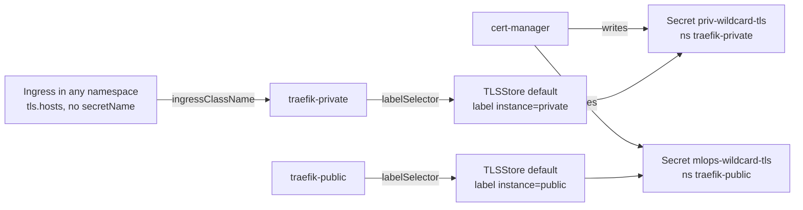

# ADR 0002: Traefik Default Certificate Instead of Per-Namespace Secret Copies

**Purpose**: Record how the two Traefik instances serve the wildcard TLS certificates without copying the secrets into app namespaces

**Scope**: TLS for `*.priv.mlops-club.org` (traefik-private) and `*.mlops-club.org` (traefik-public): where the certificate secrets live, how Traefik finds them, and how each Traefik selects its own CRD objects

**Overview**: cert-manager writes one wildcard secret per Traefik namespace. Each Traefik serves its
    secret as the default certificate through a `TLSStore` named `default`, so Ingresses list
    `tls.hosts` and name no secret. Each Traefik's CRD provider reads only objects labeled with its
    instance name, which keeps the other instance's `default` TLSStore out of view. Emberstack
    Reflector, which copied both secrets into every namespace, is removed

**Dependencies**: `network/private/traefik/values.yaml`, `network/public/traefik/values.yaml`, `network/private/traefik/priv-wildcard-certificate.yaml`, `network/public/traefik/mlops-wildcard-certificate.yaml`

**Exports**: The default-TLSStore pattern, the `traefik.mlops-club.org/instance` label convention for Traefik CRD objects

**Related**: `network/private/README.md`, `network/private/cert-manager/LETSENCRYPT_SETUP.md`, `.ai/howto/how-to-deploy-a-new-app.md`

---

**Status**: Accepted

## Context

- cert-manager issues two wildcard certificates: `priv-wildcard-tls` (`*.priv.mlops-club.org`, namespace
  `traefik-private`) and `mlops-wildcard-tls` (`*.mlops-club.org`, namespace `traefik-public`).
- An Ingress `tls.secretName` resolves in the Ingress's own namespace. To make private apps work, the
  Certificates carried Reflector `secretTemplate` annotations, and Reflector (Helm release `reflector`)
  copied both secrets into every namespace: 33 copies of each. Private Ingresses named their local copy.
  No Ingress used the `mlops-wildcard-tls` copies: public Ingresses have no `tls` block, because
  Cloudflare terminates TLS and the tunnel reaches traefik-public over HTTP.
- Both Traefik values files set `tls.stores.default.defaultCertificate`. Traefik chart 38.0.2 ignores
  the `tls:` key (the chart key is `tlsStore:`), so no default TLSStore existed and Traefik fell back to
  its self-signed `TRAEFIK DEFAULT CERT`. That gap is what made the per-namespace copies necessary.
- Both Traefik instances watch all namespaces. With a `default` TLSStore in each Traefik namespace, each
  instance sees two stores named `default`, logs `Default TLS Store defined in multiple namespaces`, and
  drops the default certificate.

## Decision

1. Each Traefik sets `tlsStore.default.defaultCertificate.secretName` to its wildcard secret. The chart
   renders a `TLSStore` named `default` in that Traefik's namespace.
2. Each Traefik's `kubernetesCRD` provider has `labelSelector: traefik.mlops-club.org/instance=private`
   (or `=public`), and the chart's `commonLabels` puts that label on its own objects, including the
   TLSStore. Each instance sees exactly one `default` store.
3. Ingresses list `tls.hosts` and name no `secretName`. Harbor uses `expose.tls.certSource: none`.
4. Reflector is uninstalled, its annotations are removed from the Certificates, and the copies are
   deleted. Only the two source secrets exist.

A new private app gets TLS with `ingressClassName: traefik-private` and
`tls: [{hosts: [<app>.priv.mlops-club.org]}]`. Nothing is copied.

## Alternatives considered

| Option | Why not |
|---|---|
| Keep Reflector, fix nothing else | Works, but keeps one copy of each private key per namespace (66 secrets) and an extra controller whose outage leaves new namespaces without TLS |
| Vault + Vault Secrets Operator, or External Secrets Operator | Still materializes one secret per namespace, and adds Vault (or another backend) to run, unseal and back up |
| Scope each Traefik's CRD provider by namespace (`kubernetesCRD.namespaces`) | Also isolates the two `default` stores, but Traefik objects such as `Middleware` could then live only in the Traefik namespace, not next to the app that uses them |
| Scope each Traefik's CRD provider by label (chosen) | Objects can live in any namespace; the label plays the same role for CRDs that `ingressClassName` plays for Ingresses |

## Consequences

- Each certificate is held in one place. cert-manager renewals reach Traefik directly; there are no
  copies to refresh.
- Any future Traefik CRD object (`Middleware`, `IngressRoute`, `TLSOption`, ...) must carry
  `traefik.mlops-club.org/instance: private` (or `public`), or the matching Traefik ignores it. Plain
  Ingress objects are unaffected; they are selected by `ingressClassName`.
- An Ingress that names a secret missing from its namespace still gets the default certificate, but
  Traefik logs `Error configuring TLS: secret ... does not exist`. Ingresses deployed from other
  repositories (namespaces `golden-rules-studio-otel`, `k2`, `loseit-agent`, `navidrome`, `retrom`)
  still name `priv-wildcard-tls` and log that error until their repositories drop `secretName`.
- Verification: `kubectl get tlsstore -A` lists exactly one `default` per Traefik namespace, and
  `openssl s_client -connect <host>:443 -servername foo.example.com` returns the wildcard, not
  `TRAEFIK DEFAULT CERT`.
