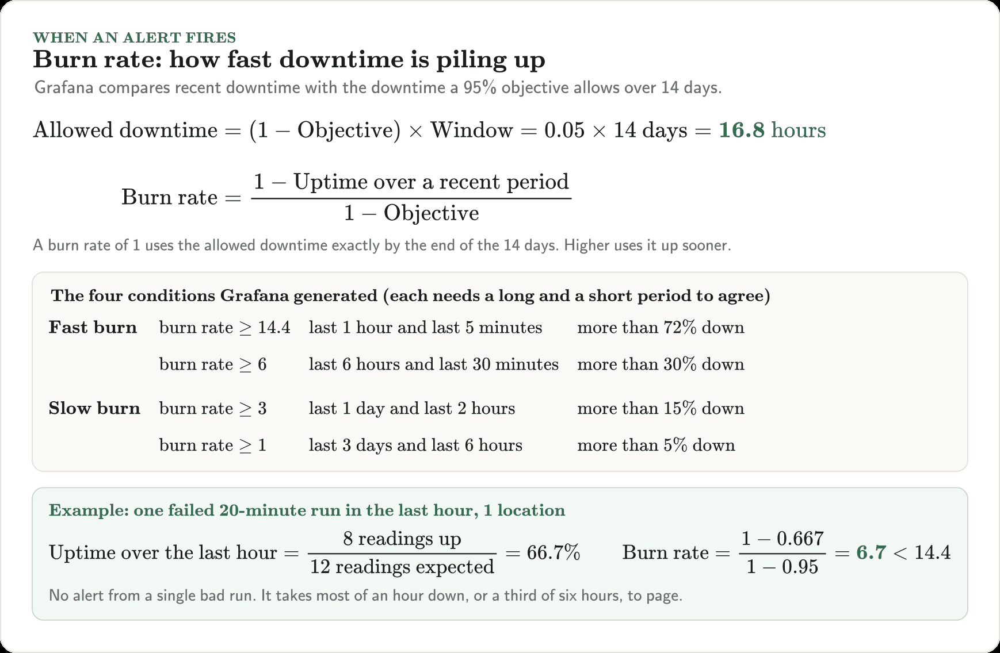
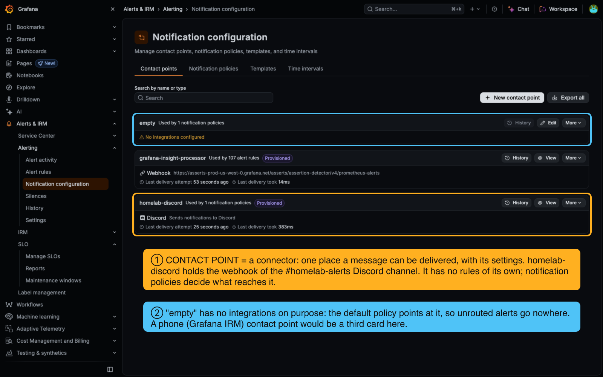
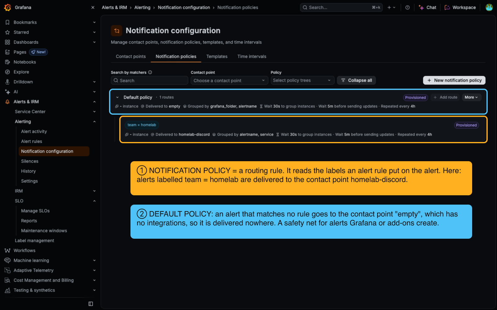

# ADR 0004: Which Alerts Fire and How They Reach Discord

**Purpose**: Record which alert rules exist for the homelab and how Grafana routes them to Discord: alert rules put labels on alerts, a notification policy matches the labels, a contact point delivers

**Scope**: The alert rules in Grafana Cloud (the probe heartbeat and the burn-rate rules generated from each service's uptime query), the notification policy tree, and the `homelab-discord` contact point. When a phone may ring is [ADR 0005](../0005-on-call-schedule/decision.md)

**Overview**: Fifteen rules: one "probe is silent" heartbeat and two burn-rate rules for each of the
    seven services. All carry `team = homelab`; one policy sends that label to Discord and everything
    else nowhere. Burn-rate rules compare recent downtime with the downtime a 95 % objective allows over
    14 days, so a single failed run doesn't page but a sustained outage does

**Dependencies**: [ADR 0001](../0001-outside-in-monitoring/decision.md) (checks, readings, the uptime query), `monitoring/terraform/notifications.tf`, `monitoring/terraform/alerts_heartbeat.tf`, `monitoring/terraform/slos.tf`

**Exports**: The `team = homelab` routing label, the alerting terms used in ADR 0005

**Related**: [ADR 0005](../0005-on-call-schedule/decision.md), [MONITORING_ACCOUNTS.md](../../MONITORING_ACCOUNTS.md) (where the Discord webhook lives)

---

**Status**: Accepted

## Key terms

| Term | Plain meaning | Example in this setup |
|---|---|---|
| **Alert rule** | A question Grafana asks on a schedule. When the answer is "yes" for long enough, the rule fires an alert | "Tailnet probe is silent": has `homelab-cluster` sent no result for 2 minutes? |
| **Label** | A key = value tag a rule puts on every alert it fires; routing reads labels, not rule names | `team = homelab`, `service = k2`, `severity = critical` |
| **Notification policy** | A routing rule: match labels, pick a contact point, decide how alerts are grouped and repeated | `team = homelab` → `homelab-discord`, grouped by alert name and service, repeated every 4 h while firing |
| **Contact point** | A connector to one destination, with its settings; it has no rules of its own | `homelab-discord`: the webhook of `#homelab-alerts`. `empty`: delivers nowhere |
| **Objective** | The uptime a burn-rate rule measures against. Not shown on any dashboard | 95 % over 14 days for every service |
| **Allowed downtime** | (1 − objective) × window | 5 % × 14 days = 16.8 hours |
| **Burn rate** | How fast recent downtime would use up the allowed downtime; 1 = exactly by the end of the window | One failed run in the last hour at one location: burn rate 6.7 |
| **Mute timing** | A schedule during which a policy holds notifications back | Planned for phone paging only ([ADR 0005](../0005-on-call-schedule/decision.md)) |

## Which alerts exist

| Rule | Per | Fires when | Why |
|---|---|---|---|
| Tailnet probe is silent (`alerts_heartbeat.tf`) | Once | No result from probe `homelab-cluster` for 2 minutes; "no data" itself counts as firing | Catches the probe pod, the cluster network or the whole cluster going down, which no service check can report |
| *Service* availability: Error Budget Burn Rate is **Very High** (fast burn, generated by Grafana SLO) | Each of 7 services | See the card below: most of the last hour down, or about a third of the last 6 hours | A real outage, now |
| *Service* availability: Error Budget Burn Rate is **High** (slow burn) | Each of 7 services | 15 % of the last day down, or 5 % of the last 3 days | Flaky service: it would use up the allowed downtime before the 14 days are over |

Not alerted: a single failed run, slow runs, the Audiobookshelf browser check (it shares the
Audiobookshelf service with the login check, which is alerted).

The thresholds are Grafana SLO's generated multi-window rules (read back from Grafana's rule API). With
the earlier 99.9 % objective, one missed 15-minute run produced a burn rate of 250 and paged; at 95 % the
same miss stays well under the threshold.

## How an alert reaches Discord

The alert rule fires with labels; the notification policy matches `team = homelab`; the contact point
delivers to `#homelab-alerts`. Everything without that label (for example Grafana's built-in trial rules)
falls to the default policy, whose contact point `empty` has no integrations.

| Setting | Value | Effect |
|---|---|---|
| `group_by` | `alertname`, `service` | One Discord message per rule and service, not one per series |
| `group_wait` | 30 s | First message waits 30 s to collect related alerts |
| `group_interval` | 5 m | New alerts in an existing group wait up to 5 minutes |
| `repeat_interval` | 4 h | A still-firing alert is repeated every 4 hours |
| Resolve messages | On | Discord gets a "resolved" message when the alert clears |

## Consequences

- Adding a rule that should reach Discord needs only the label `team = homelab`.
- Burn-rate windows reach back up to 3 days, so a new service can fire a burn-rate alert in its first
  hours if early readings were down (seen once while the checks were being set up).
- Discord is the only destination; nothing wakes anyone up until [ADR 0005](../0005-on-call-schedule/decision.md) is implemented.
