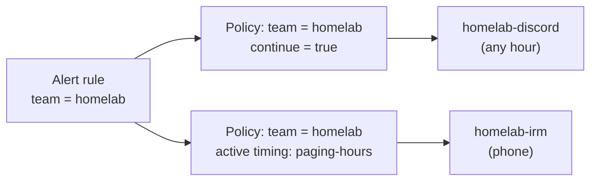

# ADR 0005: On-Call Schedule: When the Phone May Ring

**Purpose**: Record when homelab alerts may page a phone, and how: Discord at any hour, a phone call or push only during paging hours, through Grafana IRM and a Grafana time interval

**Scope**: Phone paging for alerts labelled `team = homelab` ([ADR 0004](../0004-alerts-and-routing/decision.md)). Which alerts exist and how they reach Discord are decided there, not here

**Overview**: The owner's day sets the schedule. Paging hours (America/Denver): weekdays 08:45–18:00,
    Saturday 09:45–18:00, Sunday 11:00–18:00 (church, 09:00–11:00, never pages). Outside those hours
    alerts still go to Discord; the phone stays quiet, and an alert still firing when paging hours begin
    pages then

**Dependencies**: [ADR 0004](../0004-alerts-and-routing/decision.md) (alert rules, labels, notification policy), `monitoring/terraform/notifications.tf`

**Exports**: The paging-hours schedule

**Related**: [ADR 0001](../0001-outside-in-monitoring/decision.md)

---

**Status**: Proposed. Blocked on the owner installing the Grafana IRM mobile app and pairing a phone

## Paging hours

| Day | Phone may ring (America/Denver) | Quiet |
|---|---|---|
| Monday–Friday | 08:45–18:00 | 18:00–08:45 |
| Saturday | 09:45–18:00 | 18:00–09:45 |
| Sunday | 11:00–18:00 | 18:00–11:00, including church 09:00–11:00 |

Discord (`#homelab-alerts`) gets every alert at any hour, as today.

## Key terms

| Term | Plain meaning | Example in this setup |
|---|---|---|
| **Time interval** | A named, recurring set of times in a time zone | `paging-hours`: the table above |
| **Active timing** | A policy is only active (sends) inside the interval | The IRM route uses `paging-hours` |
| **Mute timing** | The inverse: a policy is silent inside the interval | Equivalent alternative: mute the IRM route during `quiet-hours` |
| **Grafana IRM** | Grafana's on-call product: escalation chains and phone push or calls | Contact point `homelab-irm`, one user, push then call |
| **`continue`** | Lets an alert match the next sibling policy too | Discord route with `continue = true`, so the same alert also reaches the IRM route |

## Design

Example: K2 goes down on Sunday at 09:30. Discord gets the burn-rate alert within minutes. The phone stays
quiet during church; if the alert is still firing at 11:00, the IRM route becomes active and pages.

## Why Grafana IRM

It sits in the same Grafana stack as the rules, adds no new vendor, and its free tier covers a single
person. A plain Discord mobile notification can't break through Do Not Disturb or escalate to a call.

## To implement

1. Owner: install Grafana IRM, pair the phone, set the notification rules (push, then call).
2. Terraform: a `grafana_mute_timing` named `paging-hours` with the intervals above; a `homelab-irm` contact
   point; `continue = true` on the Discord route; a second `team = homelab` route to IRM with
   `active_timings = ["paging-hours"]`.
3. Verify: fire a test alert inside and outside paging hours; confirm Discord always gets it and the phone
   only inside; confirm an alert firing across 11:00 on a Sunday pages at 11:00.
