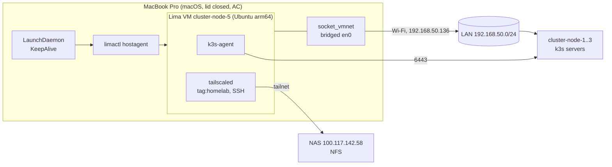
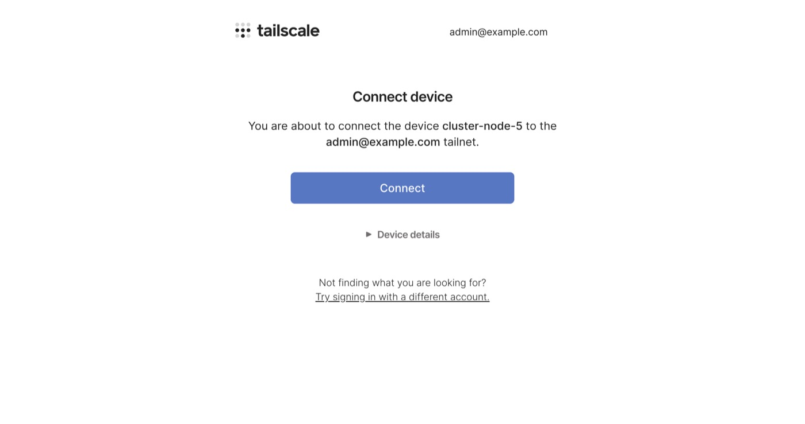
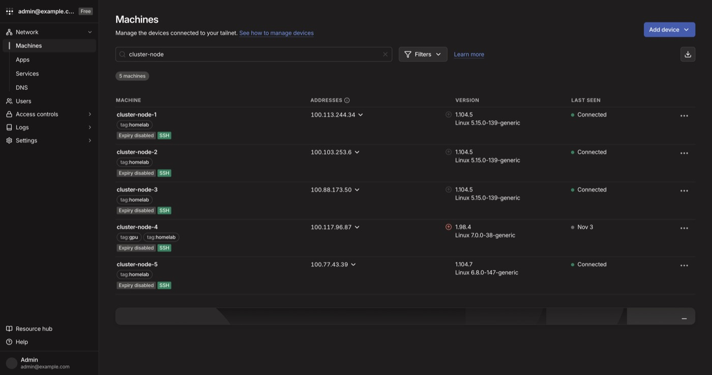

# ADR 0006: MacBook Pro as k3s Agent Node `cluster-node-5`

**Purpose**: Record how an Apple Silicon MacBook Pro joins the homelab cluster as a k3s agent that stays up 24/7, survives crashes, and protects its battery and disk

**Scope**: Any Apple Silicon MacBook Pro running macOS 26+ as a cluster node: the Lima VM, its macOS host settings, its Tailscale membership, and how workloads opt in to it. The first such node is `cluster-node-5`

**Overview**: macOS cannot run k3s natively, so a Lima VM on Apple's Virtualization.framework runs Ubuntu
    24.04 arm64 and the same k3s agent version as the NUCs. The VM is bridged onto the LAN over Wi-Fi
    (socket_vmnet) so it is a peer on 192.168.50.0/24 like a physical node, and it joins the tailnet as
    `cluster-node-5` with `tag:homelab` and Tailscale SSH, exactly like the NUCs. A boot LaunchDaemon keeps
    the VM running; pmset keeps the Mac awake with the lid closed on AC power; macOS Charge Limit protects
    the battery. The node is tainted so only workloads that tolerate it (arm64-capable images) land there.
    Every host change has a scripted revert. Nothing here depends on a particular MacBook model; sizing
    follows the host's core count and memory.

**Dependencies**: `macbook-node/lima-k3s-agent.yaml`, `macbook-node/install.sh`, `macbook-node/uninstall.sh`, `macbook-node/host-setup.sh`

**Exports**: The `node.mlops-club.org/macbook=true:NoSchedule` taint and `node.mlops-club.org/host=macbook-pro` label; the Lima + LaunchDaemon pattern for running a Linux node on macOS

**Related**: `.ai/docs/CLUSTER_HA_AUDIT.md`, `k3s-ansible/inventory/cluster/hosts.ini`, `storage/README.md`

---

**Status**: Accepted

## Context

- The cluster is three control-plane NUCs (`cluster-node-1..3`, amd64) and one GPU agent
  (`cluster-node-4`). Every node is a DHCP client on 192.168.50.0/24, runs flannel VXLAN over its LAN
  interface, and is a Tailscale device tagged `tag:homelab` with Tailscale SSH (`ssh main@cluster-node-N`).
- The `nas-nfs` StorageClass mounts the NAS at its Tailscale IP (`100.117.142.58`), so every node that
  mounts NFS volumes must be on the tailnet. The NAS export requires a privileged source port (no
  `insecure` option).
- The MacBook Pro is a dedicated node: it stays plugged in, on Wi-Fi, with the lid closed. Nobody uses
  it interactively, so the VM can take most of its CPU and memory.
- Requirements: protect the battery while always plugged in; keep running with the lid closed; rejoin
  automatically after any crash, including a host crash; keep the filesystem safe and fast.

## Decision

1. **Lima VM on Virtualization.framework (`vmType: vz`)**: Ubuntu 24.04 arm64. Sizing: vCPUs equal to the
   host's core count (vCPUs are host threads and cost nothing while idle), memory equal to host RAM minus
   8 GiB for macOS (see [Limitations](#limitations)), and a 256 GiB sparse disk on the internal SSD.
   `cluster-node-5` runs on a 12-core, 32 GB host, so it has 12 vCPUs and 24 GiB. No host directories are mounted; all k3s and containerd state lives
   on the guest's own ext4 disk (virtio block, `discard` so freed blocks return to macOS).
2. **Bridged networking** through socket_vmnet (`lima: bridged`) onto the Mac's uplink, the Wi-Fi
   interface (`en0` on MacBook Pros) or a USB-C Ethernet adapter, with a fixed guest MAC per node
   (`52:55:55:50:00:05` for `cluster-node-5`). The guest gets its own DHCP address (192.168.50.136), so flannel
   VXLAN, kubelet (10250) and NodePorts reach it directly. Lima's guest-to-localhost port forwarding is
   disabled; nothing is reached through the Mac's loopback.
3. **Tailscale inside the guest** as `cluster-node-5`, `tag:homelab`, `--ssh`. It provides Tailscale
   SSH as user `main` (passwordless sudo, matching the NUCs) and the route to the NAS's Tailscale IP.
   Authentication is an interactive admin approval, so no auth key is created or stored (see
   [Joining the tailnet](#joining-the-tailnet)).
4. **k3s agent v1.30.2+k3s2** pointed at `https://192.168.50.96:6443` (the same server URL
   `cluster-node-4` uses). The join token is streamed from `cluster-node-1` into
   `/etc/rancher/k3s/cluster-token` inside the guest and never touches the Mac's disk.
5. **Opt-in scheduling**: taint `node.mlops-club.org/macbook=true:NoSchedule`, label
   `node.mlops-club.org/host=macbook-pro`, and `node.kubernetes.io/exclude-from-external-load-balancers=true`
   so MetalLB never answers for a LoadBalancer IP from this node. The node is arm64. The scheduler does
   not check an image's architectures: an amd64-only pod placed here fails to pull, and because a pod is
   bound to its node, the kubelet retries on the same node indefinitely instead of moving it to a NUC.
   The taint stays until every workload image is multi-arch or pinned to `kubernetes.io/arch: amd64`.
6. **Always-on host** (`macbook-node/host-setup.sh apply`, revert with `revert`):
   - `pmset -a disablesleep 1` (no sleep with the lid closed), and on AC: `sleep 0`, `disksleep 0`,
     `standby 0`, `powernap 0`, `womp 1`, `tcpkeepalive 1`, `displaysleep 2`. `apply` saves the prior
     settings to a backup file in the user's config directory, and `revert` restores them.
   - A LaunchDaemon (`io.lima-vm.daemon.<instance>`) runs `limactl start <instance> --foreground` as
     the owning user at boot with `KeepAlive=true`. Lima's own
     `autostart --condition boot` template restarts only on non-zero exit; a guest `poweroff` exits 0,
     so the template would leave the VM down.
   - Inside the guest: `kernel.panic=10` and `kernel.panic_on_oops=1` reboot the guest in place after a
     panic; systemd restarts `k3s-agent` and `tailscaled`.
7. **Battery**: macOS Charge Limit (System Settings → Battery → Charging, macOS 26.4+) set to 80%. It
   is built in, survives OS updates, and needs no root daemon. A third-party tool (`batt`) could hold a
   lower limit but adds a root daemon writing SMC keys.
8. **FileVault off**. With FileVault on, a host crash or unattended reboot stops at the pre-boot unlock
   screen and nothing runs until someone types a password. With it off, the Mac boots to the login
   window and the LaunchDaemon starts the VM without a login.



## Joining the tailnet

`tag:homelab` is owned by `autogroup:admin` in the tailnet policy, and the existing SSH rule
already accepts `autogroup:owner` → `tag:homelab` as `autogroup:nonroot`. No policy change is needed.
The cluster's Tailscale OAuth client cannot mint `tag:homelab` keys (`requested tags [tag:homelab] are
invalid or not permitted`), and an auth key would be a secret to store. Instead `install.sh` runs:

```bash
sudo tailscale up --ssh --hostname=cluster-node-5 --advertise-tags=tag:homelab
```

which prints a login URL. An admin opens it and approves the device:



The device joins with the tag, key expiry disabled (tagged devices do not expire), and Tailscale SSH on,
matching the NUCs:



The Tailscale state lives on the guest disk, so restarts and crashes keep the identity. Rebuilding the
VM from scratch needs the old `cluster-node-5` device removed in the admin console and one new approval.

## Alternatives considered

| Option | Why not |
|---|---|
| k3s in a Docker Desktop / OrbStack container | Both NAT the container; no LAN IP for flannel VXLAN or kubelet. Docker Desktop's VM is not under our control for crash recovery |
| Lima with NAT (`vzNAT` / user-mode) only | Node registers with an IP the NUCs cannot reach: pod traffic to the node and `kubectl logs/exec` break |
| Flannel over Tailscale for this node only | Flannel backend and interface are cluster-wide decisions; the NUCs would need re-plumbing |
| Asahi Linux on the bare metal | Replaces macOS; hardware support is incomplete and lags new Apple Silicon generations |
| NAS reached by DNAT of its Tailscale IP to its LAN IP (tested) | Works and is slightly faster (94 vs 81 MB/s NFS write), but it is a node-specific iptables rewrite, and the node would still lack Tailscale SSH |
| Lima `autostart --condition boot` as generated | Restarts only on failure exit; a guest poweroff (exit 0) leaves the VM down |

## Verification

Measured on `cluster-node-5` (M2 Max host, Wi-Fi uplink).

| Check | Result |
|---|---|
| Node registration | `cluster-node-5` Ready, v1.30.2+k3s2, InternalIP 192.168.50.136, podCIDR assigned |
| Pod networking | NUC pod → pod on cluster-node-5 by IP and by Service DNS; cluster-node-5 pod → CoreDNS and internet |
| kubelet path | `kubectl logs` and `kubectl exec` against pods on cluster-node-5 |
| NFS | `nas-nfs` PVC mounted on cluster-node-5 over Tailscale; 300 MB `dd conv=fsync` write at 81 MB/s |
| Tailscale SSH | `ssh main@cluster-node-5` from the tailnet, passwordless sudo |
| Guest disk | fio: 13.6k IOPS 4k random write (QD32), 3.2 GB/s sequential read, 0.45 ms average `fdatasync` (flushes reach the host SSD) |
| Host agent SIGKILL (VM dies hard) | LaunchDaemon restarts it; ext4 journal replays cleanly; node Ready and SSH back in 24–28 s |
| Guest kernel panic (`sysrq c`) | Guest reboots itself in ~11 s, k3s and Tailscale return |
| Guest `poweroff` | Restarted by `KeepAlive=true` in 31 s |
| `k3s-agent` SIGKILL | systemd restarts it |
| Wi-Fi off for 20 s | Node reachable from the NUCs 9 s after Wi-Fi returns; stays Ready |
| Full revert and rebuild | `uninstall.sh` removes node and VM; `install.sh` rebuilds and rejoins with the same IP |

Not exercised by test: a physical lid close (settings verified with `pmset -g`), a host kernel
panic or reboot with FileVault off, and a router reboot.

## Limitations

- **Memory is not returned to macOS.** Virtualization.framework allocates guest memory on demand, but
  pages the guest frees stay with the VM process; Lima exposes no balloon or free-page reporting. In a
  test the VM held 1.4 GB on the host, the guest allocated and freed 6 GB, and the host footprint stayed
  at 7.5 GB. Over time the VM grows toward its configured memory, so that setting is a ceiling macOS
  should be able to give up permanently. Watch the VM process footprint in Activity Monitor.
- **Wi-Fi uplink.** Airtime is shared, so contention, interference and power-save pauses show up as
  higher and more variable latency (5–90 ms to the NUCs during setup), slower pod-to-pod traffic and
  NFS, and a pause when Wi-Fi reconnects. Wi-Fi allows one MAC per client, so vmnet rewrites the guest's
  MAC on the way out. A USB-C 2.5 GbE adapter (RTL8156B chipset, supported by macOS without a driver)
  and a patch cable remove all of this; set it as the bridged interface in Lima's `networks.yaml`.
- **arm64.** Images must be multi-arch to run here. Harbor (`goharbor/*`) publishes amd64 only.
- **Laptop power.** `disablesleep` is global, so the Mac does not sleep on battery either.

## Consequences

- **Disk headroom is the main filesystem risk.** The VM disk is sparse and can grow to 256 GiB. If the
  Mac's APFS container fills, guest writes fail and ext4 remounts read-only (`errors=remount-ro`). The
  kubelet image GC thresholds (75%/60%) and `nodefs.available<10%` eviction bound growth inside the
  guest, but not the host. Keep more free space on the Mac than the guest can still grow into (`df -h /` on both sides).
- **Before travelling**, run `sudo macbook-node/host-setup.sh pause` (or `revert`) so an unplugged Mac
  with the lid closed sleeps instead of draining.
- **Power loss is a non-event**: the battery is a built-in UPS, so the guest's flushes always complete.
- **IP stability** matches the NUCs: all nodes are DHCP clients and keep their addresses because the
  router re-issues the same lease to the same client. The VM's fixed MAC and DHCP client ID give it the
  same property; a router DHCP reservation pins any of them explicitly.

## Operations

| Task | Command |
|---|---|
| Build and join | `sudo macbook-node/host-setup.sh apply` then `macbook-node/install.sh`, then `apply` again to hand the VM to launchd |
| Status | `sudo macbook-node/host-setup.sh status`, `kubectl get node cluster-node-5`, `ssh main@cluster-node-5` |
| Stop until next `apply` or reboot | `sudo macbook-node/host-setup.sh pause` |
| Remove everything | `sudo macbook-node/host-setup.sh revert && macbook-node/uninstall.sh`, delete the device in the Tailscale console, `brew uninstall lima socket_vmnet` |
| Schedule a pod here | add `tolerations: [{key: node.mlops-club.org/macbook, operator: Exists, effect: NoSchedule}]` and optionally `nodeSelector: {kubernetes.io/hostname: cluster-node-5}` |
