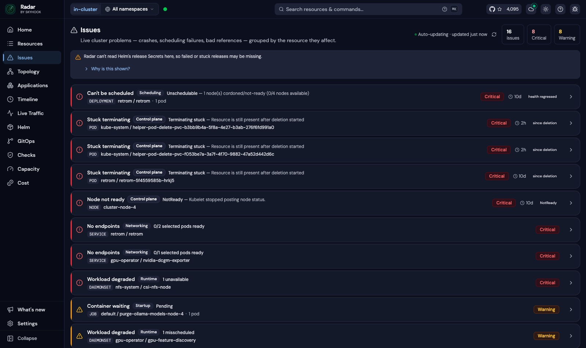
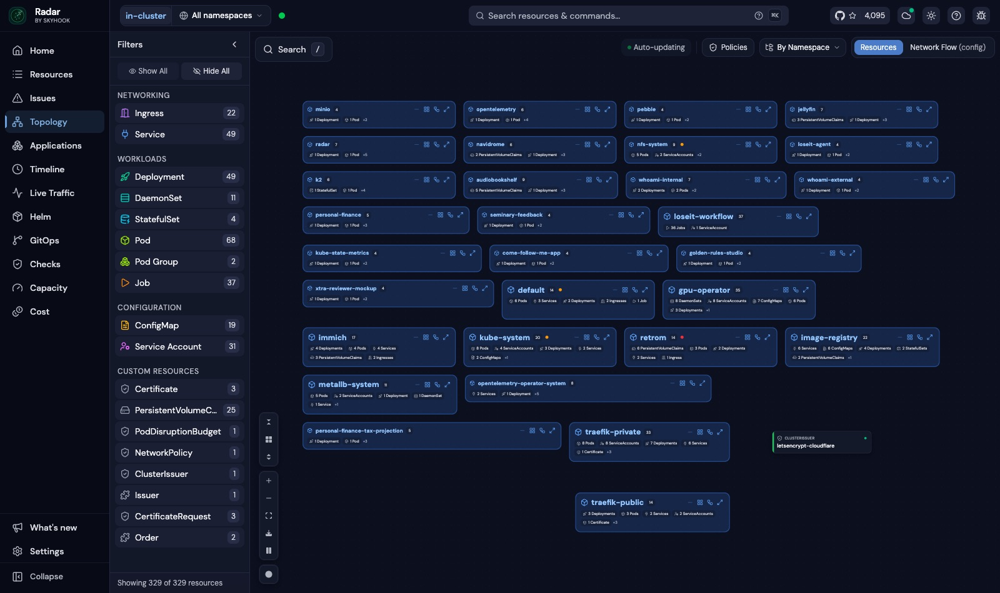
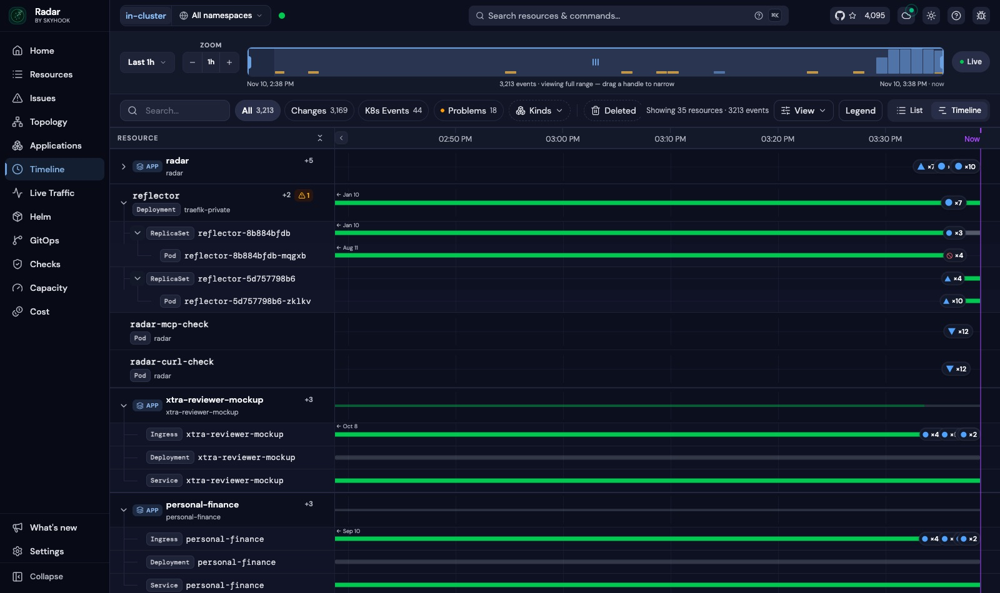
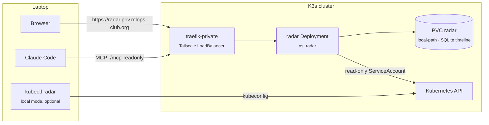

# How-To: Use Radar to Inspect and Diagnose the Cluster

**Purpose**: Install, access, and use Radar (Kubernetes UI + MCP server) to see cluster state and let Claude Code diagnose failures

**Scope**: The in-cluster Radar release managed by helmfile, the laptop-side `kubectl radar` CLI, and the Claude Code MCP connection

**Overview**: Radar is a single-binary Kubernetes UI from Skyhook (Apache-2.0) with an issues
    queue, topology graph, change timeline, Helm view, and log viewer, plus a built-in MCP
    server for AI agents. This cluster runs Radar in-cluster at
    `https://radar.priv.mlops-club.org` (Tailnet only) with a strictly read-only
    ServiceAccount and a SQLite timeline that persists across restarts. This guide covers
    how the release is configured and why, how to install the laptop client and connect
    Claude Code to the MCP server, how to upgrade, and how to troubleshoot.

**Dependencies**: helmfile, helm, helm-diff plugin, kubectl, Homebrew, Claude Code CLI, Tailscale

**Exports**: A running Radar UI and a read-only MCP endpoint for Claude Code

**Related**: `radar/values.yaml`, `helmfile.yaml.gotmpl` (release `radar`), `how-to-troubleshoot-kubernetes.md`

**Difficulty**: easy

---

## What it looks like

The **Issues** queue groups live problems (scheduling failures, stuck pods, NotReady nodes,
services with no endpoints) by the resource they affect:



The **Topology** view lays out every namespace and how its ingresses, services, and
workloads connect:



The **Timeline** records every change and event per resource. This is what answers "what
changed while I wasn't looking", and it survives pod restarts because it is stored in SQLite:



## Architecture



## How the in-cluster release is configured

The release lives in `helmfile.yaml.gotmpl` (OBSERVABILITY section, release `radar`,
chart `skyhook/radar`, pinned version) with values in `radar/values.yaml`.

| Setting | Value | Why |
|---|---|---|
| Hostname | `radar.priv.mlops-club.org` | Same private path as other `*.priv` services: `traefik-private` ingress class, reflector-replicated `priv-wildcard-tls`, external-dns record pointing at Traefik's Tailscale IP |
| `auth.mode` | `none` (chart default) | The Tailnet is the access boundary, as for `ollama.priv` |
| RBAC | chart default read-only; `secrets`, `helm`, `portForward`, `podExec` all `false` | Anyone on the Tailnet acts as Radar's ServiceAccount, so it can only get/list/watch |
| `disableExec` | `true` | Removes `pods/exec` from the ServiceAccount; no terminals, debug shells, or `exec_pod` MCP tool |
| `extraArgs: --mcp-read-only` | on | Only the `/mcp-readonly` endpoint is served; `/mcp` (write tools) returns 404 |
| `timeline.storage` | `sqlite` on a 2Gi `local-path` PVC, 7-day retention, 1500Mi cap | History survives restarts. `local-path`, not `nas-nfs`, because SQLite locking over NFS is unreliable |
| `usageReporting.enabled` | `false` | No telemetry leaves the homelab |

Consequences of the read-only posture:

- The UI's Helm view cannot read Helm release Secrets, so it shows "Helm's records are
  restricted" and lists releases from object labels only. Use `helm list -A` for release
  history.
- Restart, scale, rollback, and drain buttons fail with an RBAC error. Make changes with
  `kubectl`, `helm`, or `helmfile`, not through Radar.

## Steps

### Step 1 — Deploy or upgrade the release

```bash
source .env
helmfile --file helmfile.yaml.gotmpl -l name=radar diff
helmfile --file helmfile.yaml.gotmpl -l name=radar apply
```

`bootstrap.sh` also deploys it as part of the full `helmfile apply`.

To upgrade, bump `version:` on the `radar` release in `helmfile.yaml.gotmpl` (see
`helm search repo skyhook/radar --versions`), update the version in the README dependency
graph, then run the two commands above. Keep the laptop CLI on the same version
(`brew upgrade kubectl-radar`).

### Step 2 — Verify the deployment

```bash
kubectl -n radar get pods,pvc,ingress
kubectl -n radar get secret priv-wildcard-tls     # must exist for HTTPS
curl -s -o /dev/null -w "%{http_code}\n" https://radar.priv.mlops-club.org/api/health   # 200 (from a Tailnet device)
```

### Step 3 — Install the laptop client (macOS)

```bash
# Radar CLI. Installs both `kubectl-radar` (kubectl plugin) and the `radar` shorthand.
brew install kubectl-radar
radar --version

# Tools to manage the release from this repo
brew install helm helmfile
helm plugin install --verify=false https://github.com/databus23/helm-diff
```

`--verify=false` is needed with Helm 4 because the helm-diff plugin ships without
provenance signatures.

The desktop app (`brew install --cask skyhook-io/tap/radar-desktop`) is not needed; the
in-cluster UI covers the same ground.

### Step 4 — Connect Claude Code to the MCP server

Register the in-cluster read-only endpoint at user scope so it is available in every project:

```bash
claude mcp add --scope user --transport http radar https://radar.priv.mlops-club.org/mcp-readonly
claude mcp get radar     # Status: ✔ Connected (requires Tailscale to be up)
```

The endpoint exposes read tools only, including `issues`, `diagnose`, `get_changes`,
`get_events`, `get_pod_logs`, `get_workload_logs`, `get_topology`, `get_resource`,
`list_resources`, `get_helm_release`, `get_cluster_audit`, and `search`.

Example prompts:

- "Use radar to list critical issues in the cluster and diagnose the top one."
- "What changed in the `personal-finance` namespace in the last 24 hours?"
- "Why is the `retrom` deployment unschedulable?"

### Step 5 (optional) — Run Radar locally

When off the Tailnet, run Radar on the laptop against the kubeconfig:

```bash
kubectl radar            # opens http://localhost:9280
```

Local mode has its own MCP endpoint (`http://localhost:9280/mcp-readonly`) while it runs,
but its timeline only covers the time the local process has been running. The in-cluster
instance is the one with history. Alternatively, port-forward the in-cluster instance:

```bash
kubectl -n radar port-forward svc/radar 9280:9280   # then open http://localhost:9280
```

## Troubleshooting

| Symptom | Cause | Fix |
|---|---|---|
| Ingress serves Traefik's default cert / TLS error | `priv-wildcard-tls` was not reflected into the `radar` namespace (reflector missed the new namespace) | `kubectl -n traefik-private rollout restart deploy/reflector`, then check `kubectl -n radar get secret priv-wildcard-tls` |
| Browser and `claude mcp get radar` time out | The device cannot reach `traefik-private-traefik-private-2` on the Tailnet | `tailscale ping 100.95.181.95`; reconnect Tailscale. Use port-forward meanwhile |
| "Radar without authentication answers only ..." | Reached via a hostname not in `allowedHosts` | Use `radar.priv.mlops-club.org`, or add the hostname to `allowedHosts` in `radar/values.yaml` |
| `claude mcp` returns 404 on `/mcp` | `--mcp-read-only` disables the write endpoint | Use `/mcp-readonly` |
| Pod stuck Pending | `local-path` PVC is bound to a node that is down | `kubectl -n radar delete pvc radar` and the pod together, then re-apply; timeline history is lost |

## Uninstall

```bash
helm -n radar uninstall radar
kubectl delete namespace radar
```

Then remove the `radar` release and the `skyhook` repository from `helmfile.yaml.gotmpl`.
