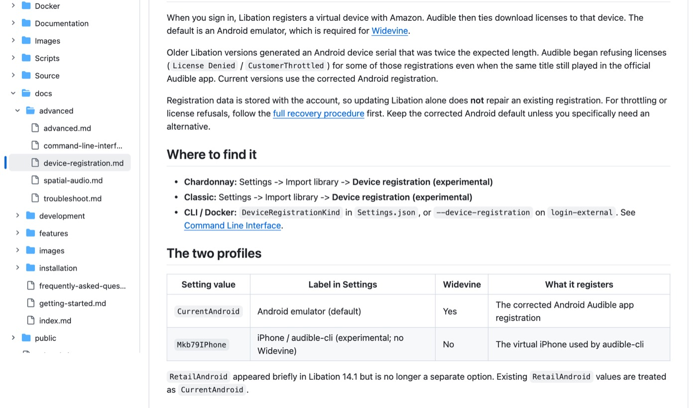
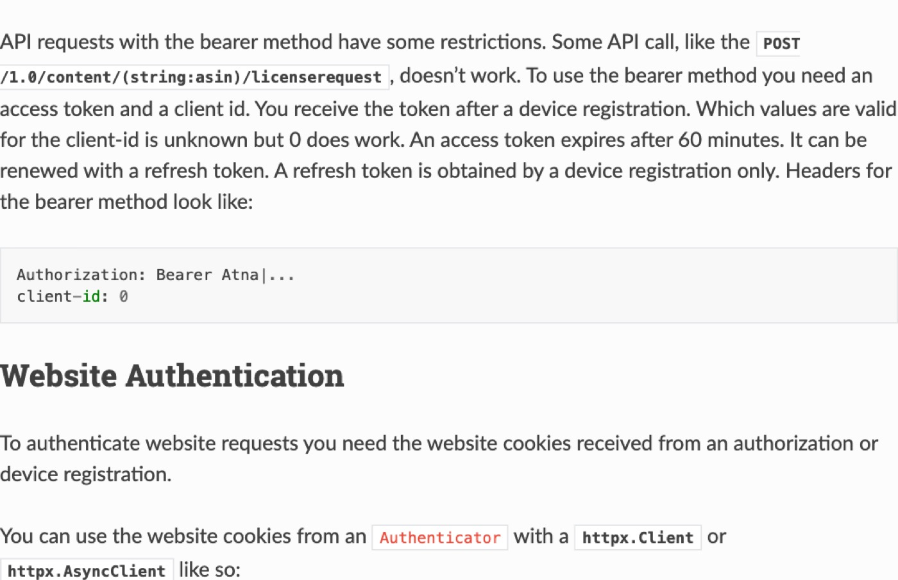
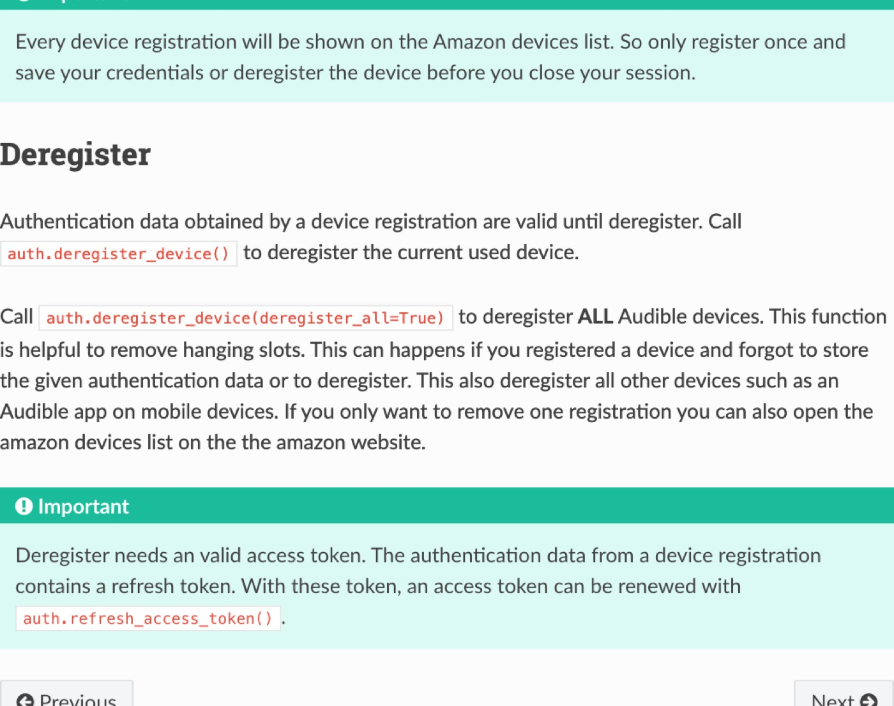
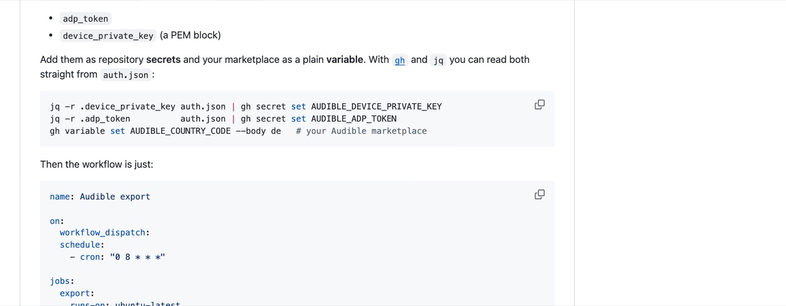
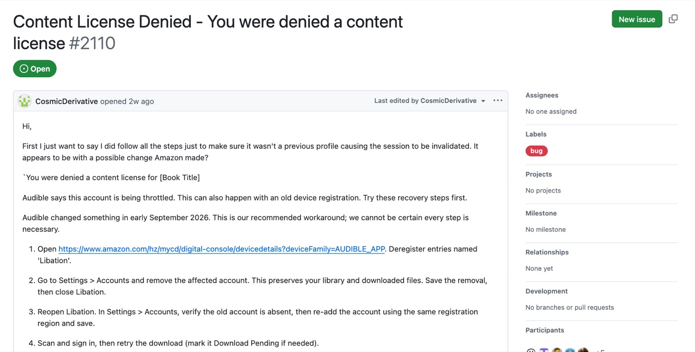
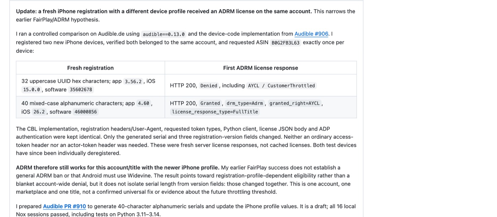
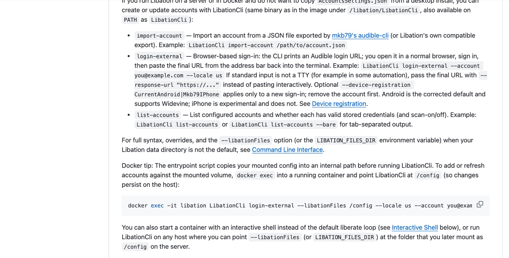
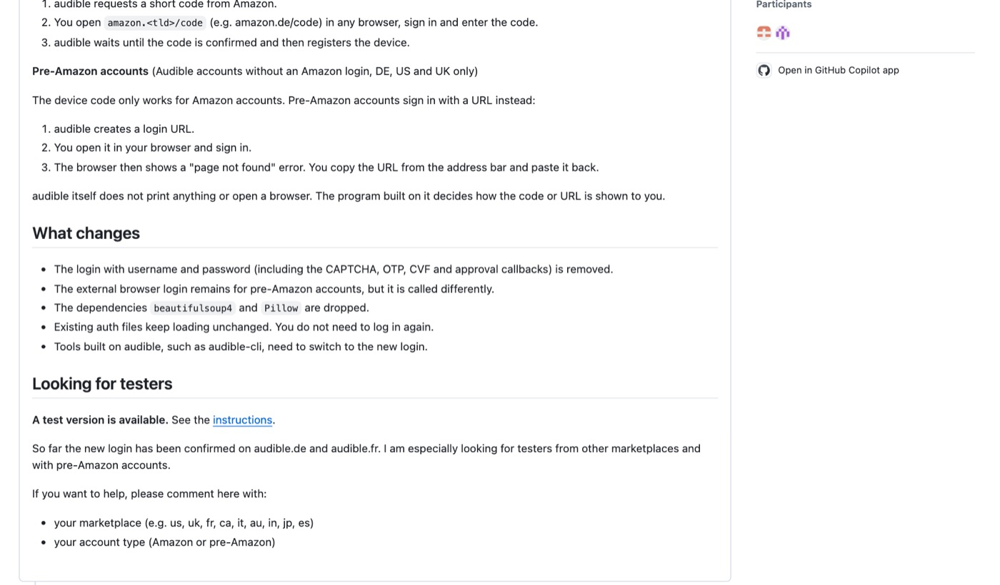
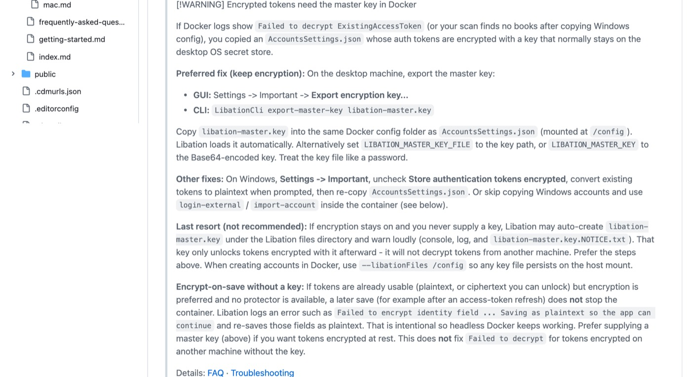
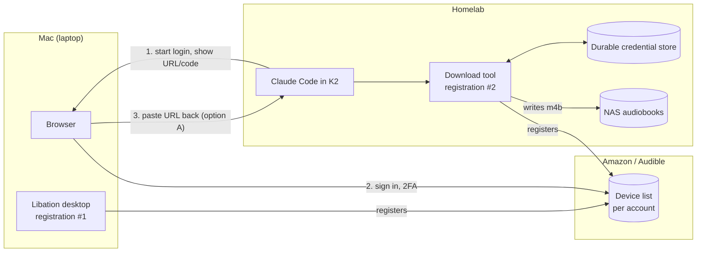

# Audible / Libation Agent: Research (QRSPI: R)

**Purpose**: Facts gathered to answer the questions in `01-questions.md`, with emphasis on Audible login and token lifespan

**Scope**: Audible auth model, Libation and audible-cli capabilities, the K2 pod's persistence and tooling, NAS write path and data safety, notification options

**Overview**: Each section states findings with evidence (command output, source file and line, or a
    screenshot of the doc). Findings are marked **VERIFIED** (observed or quoted from source) or
    **INFERRED** (reasoned, not observed). Design choices are not made here. Each section ends with
    "Implications for design" so the next step (Structure/Design) has a clear starting point.

**Related**: `01-questions.md` (questions and user answers), `.ai/howto/how-to-add-audiobooks-to-audiobookshelf.md`

---

## TL;DR

> **Spike results** (`03-spike-results.md`): an exported login file worked inside the unmodified K2 pod. Spike 1: audible-cli listed new books, downloaded and decrypted *The Big Con*, and the M4B landed on the NAS via a no-overwrite write. Spike 2: LibationCli (self-contained Linux build plus user-space ICU) ran in K2 with a **throwaway config built from one plain secret**, and produced the finished M4B in 14 s.

1. **Login lifespan is better than feared.** An Audible device registration gives two kinds of credentials. Access tokens last 60 minutes and auto-refresh. The registration's signing keys (`adp_token` + `device_private_key`) stay valid **until the device is deregistered**. Tools that sign requests (audible-cli does by default) never need a refresh. Realistic answer to "how often do I log in?": once per account, plus again only if the registration is deregistered or Audible starts refusing it.
2. **Two viable toolchains, both headless:**
   - **LibationCli** (ships inside the Mac app and the official Docker image). It can download one book by ASIN and mark books as already downloaded.
   - **audible-cli** (Python, runs with `uv`). It can list the library filtered by date added, download by ASIN, and decrypt with ffmpeg.
3. **Mac Libation tokens are not portable as-is.** They are encrypted with a macOS-bound master key (`"IsEncrypted": true`). Moving them needs `LibationCli export-master-key`, or a fresh login on the homelab.
4. **Biggest live risk is Audible refusing download licenses** (`CustomerThrottled` / `License Denied`), not tokens expiring. Audible changed something in September 2026. Fresh registrations on current profiles are what works.
5. **The K2 pod is a fragile home for credentials.** Everything lives on one node-local disk with no backup. Tokens must be kept somewhere that survives a lost disk.
6. **The NAS offers no safety net for mistakes.** Data safety has to come from the write path's design. See `PRIVATE-NOTES.md` (git-ignored) for specifics.
7. **K2's phone push is inactive** in this deployment. "Login expired" alerts can be a K2 feedback/inbox item (visible in the desktop client) or an outbound HTTP notifier.

---

## 1. Current state of the system

### 1.1 Libation on the Mac

```console
$ jq '.Accounts[] | {AccountName, LibraryScan}' AccountsSettings.json   # names only
"account-b@example.com - us"   LibraryScan: true
"account-a@example.com - us"   LibraryScan: true

$ jq '.Accounts[].IdentityTokens | keys'   # key names; values not printed
AdpToken, AmazonAccountId, Cookies, DeviceName, DeviceSerialNumber, DeviceType,
ExistingAccessToken, LocaleName, PrivateKey, RefreshToken, StoreAuthenticationCookie

$ jq '... | DeviceType, DeviceName, ExistingAccessToken.Expires'
A10KISP2GWF0E4  "<Account B>'s 11th Audible for Android"  2026-11-03T23:54:43Z
A10KISP2GWF0E4  "<Account A>'s Audible for Android"         2026-11-03T23:56:23Z

$ jq '.Accounts[0].IdentityTokens.RefreshToken'   # redacted
{"Value":"v1.m…len514","IsEncrypted":true}
```

- **VERIFIED**: Both accounts use Libation's default `CurrentAndroid` registration (device type `A10KISP2GWF0E4`, "Audible for Android").
- **VERIFIED**: Tokens are encrypted at rest (`IsEncrypted: true`).
- **VERIFIED**: Access tokens expire about 1 hour after the last refresh.
- **VERIFIED**: Amazon numbers device names. "Account B's **11th** Audible for Android" means her account has had at least 11 Audible-for-Android registrations over time (phones, tablets, earlier Libation logins). Registrations pile up. Section 2.5 covers why that matters.

Library contents (from a read-only copy of `LibationContext.db`):

```console
$ sqlite3 LibationContext.db "select Account, count(*), sum(BookStatus=1) ..."
account-a@example.com | 954 entries | 3 marked downloaded
account-b@example.com | 443 entries | 6 marked downloaded
```

### 1.2 What is on the NAS

```console
$ ssh eric@nas 'cd /volume1/k8s-homelab/media/audiobooks/Books; ...'
/dev/mapper/...-volume1   22T  1.3T   21T   6% /volume1      # plenty of space
637G   .                                                     # library size
940    folders total
887    folders whose name ends in [ASIN]                     # e.g. "11-22-63 [B005UR3VFO]"
       (the rest: non-Audible imports and system folders)

$ ls -ln | awk '{print $3":"$4" "$1}' | sort | uniq -c
    490 1000:10 drwx------      # readable only by uid 1000 (NAS user eric)
    374 1000:10 drwxrwxrwx
     71 1000:10 drwxr-xr-x
```

- **VERIFIED**: Libation's "downloaded" flag (9 books) does not reflect the NAS (887 ASIN folders). **The NAS folder names are the source of truth for "already on the homelab".** ASIN matching works for 94% of folders.
- **VERIFIED**: 21 TB free. Disk space is not a constraint.

### 1.3 How the NAS is exposed

```console
$ kubectl get pv audiobookshelf-audiobooks -o yaml   (trimmed)
  csi: { driver: nfs.csi.k8s.io, volumeAttributes: { server: <nas-ip>,
         share: /volume1/k8s-homelab/media/audiobooks } }
  mountOptions: [nfsvers=3, nolock]
  persistentVolumeReclaimPolicy: Retain
  accessModes: [ReadWriteMany]

$ kubectl exec -n audiobookshelf deploy/audiobookshelf -- id
uid=0(root) ...      # ABS runs as root, so it can read the drwx------ folders
```

- **VERIFIED**: NFSv3 static PV, RWX, `Retain`.
- **VERIFIED**: The NAS side offers no recovery net for an accidental delete over NFS. See `PRIVATE-NOTES.md` (git-ignored) for specifics.
- **INFERRED**: A second static PV pointing at the same NFS path can be bound into another namespace (the existing PV is already claimed by `audiobookshelf/audiobooks`).

### 1.4 The K2 pod

```console
$ kubectl get sts k2 -n k2   (trimmed)
image: cr.priv.mlops-club.org/k2/k2-agents:0.46.5-cc2.1.308-uv0.13.6
nodeAffinity: kubernetes.io/hostname In [cluster-node-2]       # pinned
securityContext: runAsUser 10000, runAsNonRoot, drop ALL caps
automountServiceAccountToken: false                             # no k8s API
volumeMounts: [ /var/lib/k2 <- data-k2-0 (local-path, 50Gi) ]  # the ONLY mount
annotations: kubectl.kubernetes.io/last-applied-configuration  # hand-applied; no manifest in any repo

$ kubectl exec -n k2 k2-0 -- du -sh ~/.*  (trimmed)
71M   .claude   (.credentials.json, settings.json, projects/, skills/, plugins/)
31M   .k2       (k2so.db, vault/{vault.db, key/kek}, llm-accounts/, skills/, hooks/)
235M  .local    (bin/{k2,...}, share/uv/{python,tools})
3.5G  .cache
696K  work      (workspaces: work/k2, work/golden-rules)

$ df /var/lib/k2
/dev/sda2  468G  59G used      # the node's root disk; the 50Gi "limit" is not enforced
```

Tools in the image: `claude`, `uv`/`uvx`, `k2-daemon`. **Not present**: `python3` (only uv-managed Python), `node`, `ffmpeg`, `dotnet`, `ssh`.

| Location | Survives pod restart / image upgrade? | Contents |
|----------|--------------------------------------|----------|
| `/var/lib/k2` (PVC) | Yes | Workspaces, `~/.claude`, K2 vault + its key, `uv tool install`s, uv Python |
| Image filesystem (`/usr/local/bin`, ...) | Replaced on upgrade | `claude`, `uv`, `k2-daemon`; cannot `apt install` (non-root) |
| `/tmp`, `/dev/shm` | No | Scratch, per-session secret files. A symlink `~/.local/bin/gd -> /tmp/...` already dangles after restarts |

| Failure | What happens to data on the PVC |
|---------|---------------------------------|
| Pod crash / restart | Kept. **VERIFIED** restarts=0 over 6d22h |
| StatefulSet deleted | Kept (`persistentVolumeClaimRetentionPolicy: Retain`) |
| PVC deleted | **Gone** (PV reclaim policy `Delete`) |
| cluster-node-2 offline | Pod stays Pending until the node returns (pinned twice: nodeAffinity + local PV). `cluster-node-4` is NotReady right now, so this is not hypothetical |
| cluster-node-2 disk dies | **Gone**, including the vault's key. No backups exist (no velero/restic/volsync; `storage/README.md:327` names this risk) |

**Answer to "what gets lost when K2 resets":** a pod restart or upgrade loses only `/tmp`, `/dev/shm` and anything in the image filesystem. Losing node-2's disk or the PVC loses **everything**: Claude login, K2 vault, any Audible tokens kept there.

---

## 2. Audible authentication (the deep dive)

### 2.1 What a "login" actually produces

Logging in with Libation or audible-cli **registers a virtual device** on the Amazon account, the same way a phone running the Audible app does. Audible then ties download licenses to that device.


*Source: [Libation docs: device registration](https://github.com/rmcrackan/Libation/blob/master/docs/advanced/device-registration.md)*

A registration yields:

| Credential | Lifespan | Used for |
|-----------|----------|----------|
| `access_token` | **60 minutes** | "Bearer" API requests |
| `refresh_token` | Until deregistered (**INFERRED**: also killed by password change; no official source) | Getting a new access token |
| `adp_token` + `device_private_key` | **Until the device is deregistered** | "Signed" API requests, including license requests to download |
| `cookies` | Variable | Website requests (not needed here) |
| `activation_bytes` | Permanent per account | Decrypting legacy AAX files |


*Source: [audible docs: authentication](https://audible.readthedocs.io/en/latest/auth/authentication.html)*


*Source: [audible docs: register](https://audible.readthedocs.io/en/latest/auth/register.html). Note the warning above "Deregister": every registration shows on the Amazon devices list, so register once and keep the credentials.*

### 2.2 Token lifespan: what forces a re-login

**VERIFIED** by the audible-cli README: signed requests need only `adp_token` and `device_private_key`. Neither expires on a timer.


*Source: [audible-cli README: Continuous integration](https://github.com/mkb79/audible-cli#-continuous-integration-github-actions). The README shows a scheduled GitHub Action running indefinitely on just these two values.*

Events that **do** force a new login:

1. **The device is deregistered.**
   - Manually, from Amazon's "Content & Devices" page.
   - By a tool calling `deregister_device(deregister_all=True)`, which removes **every** device on the account, including phones.
   - By Libation's own recovery path: when a token refresh fails, `IdentityMaintainer.cs:71-98` calls `DeregisterAsync(); RegisterAsync()`. The re-register needs interactive login data, so in a headless setting this path most likely ends with no working credentials (**INFERRED**).
2. **Audible starts refusing the registration** (section 2.3).
3. **Password change** (**INFERRED**, no source found).
4. **Losing the file** that holds the credentials (section 1.4: the K2 PVC has no backup).

Events that do **not** force a re-login: time passing, pod restarts (if the file is persisted), the access token's 60-minute expiry (refreshed automatically by both tools).

**VERIFIED** (Libation issue #1284): a LibationCli install whose stored access token went stale stopped finding new books. Copying a fresh `AccountsSettings.json` from the desktop fixed it. The maintainer said refresh "is supposed to happen automatically." Takeaway: **give each machine its own registration** rather than sharing one file across machines, which leads to drift.

### 2.3 License refusals: what is known (September 2026 onward)

**The mechanism.** Listing the library and downloading a book are different API calls. A download first calls `POST 1.0/content/{asin}/licenserequest`, which returns the decryption key. Since September 2026, Audible has sometimes answered that call with HTTP 200 and `"status_code": "Denied"`, including `AYCL / CustomerThrottled`. Listing keeps working, so the failure only shows up at download time (mkb79/Audible#909).


*Source: [Libation issue #2110](https://github.com/rmcrackan/Libation/issues/2110) (open)*

**What the device registration has to do with it (VERIFIED).** mkb79 registered two fresh iPhone devices on the same account and requested the same title once from each. Only the serial and three version fields differed:


*Source: [mkb79/Audible#909](https://github.com/mkb79/Audible/issues/909), 2026-10-23*

The fix was released as audible **0.13.1** (2026-10-23, "Register new iPhone devices with the Audible 4.60 profile", #910). **Existing auth files keep their old registration.** Upgrading the library does not repair a registration made earlier; only a new login does.

**The registration profiles in play** (from source):

| Client | Profile it registers as | Values | Reported result |
|--------|------------------------|--------|-----------------|
| Libation 14.2.x default (`CurrentAndroid`) | Android Audible app, device type `A10KISP2GWF0E4` | app `26.34.07`, Android 14 emulator (`AudibleApi/Resources.cs:13-23`) | Working for most #2110 reporters after re-registering. **Granted on 2026-11-03 in our spike** (ADRM via audible-cli, `03-spike-results.md`) |
| Libation `Mkb79IPhone` ("iOS, experimental") | iPhone, device type `A2CZJZGLK2JJVM` | app `3.56.2`, iOS `15.0.0` (`DeviceRegistrationProfile.cs:118-147`) | **Denied** pattern; #2110 reporters fixed it by switching to Android |
| audible / audible-cli **< 0.13.1** | iPhone, 32-char serial | app `3.56.2`, iOS `15.0.0` | **Denied** in mkb79's controlled test |
| audible **≥ 0.13.1** | iPhone, 40-char serial (`login.py:246`) | app `4.60`, iOS `26.2`, software `46000856` (`_device.py:3-5`) | **Granted** in mkb79's controlled test (one account, one title) |
| Old Libation Android registrations | Android, serial twice the expected length | n/a | Denied; Libation docs say to re-register (`device-registration.md`) |

**The throttle itself also responds to behavior (reported, not proven):**
- #909's reporter notes they "made many license requests, logins and device registrations" over two days before the denials, and suspects that caused it.
- Libation maintainers in #2110 advise waiting 24 to 48 hours **without retrying**, because "every time it says it's throttling you it adds to your time." Running a scheduled liberate loop made it worse for one reporter.
- Several reporters downloaded one book at a time (not "Liberate all") and got through.
- One reporter's official phone app also queued downloads for hours during the throttle, which suggests account-level state, not only the device.

**Which clients can download (and with which DRM):**

| Client | DRM it requests | Output | Notes |
|--------|-----------------|--------|-------|
| Official Audible app, iPhone | FairPlay | In-app only | mkb79 got FairPlay **Granted** on an iPhone registration that was Denied for ADRM |
| Official Audible app, Android | Widevine / ADRM | In-app only | The profile Libation's `CurrentAndroid` imitates |
| Libation, Android profile | ADRM, or **Widevine** when enabled in Audio File Settings | Decrypted `.m4b` | #2110 maintainer: Widevine is "the best setting… audio quality is better… login seems a bit more stable" |
| Libation, iPhone profile | ADRM | Decrypted `.m4b` | No Widevine (device-registration docs table) |
| audible-cli | ADRM (AAXC) or Mpeg (legacy AAX) | Encrypted `.aaxc` + voucher, then ffmpeg | No Widevine path |

**Concrete mitigations:**
1. **Register with a current profile only**: Libation 14.2.x `CurrentAndroid`, or audible ≥ 0.13.1. Never Libation's iPhone option or audible < 0.13.1.
2. **Register once per account and keep it.** Every new registration is visible to Amazon and shows up as "<name>'s Nth Audible for Android". Do not create test registrations casually.
3. **One license request per chosen book, no automatic retries.** On `Denied`, stop, report the denial reasons to the user, and do not try again for 24 to 48 hours.
4. **Smoke-test right after registering**: download one book you know is owned (not a Plus-catalog title) before relying on the registration.
5. **Prune stale registrations** named "Libation" from Amazon's Content & Devices page, which is the first step in #2110's recovery procedure. This is a manual, user-only action.
6. **Keep a fallback**: the Mac's Libation registration currently works (Granted 2026-11-03). If the homelab registration is throttled, the Mac can still download.
7. **Consider Widevine via Libation** as a second DRM path if ADRM gets refused, since Widevine is only available on the Android profile.

**Still unknown:** the exact throttle threshold, whether it is per device or per account (evidence points both ways), and whether Plus-catalog titles behave differently from purchased ones (the #909 reporter's library was all catalog titles).

### 2.4 How a login can happen without a GUI

There are three login mechanisms. None of them needs the Libation desktop app.

**(a) External-browser URL paste.** Supported by both tools today.

```console
# LibationCli
LibationCli login-external --account you@example.com --locale us [--response-url "https://..."]
# audible-cli
audible manage auth-file add -f account-a.json -cc us --external-login
```

The tool prints an Amazon login URL. You open it in any browser and sign in; Amazon handles password, 2FA, CAPTCHA and approval itself. The browser lands on a "page not found" URL containing an authorization code, and you paste that URL back into the tool.


*Source: [Libation docs: Docker](https://github.com/rmcrackan/Libation/blob/master/docs/installation/docker.md). `list-accounts` also reports "whether stored credentials are valid", which is useful as a health check.*

Through K2: the agent runs the command and shows you the URL. You open it on the laptop, then paste the resulting URL back into the chat. That URL contains a one-time authorization code that the agent (and K2's session log) sees.

**(b) Device-code login.** Not released; in testing.


*Source: [mkb79/Audible#906](https://github.com/mkb79/Audible/issues/906) (open)*

The tool shows a short code, and you enter it at `amazon.com/code` on any device. No URL or password passes through the agent. **Caveats (VERIFIED from the screenshot):**
- It is a test plugin, confirmed only on audible.de and audible.fr. **US is untested.**
- It does not work for pre-Amazon Audible accounts.
- The final version **removes** username/password login entirely.

**(c) Log in on the Mac, copy the result to the cluster.**
- **audible-cli**: run `audible manage auth-file add --external-login` on the Mac, then copy `account-a.json` (or just `adp_token` + `device_private_key`) into a Kubernetes Secret.
- **Libation**: either `LibationCli export-master-key` plus `AccountsSettings.json`, or run `LibationCli --libationFiles <dir> login-external` on the Mac to create a separate config dir and copy that dir.
- **Libation GUI**: it has an "Export to audible-cli" button that turns an existing Libation account into an audible-cli JSON. That reuses the Mac's registration (shared credentials, see 2.2).


*Source: [Libation docs: Docker](https://github.com/rmcrackan/Libation/blob/master/docs/installation/docker.md). This is why copying today's `AccountsSettings.json` to the cluster would fail with `Failed to decrypt ExistingAccessToken`.*

### 2.5 Options for where logins happen



| Option | How it works | Pros | Cons |
|--------|--------------|------|------|
| **A. Log in from the homelab, URL paste** | Agent runs `login-external` / `--external-login`, you open the URL on the Mac and paste the result into K2 | Works today with both tools. No file shuffling. Homelab gets its own registration by construction. The Mac's Libation keeps working untouched | The one-time auth code passes through the agent and K2's session log. Clunky copy-paste. The credentials land in whatever store the tool writes to, which must be made durable (see section 3) |
| **B. Log in on the Mac, copy a file** | Run the tool's login on the Mac into a separate file/dir, then put it into a Kubernetes Secret | Real browser, nothing passes through the agent. Credentials live in a k8s Secret: easy to back up, outlives the K2 disk | Manual step per account (twice total). Needs care not to commit or leak the file. Libation variant also needs the master key |
| **C. Device code** (future) | Agent shows a code; you enter it at amazon.com/code | Cleanest UX; nothing secret passes through the agent | Unreleased test plugin; US untested; extra fragility |
| **D. Reuse the Mac's existing Libation registration** | Export from the GUI (audible-cli JSON) or export master key + copy | No new device on the account | Two machines share one registration, so tokens drift (#1284). If either side triggers Libation's deregister-on-failure path, both break. Old registrations are the ones Audible is throttling |

How often each option needs the Mac (**INFERRED** from 2.2): once per account at setup, and again only after a deregistration or an Audible refusal. That is not "every N days." With A and C the Mac is just "a browser" and any phone works too.

### 2.6 Implications for design

- Give the homelab **its own registration per account** (Account A, Account B). Do not share the Mac's.
- Store the registration's credentials somewhere that **outlives the K2 disk**, and arrange for any refreshed access token to be written back or simply re-derived.
- Pick a tool whose normal operation never deregisters a device. Treat "deregister" as a **never without asking** action, next to delete and overwrite.
- Build a cheap "are credentials valid?" check (`LibationCli list-accounts`, or an `audible library list` call) the agent runs at the start of each conversation.

---

## 3. Toolchain: LibationCli vs audible-cli

### 3.1 LibationCli (already on the Mac, inside `Libation.app`)

```console
$ /Applications/Libation.app/Contents/MacOS/LibationCli help
LibationCli v14.2.2
  export-master-key    Export Libation's OS-bound encryption master key to a file for portable use
                       (e.g. Docker). The file unlocks encrypted AccountsSettings.json.
  export               Must include path and flag for export file type: --xlsx , --csv , --json
  import-account       Import an Audible account from an mkb79/audible-cli JSON export file.
  liberate             Liberate: book and pdf backups. Default: download and decrypt all
                       un-liberated titles and download pdfs.
                       Optional: specify product id(s) via --id or positional ASIN(s) to
                       liberate those book(s), including re-download if already liberated.
                       Optional: stop this run early with --limit-books, --limit-mb or --limit-gb.
  list-accounts        List configured Audible accounts: locale, ... and whether stored
                       credentials are valid.
  login-external       Sign in with Audible using an external browser: open the printed URL,
                       then paste the final URL from the address bar.
  scan                 Scan library. Default: scan all accounts.
  set-status           Set download statuses throughout library ...
  (also: convert, copydb, search, get-license, get-setting, upload, version)

$ LibationCli liberate --help
  -i, --id            Product ID (ASIN) of a book to process. Repeatable. Same as positional [asins].
  -f, --force         Force the book to re-download
  --limit-books       Stop this run after downloading this many books.
  --libationFiles     Path to Libation Files directory

$ LibationCli set-status --help
  -d, --downloaded          if the audio file can be found, mark the book 'Downloaded'
  -p, --download-pending    if the audio file cannot be found, mark the book 'Download Pending'
  -f, --force               Set the download status regardless of whether the file can be found.
```

- **VERIFIED**: `liberate <ASIN>` downloads and decrypts **only that book**. A bare `liberate` downloads **every** un-liberated title, which would be about 1,388 books. The design must make the bare form impossible to run by accident.
- **VERIFIED**: `set-status -d` finds existing files by the regex `{ASIN}.*?\.(ext)$` (`AudibleFileStorage.cs:129,150-153`). `set-status -d -f <asins>` marks them without a file check. This can sync Libation's DB with the 887 ASINs on the NAS.
- **VERIFIED**: `export --json` includes `DateAdded` and `BookStatus` (`ExportDto.cs:14,95`).
- **VERIFIED**: The official Docker image (`rmcrackan/libation`, amd64+arm64, runs as UID 1001) runs `scan` then a full `liberate` and exits. With `SLEEP_TIME`, it loops. Passing a command overrides the loop. It is documented as "provided as-is… not officially supported."
- **VERIFIED gotcha**: the Docker entrypoint copies `/config/AccountsSettings.json` to an internal path on every start (`liberate.sh:27-38`). Refreshed tokens are lost on restart unless `--libationFiles /config` points at the persistent mount.
- **VERIFIED**: There is no `remove-account` command in LibationCli.
- Runtime: .NET, self-contained in the image. **Not runnable in the current K2 image** (no dotnet) unless bundled as a self-contained binary.

### 3.2 audible-cli (Python, runs under `uv`)

```console
$ uvx --from audible-cli==0.6.0 audible manage auth-file add --help
  Register a new device and add an auth file to config dir.
  -f, --auth-file PATH            The auth file name (without dir) to be added.
  -p, --password TEXT             The optional password for the auth file.
  -cc, --country-code [de|us|uk|fr|ca|it|au|in|jp|es|br]
  --external-login                Authenticate using a web browser.

$ uvx --from audible-cli==0.6.0 audible library export --help
  -f, --format [tsv|csv|json]     Output format  [default: tsv]
  --start-date [...]              Only considers books added to library on or after this UTC date.
  --end-date [...]                Only considers books added to library on or before this UTC date.

$ uvx --from audible-cli==0.6.0 audible download --help   (trimmed)
  -a, --asin TEXT                 asin of the audiobook
  --all                           download all library items, overrides --asin
  --aaxc                          Download book in aaxc format incl. voucher
  --pdf / --cover / --chapter     extras
  -o, --output-dir PATH
  -y, --no-confirm                start without confirm
```

- **VERIFIED**: `library export --start-date` answers "what was added since my last conversation" directly, per account (`-P <profile>`). Fields include `asin`, `title`, `date_added`, `purchase_date`.
- **VERIFIED**: `download -a <ASIN> --aaxc` writes an encrypted `.aaxc` plus a `.voucher` holding `key`/`iv`. Converting to `.m4b` needs the `cmd_decrypt` plugin (described as a "proof-of-concept") or a direct `ffmpeg -audible_key K -audible_iv IV -i x.aaxc -c copy x.m4b`. It needs **ffmpeg ≥ 4.4**, which the K2 image lacks.
- **VERIFIED**: `--all` exists, and like a bare `liberate` the design must block it.
- **VERIFIED**: Signed requests by default, so no refresh is needed (section 2.2). The auth file is written only at login and when fetching activation bytes, so it is effectively read-only during normal use. That makes it a good fit for a read-only Kubernetes Secret mount.
- **VERIFIED**: `uv tool install audible-cli` persists on the K2 PVC (`uv tool dir --bin` = `/var/lib/k2/.local/bin`, which is on PATH).

### 3.3 Side by side

| Need | LibationCli | audible-cli |
|------|-------------|-------------|
| List library, "new since date" | `scan` + `export --json`, filter `DateAdded` | `library export -f json --start-date` |
| Download one ASIN | `liberate <ASIN>` (download + decrypt + name folder in one step) | `download -a <ASIN> --aaxc` + decrypt step (ffmpeg) |
| Output folder layout | `Title [ASIN]/Title [ASIN].m4b`, already matches the NAS | Must be built (rename/move) to match `Title [ASIN]/` |
| Headless login | `login-external` | `--external-login`; device-code soon |
| Credential file during use | Rewritten on refresh (needs writable, durable storage) | Effectively read-only (fits a k8s Secret) |
| Deregisters on its own? | Yes, on refresh failure (`IdentityMaintainer.cs:71-98`) | Only when asked (`manage auth-file remove`) |
| Runtime on homelab | .NET; official image or self-contained build | Python via `uv`, plus ffmpeg |
| "Already on NAS" awareness | Its own DB; can be synced with `set-status` | None; the agent compares ASINs against the NAS folder names |
| Maturity / support | Mature app; Docker "as-is" | Mature CLI; decrypt plugin is a proof-of-concept |

**Implication**: a hybrid is possible, with audible-cli listing and LibationCli downloading. LibationCli's `import-account` takes an audible-cli JSON, so **one registration can serve both tools** (**INFERRED**: only if both run in the same place and share the file).

---

## 4. Giving Claude Code in K2 what it needs

**VERIFIED** (from the K2 repo and the live pod):

- **Context and skills**: `k2 agent context` composes an always-on `AGENTS.md` per workspace. Skills live in `~/.k2/skills/` or `<workspace>/.k2/skills/`. MCP servers are standard Claude Code config (**INFERRED**: K2 does not manage `.mcp.json` itself).
- **Secrets**: the **K2 Vault** delivers secrets per workspace as env vars, files, an API call, or a proxied `fetch`. `k2 thread secret` collects a value from the human without the agent seeing it. The vault lives on the same unbacked PVC, so it shares the K2 disk's fate.
- **Permissions**: secrets reachable by one K2 session should be assumed reachable by others. "Never delete without asking" has to be enforced by **what the agent can physically do**, not only by instructions. See `PRIVATE-NOTES.md` (git-ignored) for specifics.
- **Network** (egress is open):
  ```console
  (from k2-0)  audiobookshelf svc: 200 | NAS <nas-ip>: 2049 open, 22 open, 445 open | audible.com: 200
  ```
  The pod can reach Audible, Audiobookshelf's API, and the NAS. Being non-root with no capabilities, it cannot NFS-mount the NAS itself. The NAS must arrive as a Kubernetes volume, or the agent goes through some other service.
- **k2 CLI quirk**: under `kubectl exec`, Kubernetes injects `K2_PORT=tcp://10.43.231.91:7420` (because the Service is named `k2`), which breaks the CLI. Sessions inside K2 set `K2_PORT=7420`. Fix with `enableServiceLinks: false`. Some subcommands also call `python3`, which is not in the image.
- **Deploy source**: the StatefulSet was applied by hand. Its manifest and the `k2-agents` Dockerfile are not in any repo found. Any change (a NAS volume, a sidecar, a Secret mount) means first capturing the live manifest into `apps/k2/`.

### 4.1 Implications for design

Concerns to address, regardless of shape:

| Concern | Current gap |
|---------|-------------|
| Download runtime (dotnet or ffmpeg) | Neither in the K2 image; can't `apt install` as non-root |
| Durable Audible credentials | K2 PVC is one unbacked node-local disk |
| NAS write access | K2 has no NAS mount |
| Safety against deletes | Must come from the write path itself (see private notes) |
| Reproducibility | K2 manifest and image build are not in git |

---

## 5. Writing to the NAS safely

Facts that bound the design (all **VERIFIED** above):

- NFS deletes are permanent; there is no NAS-side undo. See `PRIVATE-NOTES.md` (git-ignored) for specifics.
- K2 runs as UID 10000. `Books/` is `drwxrwxrwx` with no sticky bit, so UID 10000 **can create** new folders there. Removing a non-empty folder means first deleting its contents, which needs write permission on that folder. So a non-root UID 10000 **cannot** delete the 490 `drwx------` folders, but **can** delete the contents of the 374 `drwxrwxrwx` ones (**INFERRED** from POSIX semantics, not tested).
- Audiobookshelf runs as root, so it can read files written by any UID.
- Files written with `nfsvers=3` under a non-root UID keep that UID on the NAS.

Mechanisms that can make "download directly into the library" safe (**INFERRED**, to evaluate in Design):

- **Write-only-new semantics**: write to a temp name in `Books/` (e.g. `.incoming-<ASIN>/`), then `rename` to `Title [ASIN]/` only if the target does not exist (`mv -n`, or `rename(2)` with `RENAME_NOREPLACE`). Same filesystem, so the rename is atomic and Audiobookshelf never sees half-written files.
- **Least privilege**: mount the library read-only for the part that lists, and give write access only to the component that downloads.
- **Non-root writer**: run the writer as a UID that does not own existing folders, so it physically cannot remove the 490 private folders.
- **A safety net**: NAS snapshots (UGOS supports Btrfs snapshots on some models; **unverified for this NAS**), or a periodic listing of `Books/` saved for comparison.

---

## 6. Telling you a login has expired

| Option | Where you see it | Status |
|--------|------------------|--------|
| Agent says so at conversation start (credential check) | K2 desktop chat | Works today; fits the user-driven model |
| `k2 feedback ask` / `k2 inbox compose` | K2 desktop inbox (durable "needs human" item) | Available in K2 0.46.5 |
| `k2 heartbeat schedule add --daily ...` | Scheduled agent wake-up that runs the check and files an inbox item | Available; none configured |
| K2 phone push (APNs/FCM) | K2 companion app | **Inactive**: needs K2 Connect relay; this deployment sets `K2_TUNNEL_LEASE=off`, `K2_RELAY_LIST_URL=…/disabled` |
| K2 `Webhook` / `NtfySh` push targets | n/a | Exist in code (`k2-core/src/push/mod.rs:711,750`) but not wired up (**INFERRED**) |
| Outbound `curl` to ntfy.sh or similar | Phone notification | Works from the pod (egress open); no notification service runs in the cluster |
| Kubernetes CronJob outside K2 | Any of the above | Independent of K2 being up |

Since the login lifespan is "until deregistered" (section 2.2), expiry should be rare. The likelier failure is an Audible license refusal at download time, which the agent sees and reports in the moment.

---

## 7. "New since my last conversation"

- **audible-cli**: `library export --start-date <last-check>` per account. **VERIFIED**.
- **Libation**: `scan`, then `export --json` and filter `DateAdded > last-check`. **VERIFIED**.
- The "last check" timestamp has to be stored somewhere durable: a small state file on the NAS, the K2 workspace, or a ConfigMap. Losing it only means a wider review window, not data loss.
- Each "new" book should be flagged as already on the NAS (ASIN match against folder names), so you see e.g. "4 new, 1 already on the NAS."
- Some ASINs may be on both accounts. Account A ∩ Account B is **0 today**, but this needs a dedupe rule.

---

## 8. Still unknown

| Unknown | Why it matters | How to find out |
|---------|----------------|-----------------|
| Does a fresh US registration on audible 0.13.x / Libation 14.2.x get licenses granted? | Throttling is the top live risk | First real login + download of one book |
| Does password change invalidate a registration? | Lifespan expectation | Upstream question, or observe |
| Can the NAS provide an undo for mistakes? | Safety net for the write path | UGOS UI / `btrfs subvolume list` on the NAS |
| Where is the `k2-agents` image built? | Changing the image (ffmpeg/dotnet) | Ask the user, or search other machines/registries (`cr.priv.mlops-club.org/k2`) |
| Does Audiobookshelf pick up atomically renamed folders reliably? | Safe-write design | Test with one book |
| Does audible-cli's device-code login work on US accounts? | Best login UX | Wait for mkb79/Audible#906 or test the gist plugin |

---

## Sources

- Libation repo (v14.2.5 master, v14.2.2 tag): [docs/installation/docker.md](https://github.com/rmcrackan/Libation/blob/master/docs/installation/docker.md), [docs/advanced/device-registration.md](https://github.com/rmcrackan/Libation/blob/master/docs/advanced/device-registration.md), [docs/advanced/command-line-interface.md](https://github.com/rmcrackan/Libation/blob/master/docs/advanced/command-line-interface.md), `Docker/liberate.sh`, `Source/LibationCli/Options/*.cs`, `Source/AudibleUtilities/Mkb79Auth.cs`
- Libation issues: [#1284](https://github.com/rmcrackan/Libation/issues/1284) (stale CLI token), [#2110](https://github.com/rmcrackan/Libation/issues/2110), #2081, #2121 (license denied)
- audible (mkb79): [authentication](https://audible.readthedocs.io/en/latest/auth/authentication.html), [register](https://audible.readthedocs.io/en/latest/auth/register.html), [#906 device-code login](https://github.com/mkb79/Audible/issues/906), #909 (profile vs license)
- audible-cli: [README](https://github.com/mkb79/audible-cli), [#317](https://github.com/mkb79/audible-cli/issues/317), `plugin_cmds/cmd_decrypt.py`
- K2 repo (`~/repos/K2`): `crates/k2-daemon/src/vault_routes.rs`, `crates/k2-core/src/push/mod.rs`, `crates/k2-daemon/src/lib.rs`, `cli/k2`
- Live system: `kubectl` against the `k2` and `audiobookshelf` namespaces; `ssh eric@nas`; local `~/Library/Application Support/Libation/` (key names and non-secret fields only)
