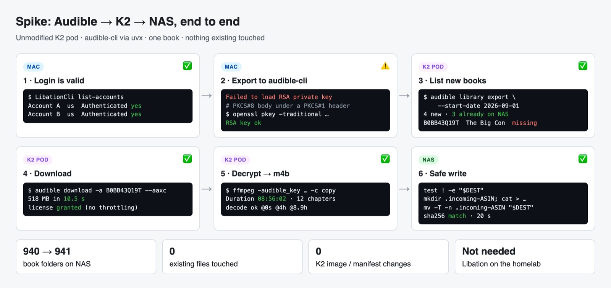
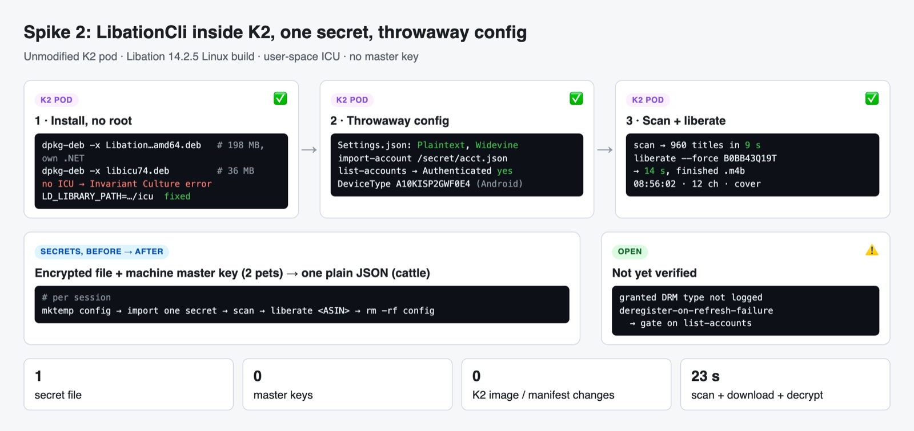

# Audible / Libation Agent: Spike Results

**Purpose**: Record an end-to-end experiment proving that Claude Code in K2 can list an Audible library, download a chosen book, decrypt it, and land it on the NAS for Audiobookshelf

**Scope**: One account (Account A), one book (The Big Con, `B0BB43Q19T`), the current unmodified K2 deployment, audible-cli as the toolchain

**Overview**: Following `02-research.md`, a working Libation login was exported to audible-cli format,
    repaired, copied into the K2 pod, and used to list the library and download one book. The
    book was decrypted in K2, streamed to a new NAS folder with no-overwrite semantics, verified
    by checksum, and confirmed visible to Audiobookshelf. All temporary files and the credential
    copy were then removed from K2. This document records the exact steps, outputs, gotchas,
    and what the spike does and does not prove.

**Related**: `01-questions.md`, `02-research.md`

---

## Result



| Step | Where | Result |
|------|-------|--------|
| Validate existing logins | Mac, `LibationCli list-accounts` | Both accounts `Authenticated: yes` |
| Export login to audible-cli | Mac, Libation GUI → Accounts → Export to audible-cli | JSON file produced |
| List library with that file | Mac, audible-cli | **Failed** until the private key format was fixed (see Gotcha 1) |
| List library from K2 | K2 pod, audible-cli via `uvx` | **Works**: 4 books added since 2026-09-01 |
| Diff against NAS | ASIN vs NAS folder names | 3 of 4 already on NAS; `B0BB43Q19T` missing |
| Download one book | K2 pod, `audible download --aaxc` | **Works**: 518 MB in ~10 s, license granted (no throttling) |
| Decrypt to M4B | K2 pod, static ffmpeg (via `imageio-ffmpeg`) | **Works**: 8h56m, 12 chapters, metadata intact, decodes cleanly |
| Write to NAS | K2 → Mac → `ssh eric@nas` | **Works**: 20 s, sha256 identical, no-overwrite move |
| Audiobookshelf visibility | ABS pod `ls` | File visible; NAS folder count 940 → 941 |
| Cleanup | K2 pod | `~/audible-staging` and `~/.audible` removed |

The spike used the **unmodified** K2 deployment. No manifests changed.

---

## Steps and output

### 1. Existing logins are valid

```console
$ /Applications/Libation.app/Contents/MacOS/LibationCli list-accounts
╭────────────────────────┬─────────────────────────────┬────────┬──────────────┬───────────────╮
│ Account ID             │ Name                        │ Locale │ Scan library │ Authenticated │
├────────────────────────┼─────────────────────────────┼────────┼──────────────┼───────────────┤
│ account-b@example.com │ account-b@example.com - us │ us     │ yes          │ yes           │
│ account-a@example.com │ account-a@example.com - us │ us     │ yes          │ yes           │
╰────────────────────────┴─────────────────────────────┴────────┴──────────────┴───────────────╯
```

Takes about 10 s. Usable as a credential health check.

### 2. Exported file shape

Libation GUI → Settings → Accounts → **Export to audible-cli**, saved as `<email>.json`.

```console
$ jq -r 'keys|join(", ")' account-a.json
access_token, activation_bytes, adp_token, customer_info, device_info, device_private_key,
expires, locale_code, refresh_token, store_authentication_cookie, website_cookies, with_username
```

This file **reuses the Mac's existing registration** ("<Account A>'s Audible for Android"). It is option D from `02-research.md` §2.5. That is fine for a spike, but the target design gives the homelab its own registration.

### 3. Gotcha 1: Libation's Android private key is mislabeled

```console
$ audible library export ...        # audible 0.13.1, legacy provider
TypeError: int() argument must be a string, a bytes-like object or a real number, not 'Sequence'

$ audible library export ...        # with `cryptography` installed
ValueError: Could not deserialize key data ... ASN.1 parsing error: unexpected tag
ValueError: Failed to load RSA private key
```

**Cause**: the PEM header is the PKCS#1 ("RSA") label, but the body is PKCS#8. Fix it once by relabeling and converting to real PKCS#1. The key never needs to be printed:

```bash
umask 077
jq -r .device_private_key account-a.json | sed 's/BEGIN RSA /BEGIN /; s/END RSA /END /' > k8.pem
openssl pkey -in k8.pem -traditional -out k1.pem      # -> real PKCS#1
openssl rsa -in k1.pem -check -noout                  # "RSA key ok"
jq --rawfile k k1.pem '.device_private_key=$k' account-a.json > account-a-fixed.json
rm k8.pem k1.pem
```

Related upstream: mkb79/Audible#900 (Android key format). A fresh `audible manage auth-file add` login would not need this.

### 4. Library listing from inside K2

```bash
# config dir = ~/.audible containing config.toml + account-a.json (mode 600)
uvx -q --from audible-cli==0.6.0 --with "audible>=0.13.1" --with cryptography \
  audible library export -f json -o /tmp/lib.json --start-date 2026-09-01
```

```console
2026-10-21 B0H4LKXP2C He Who Fights with Monsters 13: A LitRPG Adventure   # on NAS
2026-10-02 B07H3DKP7X Leadership and Self-Deception                        # on NAS
2026-10-02 B00WYDJ2YQ 48 Laws of Power                                     # on NAS
2026-09-21 B0BB43Q19T The Big Con                                          # NOT on NAS
```

Both `--with` pins matter. `audible-cli==0.6.0` alone resolves an `audible` that cannot load this key.

### 5. Download in K2

```console
$ audible download -a B0BB43Q19T --aaxc --cover --chapter -o ~/audible-staging -y
File .../The_Big_Con_...-AAX_44_128.aaxc downloaded in 0:00:10.508782.
New aaxc files: 1 / New chapter files: 1 / New cover files: 1 / New voucher files: 1
```

A license was granted on the Mac's existing `CurrentAndroid` registration. The September 2026 throttling did not affect it.

### 6. Decrypt in K2 (no image change)

The K2 image has no ffmpeg and runs as non-root. The `imageio-ffmpeg` PyPI package ships a static ffmpeg binary that `uvx` can fetch:

```bash
FF=$(uvx -q --from imageio-ffmpeg python -c "import imageio_ffmpeg;print(imageio_ffmpeg.get_ffmpeg_exe())")
# key/iv from the voucher: .content_license.license_response.{key,iv}
$FF -audible_key "$K" -audible_iv "$I" -i book.aaxc -c copy -map_metadata 0 "The Big Con [B0BB43Q19T].m4b"
```

```console
title  : The Big Con: How the Consulting Industry Weakens Our Businesses, ... (Unabridged)
artist : Mariana Mazzucato, Rosie Collington
Duration: 08:56:02.18, bitrate: 126 kb/s      12 chapters
decode ok @0s / @14400s / @32000s
sha256 45cfe1c1eee918544d0450ac72e39f67853caa267eef0634b143e827c46ba946
```

ffmpeg prints `Application provided duration ... in stream 2 is invalid` warnings for the chapter-text track. They are harmless: audio decodes and chapters are present.

### 7. Safe write to the NAS

K2 has no NAS mount, so the Mac relayed the stream. The NAS-side script refuses to touch anything that exists:

```bash
kubectl exec -n k2 k2-0 -- cat "$HOME/audible-staging/$F" \
| ssh eric@nas "set -e; cd /volume1/k8s-homelab/media/audiobooks/Books
    T='.incoming-B0BB43Q19T'; D='The Big Con [B0BB43Q19T]'
    test ! -e \"\$D\"                 # abort if the book folder exists
    mkdir \"\$T\"                     # abort if a temp folder exists
    cat > \"\$T/$F\"
    sha256sum \"\$T/$F\"
    mv -T -n \"\$T\" \"\$D\"          # GNU mv: never overwrite, never nest
    test ! -e \"\$T\"                 # prove the rename happened
    chmod 755 \"\$D\"; chmod 644 \"\$D/$F\""
```

```console
45cfe1c1...ba946  .incoming-B0BB43Q19T/The Big Con [B0BB43Q19T].m4b   # matches K2
-rw-r--r-- 1 eric admin 510481151 Nov  3 17:23 The Big Con [B0BB43Q19T].m4b
real 20.059s
```

Throughput was about 25 MB/s through `kubectl exec`, far better than the ~5 MB/s the audiobook howto warns about.

### 8. Audiobookshelf sees it

```console
$ kubectl exec -n audiobookshelf deploy/audiobookshelf -- ls -la "/audiobooks/Books/The Big Con [B0BB43Q19T]/"
-rw-r--r--    1 node     wheel    510481151 Nov  3 17:23 The Big Con [B0BB43Q19T].m4b
```

It appears in the UI after the next library scan (automatic or manual).

---

## What this proves

- **audible-cli alone covers the MVP**: list "new since date", download by ASIN, and (with ffmpeg) decrypt. Spike 2 shows **LibationCli also runs in K2** and does it in one command.
- **A login file is portable.** Created on the Mac, it worked unchanged inside the K2 pod. This confirms that changing or rebuilding K2 does not require a new Audible login, as long as a copy of the file is kept.
- **Nothing needs installing into the K2 image.** `uvx` fetches audible-cli, audible, cryptography and a static ffmpeg into the persistent uv cache.
- **ASIN-in-folder-name** is a working "already on NAS" check.
- **No-overwrite writes are easy**: temp folder, then `mv -T -n`, all inside the same NAS filesystem.

## What this does not prove

- **A fresh homelab registration** (the target design) has not been tried. The spike reused the Mac's. Whether Audible grants licenses to a brand-new registration is still the top open question (`02-research.md` §2.3).
- **Account B** was not exercised.
- **K2 writing to the NAS without the Mac.** That needs either a NAS volume on the K2 StatefulSet or an SSH path from the pod. K2 is unchanged by request.
- **Running from a Claude Code session in the K2 desktop client.** The commands ran via `kubectl exec` as the K2 user, which is the same user, filesystem and network as K2 sessions. Running them from a K2 session itself is not yet tested.

## Cleanup performed

- K2 pod: removed `~/audible-staging` (AAXC, voucher, chapters, cover, M4B) and `~/.audible` (login copy and config). The uv cache (packages, static ffmpeg) remains and holds no credentials.
- NAS: the one new folder `The Big Con [B0BB43Q19T]` is the intended result and stays.
- Mac: the exported login file was moved out of `~/Downloads` into the session scratchpad.

---

## Spike 2: LibationCli inside K2, with throwaway config

**Goal**: check whether Libation (one command: download, decrypt, chapters, cover, NAS-style naming) runs in the unmodified K2 pod, and whether its secrets can be reduced to **one plain file**.



### Install without root or image changes

```bash
cd ~/.local/opt     # on the K2 PVC, survives restarts
curl -fsSLO https://github.com/rmcrackan/Libation/releases/download/v14.2.5/Libation.14.2.5-linux-chardonnay-amd64.deb
dpkg-deb -x Libation.14.2.5-linux-chardonnay-amd64.deb libation-14.2.5     # self-contained .NET, 198 MB
curl -fsSLo libicu74.deb http://archive.ubuntu.com/ubuntu/pool/main/i/icu/libicu74_74.2-1ubuntu3.1_amd64.deb
dpkg-deb -x libicu74.deb icu                                                 # 36 MB
export LD_LIBRARY_PATH=$HOME/.local/opt/icu/usr/lib/x86_64-linux-gnu
```

**Gotcha 2**: without ICU, LibationCli aborts with `Couldn't find a valid ICU package`. `DOTNET_SYSTEM_GLOBALIZATION_INVARIANT=1` lets it start, but downloads then fail with `There is no region associated with the Invariant Culture`. Real ICU via `LD_LIBRARY_PATH` fixes both.

### One secret, everything else disposable

```bash
LF=/tmp/lf-run                                  # throwaway Libation config
echo '{"Books":"<staging>","InProgress":"/tmp/lf-inprogress","TokenStorageMethod":"Plaintext","UseWidevine":true}' > $LF/Settings.json
LibationCli import-account --libationFiles $LF /secret/account-a.json   # audible-cli JSON from the GUI export
LibationCli list-accounts  --libationFiles $LF    # Authenticated: yes
LibationCli scan           --libationFiles $LF    # 960 titles, 9 s
LibationCli liberate       --libationFiles $LF --force B0BB43Q19T      # 14 s
rm -rf $LF                                        # nothing to keep
```

```console
Imported account: <acct> - us
Scan complete. Total processed: 960
DownloadDecryptBook Completed: [B0BB43Q19T] The Big Con: ...
-> The Big Con [B0BB43Q19T]/The Big Con: How the Consulting Industry ... [B0BB43Q19T].m4b   (510 MB)
Duration: 08:56:02.19 · aac LC 125 kb/s · 12 chapters · 2400x2400 cover embedded · decode ok @32000s
```

- **VERIFIED**: The import keeps the Android device type (`A10KISP2GWF0E4`), so Widevine is allowed.
- **VERIFIED**: `TokenStorageMethod: Plaintext` is honored (`Atnr|…` refresh token stored raw). No master key is needed. Import still prints a "LAST-RESORT … created a portable master key" warning; it is harmless here because the folder is thrown away.
- **VERIFIED**: The folder name matches the NAS convention (`Title [ASIN]/`). The file name uses the full title, like existing NAS files (e.g. `11-22-63: A Novel [B005UR3VFO].m4b`).
- **NOT VERIFIED**: which DRM Audible granted. `UseWidevine: true` was requested, but the log at INFO level does not record the granted DRM type.
- **Not written to the NAS**: the book was already there from spike 1. Staging was deleted.

### Simpler Libation secrets: options

| Option | The one secret | Libation state | Notes |
|--------|----------------|----------------|-------|
| **A. Import per session (tested)** | audible-cli JSON (GUI "Export to audible-cli") | Throwaway `/tmp` dir, rebuilt each session (~10 s scan) | No master key, no persistent credential file. Refreshed access tokens are discarded; the next session refreshes again |
| B. Plaintext `AccountsSettings.json` | Libation's own file with `TokenStorageMethod: Plaintext` | Throwaway, copied in per session | Same idea; skips the import step. Plaintext files are portable without a master key (inferred from the Docker docs) |
| C. Encrypted + master key (Libation's Docker default) | `AccountsSettings.json` **and** `libation-master.key` | Persistent, writable | Two secrets, both pets. Not recommended here |

**Residual risk for all options**: when a token refresh fails, Libation calls deregister and then tries to re-register (`IdentityMaintainer.cs:71-98`). Deregistration happens at Amazon, so a throwaway config does not contain it. Mitigation to evaluate in design: run `list-accounts` first and stop if `Authenticated` is not `yes`.

### Cleanup performed (spike 2)

- K2: removed `/tmp/secret`, `/tmp/lf-run`, `/tmp/lf-inprogress`, `~/libation-staging`, and both `.deb` files.
- Kept in K2: `~/.local/opt/libation-14.2.5` and `~/.local/opt/icu` (tooling, no secrets).
- Mac: the second GUI export was streamed into the pod and deleted from `~/Downloads`.
