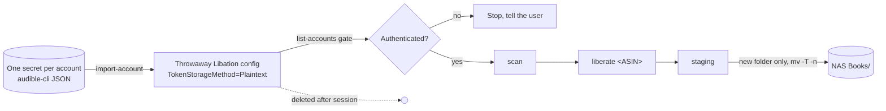

# Decision: LibationCli as the Download Engine

**Purpose**: Record the decision to use LibationCli (not audible-cli + ffmpeg) for downloading Audible books from Claude Code in K2

**Scope**: Choice of download tool, credential shape, and the guardrails the decision depends on

**Overview**: Two spikes (`03-spike-results.md`) proved both toolchains work inside the unmodified
    K2 pod. LibationCli is chosen because it downloads, decrypts, tags and names a book in one step
    using the registration profile with the broadest reported success against current Audible
    license refusals. Its credential drawbacks are neutralized by treating its config as throwaway
    and keeping one plain login file as the only secret.

**Related**: `02-research.md` §2.3 and §3, `03-spike-results.md`, `05-setup-and-reproducibility.md`

---

## Status

Accepted (planning). Revisit if Audible license behavior changes or if the guardrails below cannot be enforced.

## Context

| Need | Evidence |
|------|----------|
| Download chosen books reliably | Audible refuses licenses for some device profiles (`02-research.md` §2.3). The Android profile (Libation's default) is the one most users report working, and it was granted in both spikes |
| Finished files that match the NAS | Existing library is `Title [ASIN]/Title [ASIN].m4b` with chapters and cover, produced by Libation |
| Avoid custom glue | audible-cli's decrypt step is a plugin its author calls a proof of concept; naming and tagging would be ours to maintain |
| Login survives K2 changes | A login is a file; it is valid until the device is deregistered (`02-research.md` §2.2) |

## Decision

Use **LibationCli 14.2.x** inside K2 to download books, run **one ASIN at a time**, and treat Libation's config folder as **disposable**:

## Alternatives considered

| Option | Why not chosen |
|--------|----------------|
| audible-cli + ffmpeg | Works (spike 1) and has the simplest credentials, but only the older ADRM path, a proof-of-concept decrypt step, and naming/tagging we would own |
| Libation with encrypted tokens + master key (its Docker default) | Two secrets, both tied to one persistent config; harder to rebuild |
| Libation official Docker image as a separate service | Its default loop downloads **every** un-downloaded title; needs a new service and a way for the agent to call it. Possible later, not needed for the MVP |

## Consequences

**Positive**
- One command per book; output matches the existing NAS library.
- Widevine can be requested (Android profile only), giving a second DRM path.
- Exactly one secret per account. Libation state is rebuilt in ~10 s per session.

**Negative / guardrails required**
- Bare `liberate` downloads every un-downloaded title (~1,400). The agent must **always** pass an explicit ASIN.
- Libation deregisters the device when a token refresh fails. The agent must run `list-accounts` first and stop unless it reports `Authenticated: yes`.
- Each `liberate` is a license request. No automatic retries; on a denial, stop and report.
- Libation needs ICU on Linux (`02`/`03` gotchas). The install must provide it.
- Which DRM Audible actually granted is not logged at INFO level; unverified.
