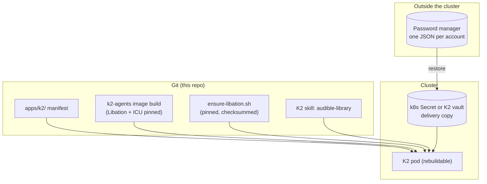

# LibationCli in K2: Setup and Reproducibility

**Purpose**: Describe how to set up LibationCli for Claude Code in K2, and how to make that setup rebuildable instead of hand-mutated

**Scope**: Tool install, the per-account secret, the per-session download procedure, restore after loss, and the path from today's hand-mutated pod to a declarative one

**Overview**: The spikes installed tools by hand into the running K2 pod, which makes the pod a pet:
    the setup exists only on its disk and only as a side effect of commands someone ran. This
    document replaces that with (1) a pinned, checksummed, idempotent install step kept in git,
    (2) one secret per account whose source of truth lives outside the cluster, and (3) a staged
    plan to move both into the K2 image/manifest so a rebuilt pod needs no manual steps.

**Related**: `04-decision-libationcli.md`, `03-spike-results.md`

---

## 1. What makes this a pet today

| Item | Where it lives | How it got there | Lost if |
|------|----------------|------------------|---------|
| LibationCli 14.2.5 (198 MB) | `~/.local/opt/libation-14.2.5` on the K2 PVC | Hand-run `curl` + `dpkg-deb -x` | PVC is lost |
| ICU 74 (36 MB) | `~/.local/opt/icu` on the K2 PVC | Hand-run `curl` + `dpkg-deb -x` | PVC is lost |
| audible-cli, audible, cryptography, imageio-ffmpeg (~200 MB) | uv cache on the K2 PVC | `uvx` during spike 1 | Cache cleaned or PVC lost |
| Audible login | Nowhere (deleted after the spikes) | n/a | n/a |
| K2 StatefulSet + image build | Live cluster only, not in git | Hand-applied | Cannot be rebuilt from the repo |

Nothing above is recorded anywhere except the pod's disk and this document.

## 2. Target: what "cattle" means here

**Rebuild test**: delete the K2 pod and its PVC, re-apply from git, restore the K2 login, and the Audible agent works after **one** step per account (provide the secret). No other manual commands.



## 3. Staged plan

| Stage | Change | K2 edits? | Rebuild after PVC loss |
|-------|--------|-----------|------------------------|
| **0 (spikes, today)** | Hand-run installs in the pod | No | Repeat by hand from `03-spike-results.md` |
| **1 (MVP)** | `ensure-libation.sh` in git, run by the K2 skill at session start. Secret source of truth in a password manager | No | Re-run is automatic; re-add one secret per account |
| **2 (K2 hardening)** | Capture the K2 StatefulSet into `apps/k2/`; bake Libation + ICU into the `k2-agents` image (or an initContainer); deliver the secret as a read-only k8s Secret mount; add a NAS volume for writes | Yes | `kubectl apply` + restore secret from password manager |

Stage 1 makes the pod's state **derived** from git (any lost install is recreated on the next session). Stage 2 removes the install from runtime entirely. Stage 2 belongs to a separate K2-hardening feature.

## 4. Stage 1 setup

### 4.1 Install step (idempotent, pinned)

Proposed `ensure-libation.sh`. It installs only if missing or wrong, verifies checksums, and writes only under `~/.local/opt`:

```bash
#!/usr/bin/env bash
# Purpose: install a pinned LibationCli + ICU into the K2 home, idempotently.
set -euo pipefail
LIBATION_VERSION=14.2.5
LIBATION_URL="https://github.com/rmcrackan/Libation/releases/download/v${LIBATION_VERSION}/Libation.${LIBATION_VERSION}-linux-chardonnay-amd64.deb"
LIBATION_SHA256=7ca10f0004140367c0cd545c64ca9fd9c9410ddb37c9a755f73f99cabbd5de5c
ICU_URL="http://archive.ubuntu.com/ubuntu/pool/main/i/icu/libicu74_74.2-1ubuntu3.1_amd64.deb"
ICU_SHA256=c9a70989678660eed9a1e904c74fa043da8bec8e2036856fc16e31ced79b04f8
OPT="$HOME/.local/opt"; DEST="$OPT/libation-$LIBATION_VERSION"; ICU="$OPT/icu-74.2"

fetch() { # url sha dest_dir
  local tmp; tmp=$(mktemp)
  curl -fsSL "$1" -o "$tmp"
  echo "$2  $tmp" | sha256sum -c --quiet -
  mkdir -p "$3.partial" && dpkg-deb -x "$tmp" "$3.partial" && mv -T "$3.partial" "$3"
  rm -f "$tmp"
}
[ -x "$DEST/usr/lib/libation/LibationCli" ] || fetch "$LIBATION_URL" "$LIBATION_SHA256" "$DEST"
[ -e "$ICU/usr/lib/x86_64-linux-gnu/libicuuc.so.74" ] || fetch "$ICU_URL" "$ICU_SHA256" "$ICU"

cat > "$HOME/.local/bin/libationcli" <<EOF
#!/usr/bin/env sh
export LD_LIBRARY_PATH="$ICU/usr/lib/x86_64-linux-gnu"
exec "$DEST/usr/lib/libation/LibationCli" "\$@"
EOF
chmod +x "$HOME/.local/bin/libationcli"
echo "libationcli ready: $DEST"
```

Tested in the K2 pod with a throwaway `HOME`: first run 6 s (download, verify, extract), second run 0 s (no-op).

- Pins: Libation **14.2.5** (`sha256 7ca10f00…de5c`), Ubuntu noble ICU **74.2-1ubuntu3.1** (`sha256 c9a70989…04f8`).
- Upgrading means changing the version and checksum in git, not running commands in the pod.
- The wrapper puts `libationcli` on the K2 session `PATH` (`~/.local/bin`).

### 4.2 The one secret per account

1. On the Mac, in Libation: Settings → Accounts → select the account → **Export to audible-cli**.
2. Store the JSON in the password manager (the **source of truth**). One entry per account.
3. Deliver a copy to K2 for sessions to read:
   - Stage 1: K2 vault as a `file` secret granted to the agent's workspace.
   - Stage 2: a read-only k8s Secret mount.
4. Delete the export from `~/Downloads`.

The delivery copy in K2 is a **cache**. If K2's disk is lost, restore it from the password manager. No new Audible login is needed while the device stays registered.

### 4.3 Per-session procedure (what the agent runs)

```bash
LF=$(mktemp -d)                                   # throwaway Libation config
printf '{"Books":"%s","InProgress":"%s","TokenStorageMethod":"Plaintext","UseWidevine":true}\n' \
  "$STAGING" "$LF/inprogress" > "$LF/Settings.json"
libationcli import-account --libationFiles "$LF" "$SECRET_FILE"   # per account
libationcli list-accounts  --libationFiles "$LF"                  # GATE: must be Authenticated: yes
libationcli scan           --libationFiles "$LF"                  # ~10 s
libationcli export         --libationFiles "$LF" --json -p "$LF/library.json"   # DateAdded for "new since"
libationcli liberate       --libationFiles "$LF" <ASIN>           # ONLY with an explicit ASIN
# then: no-overwrite move into the NAS library (03-spike-results.md, step 7)
rm -rf "$LF"
```

Guardrails (from `04-decision-libationcli.md`): explicit ASIN only, `list-accounts` gate before any download, one license request per book, no retries on denial.

The "last conversation" timestamp is the only state worth keeping between sessions. Store it next to the agent's workspace; losing it only widens the review window.

### 4.4 Restore after losing the K2 disk

1. Re-apply K2 (Stage 2) or let the pod come back.
2. First session: the skill runs `ensure-libation.sh` (reinstalls tools).
3. Re-add each account's JSON from the password manager into K2.
4. Run the per-session procedure. The `list-accounts` gate confirms the login.

## 5. Undoing the spikes' hand mutations

To prove Stage 1 works from scratch, remove what the spikes left, then let `ensure-libation.sh` recreate it:

```bash
rm -rf ~/.local/opt/libation-14.2.5 ~/.local/opt/icu
uv cache clean audible-cli audible cryptography imageio-ffmpeg
```

Nothing in this list holds credentials. The spikes already removed all secrets and staging files.
