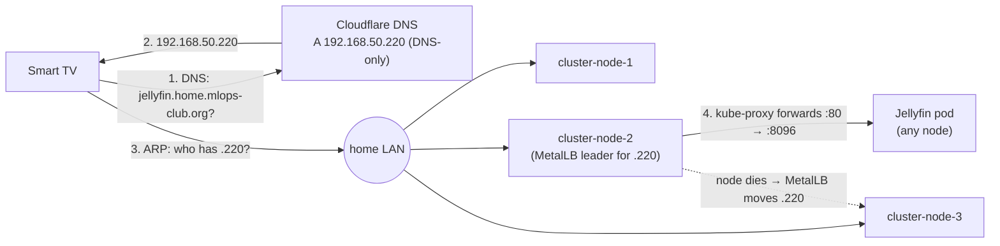

# Jellyfin LAN Access (MetalLB + external-dns)

**Purpose**: Explain how `http://jellyfin.home.mlops-club.org` reaches Jellyfin from home-network devices such as smart TVs, without Tailscale

**Scope**: The `jellyfin-lan` LoadBalancer Service, MetalLB layer-2 IP announcement, the external-dns `home.mlops-club.org` domain filter, and the router DHCP requirement

**Overview**: A MetalLB LoadBalancer Service gives Jellyfin a fixed LAN IP (`192.168.50.220`) on port 80.
    MetalLB has exactly one node answer ARP for that IP and moves it to another node when that node
    fails, so the IP does not depend on any node's own address. external-dns reads the hostname
    annotation on the Service and creates a DNS-only Cloudflare A record pointing the name at the IP.
    Everything is declared in `apps/jellyfin/manifest.yaml` and `helmfile.yaml.gotmpl`.

**Dependencies**: MetalLB (installed by `k3s-ansible`, pool `192.168.50.200-192.168.50.220`), external-dns (helmfile release in `traefik-private`), Cloudflare zone `mlops-club.org`

**Exports**: `http://jellyfin.home.mlops-club.org` (home network only)

**Related**: `apps/jellyfin/manifest.yaml`, `apps/jellyfin/docs/connecting-to-jellyfin.md`, `network/private/external-dns/values.yaml`, `.ai/docs/CLUSTER_HA_AUDIT.md`

---

## What the TV uses

```
http://jellyfin.home.mlops-club.org
```

This works only on the home network (`192.168.50.0/24`). The name resolves everywhere, but
`192.168.50.220` is a private address that is only reachable at home. Use
`https://jellyfin.priv.mlops-club.org` over Tailscale when away from home.

---

## How a floating IP works

A device on the LAN finds the owner of an IP with an ARP broadcast: *"who has 192.168.50.220?"*
Whichever machine answers *"me"* receives the traffic. One network card can answer for more than
one IP.

MetalLB (layer-2 mode) runs a **speaker** on every node. The speakers agree, through a
gossip protocol, on which one node answers for each LoadBalancer IP. That node answers ARP for
`.220` alongside its own address, and kube-proxy on that node forwards the traffic to the
Jellyfin pod, wherever the pod runs.

```
TV ──"who has .220?"──► home network (192.168.50.0/24)
                           │
   cluster-node-1 (.96)    │   (silent)
   cluster-node-2 (.226) ◄─┘   "me!"  ← also answers for .220, forwards to the Jellyfin pod
   cluster-node-3 (.94)        (silent; takes over if node-2 dies)
```

**MetalLB moves the IP between nodes.** MetalLB is a distributed, highly available component:
if the node holding `.220` dies, or its speaker stops, the remaining speakers detect it and
another node starts answering for `.220`. It also sends a gratuitous ARP so the TV and router
update their caches immediately. The DNS record never mentions a node address, so node IP
changes and node failures do not break the name.



### Verified failover

Deleting the MetalLB speaker pod on the node announcing `.220` moved the announcement to
another node within about one second (the ARP entry switched to that node's MAC), and 30
consecutive `GET /health` probes during the handoff all returned `200`. Reproduce with:

```bash
kubectl get events -n jellyfin --field-selector involvedObject.name=jellyfin-lan  # "announcing from node ..."
arp -n 192.168.50.220                                                            # MAC of the announcing node
kubectl delete pod -n metallb-system -l component=speaker --field-selector spec.nodeName=<announcing-node>
```

---

## Declarative configuration

| Piece | Where | What it declares |
|-------|-------|------------------|
| MetalLB install + IP pool | `k3s-ansible/inventory/cluster/group_vars/all.yml` (`metal_lb_ip_range`, `metal_lb_mode: layer2`) | Pool `192.168.50.200-192.168.50.220`, L2 advertisement |
| `jellyfin-lan` Service | `apps/jellyfin/manifest.yaml` | `type: LoadBalancer`, port 80 → 8096, annotation `metallb.universe.tf/loadBalancerIPs: 192.168.50.220`, annotation `external-dns.alpha.kubernetes.io/hostname: jellyfin.home.mlops-club.org` |
| external-dns domain filter | `helmfile.yaml.gotmpl` (`domainFilters[1]`) | external-dns manages `home.mlops-club.org` names in addition to `priv.mlops-club.org` |

Apply:

```bash
./apps/jellyfin/deploy.sh                                              # Service
source .env && helmfile -f helmfile.yaml.gotmpl -l name=external-dns apply  # domain filter
```

external-dns creates the A record plus an ownership TXT record
(`a-jellyfin.home.mlops-club.org`, owner `k3s-cluster`). Records under `home.` are DNS-only
(not proxied), so Cloudflare never carries the video traffic.

### Adding another LAN name

Create a `LoadBalancer` Service with both annotations, choosing an unused IP from the pool:

```yaml
metadata:
  annotations:
    metallb.universe.tf/loadBalancerIPs: 192.168.50.219
    external-dns.alpha.kubernetes.io/hostname: <app>.home.mlops-club.org
```

Check that the IP is unused first: `ping -c1 192.168.50.219 && arp -n 192.168.50.219`.

---

## Router DHCP requirement

The MetalLB pool `192.168.50.200-192.168.50.220` **must be excluded from the router's DHCP
range** (for example, set DHCP to `192.168.50.2-192.168.50.199`). MetalLB does not check whether
another device holds an address. If the router leases a pool address to a phone or TV, both
devices answer ARP for it and connections become intermittent for both.

A device with a randomized MAC held `192.168.50.200` via DHCP, which is why the Service uses
`.220`. The cluster nodes also need DHCP reservations: their addresses are hard-coded in etcd
peer URLs and the K3s agent configuration.

---

## Troubleshooting

| Symptom | Check |
|---------|-------|
| Name resolves to `104.21.x.x` / `172.67.x.x` (Cloudflare proxy) | The specific record is missing and the public `*.mlops-club.org` wildcard answered. Check external-dns (below) |
| Name resolves, but the TV cannot connect | `arp -n 192.168.50.220` on a LAN machine. Two different MACs over time means a DHCP conflict |
| Some routers return no answer for public names pointing at private IPs (DNS rebinding protection) | Allow `mlops-club.org` in the router's rebind protection, or set the TV's DNS to `1.1.1.1` |
| `EXTERNAL-IP` stuck at `<pending>` | `kubectl logs -n metallb-system deploy/controller`. The requested IP must be inside the pool and unused by other Services |

### external-dns does not create the record

The long-running external-dns pod has been seen planning no changes even when a dry run with
identical flags plans creates (it also never creates per-host `priv.` records; those names resolve
through the `*.priv.mlops-club.org` wildcard). A one-shot run with the same image, service account,
token and owner ID creates the record as declared:

```bash
IMG=$(kubectl get deploy external-dns -n traefik-private -o jsonpath='{.spec.template.spec.containers[0].image}')
SA=$(kubectl get deploy external-dns -n traefik-private -o jsonpath='{.spec.template.spec.serviceAccountName}')
kubectl run edns-once -n traefik-private --rm -i --restart=Never --image="$IMG" \
  --overrides='{"spec":{"serviceAccountName":"'"$SA"'","containers":[{"name":"edns-once","image":"'"$IMG"'","args":["--once","--source=service","--service-type-filter=LoadBalancer","--policy=upsert-only","--registry=txt","--txt-owner-id=k3s-cluster","--domain-filter=home.mlops-club.org","--zone-id-filter='"$CLOUDFLARE_ZONE_ID"'","--provider=cloudflare"],"env":[{"name":"CF_API_TOKEN","valueFrom":{"secretKeyRef":{"name":"cloudflare-api-token","key":"cloudflare_api_token"}}}]}]}}'
```

Add `--dry-run --log-level=debug` to see the plan without changing DNS.
