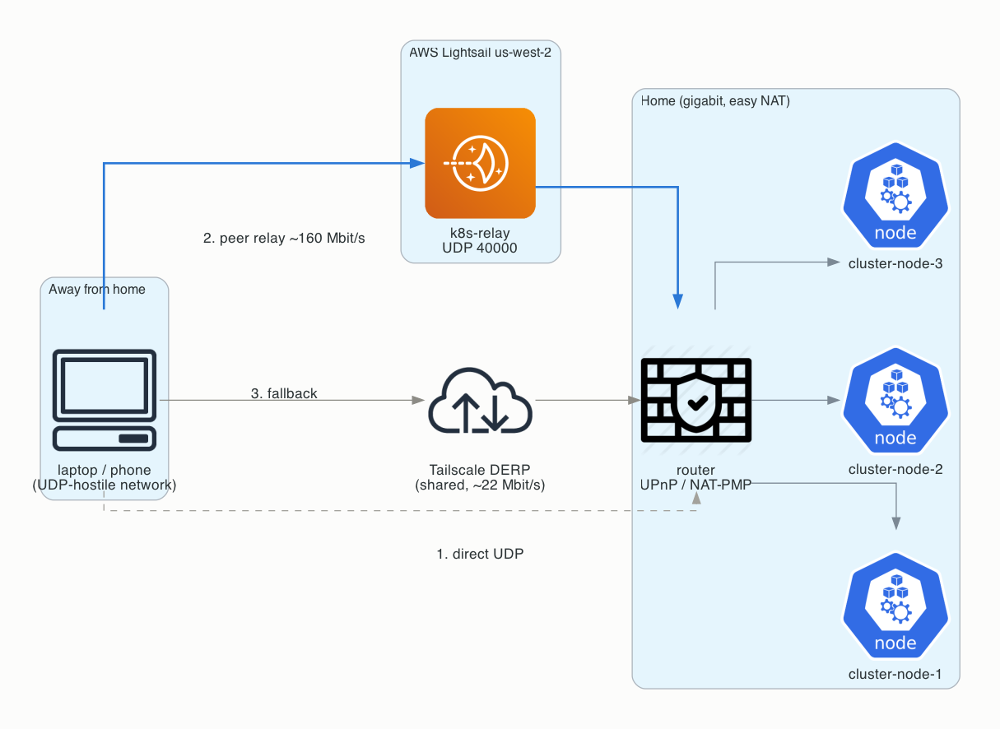
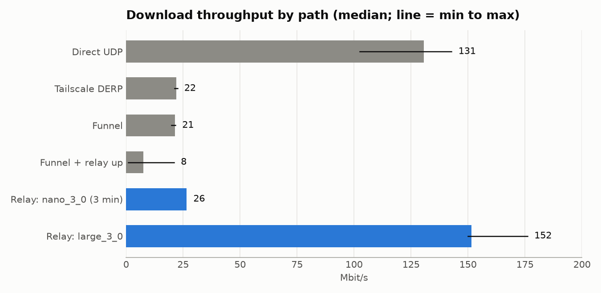
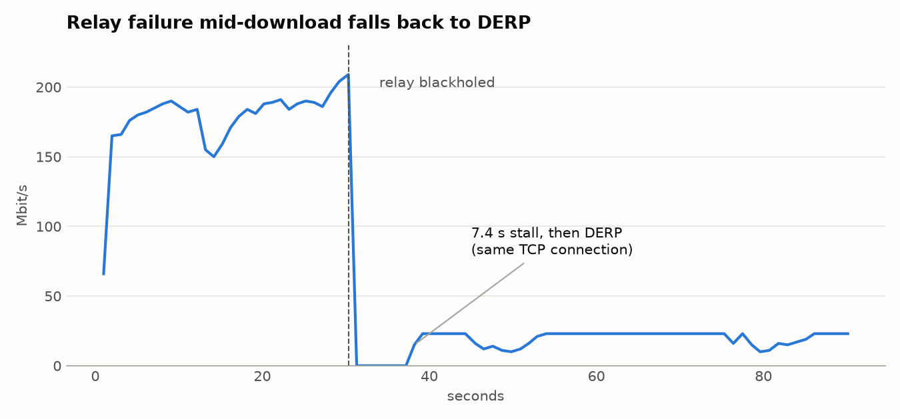
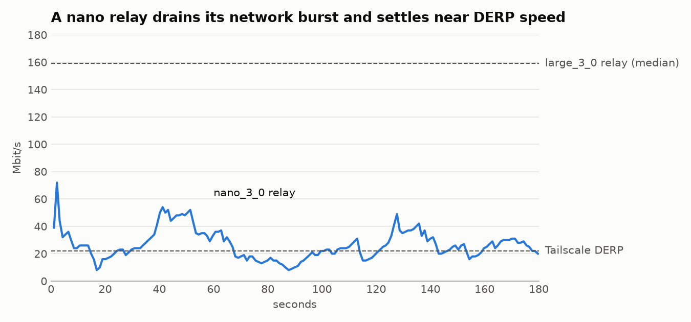

# k8s-relay

**Purpose**: Peer relay on AWS Lightsail that keeps private-network throughput high when a device can't connect directly, plus the benchmark that justifies it

**Scope**: The `k8s-relay` Lightsail instance, its tailnet policy, and the throughput research behind it

**Overview**: Devices on networks that block or mangle UDP (hotels, cellular, some offices) can't
    reach the cluster directly and fall back to Tailscale's shared DERP servers, which held a single
    download to ~22 Mbit/s. `k8s-relay` is a Tailscale peer relay in us-west-2 that those devices use
    instead; it delivered ~160 Mbit/s, matching the direct path. If the relay goes down, traffic
    falls back to DERP after a few seconds without dropping connections. The relay does not help
    Funnel. Deployment uses Pulumi with throwaway state; teardown deletes by fixed name.

**Dependencies**: pulumi, uv, aws CLI, jq; a Tailscale OAuth client with the auth-keys scope that owns `tag:ci`

**Exports**: Lightsail instance `k8s-relay` (us-west-2), tailnet device `k8s-relay` (`tag:k8s-relay`)

**Related**: [Tailscale peer relays](https://tailscale.com/kb/1591/peer-relays), [Tailscale Funnel](https://tailscale.com/kb/1223/funnel), `../tailscale/`

**Implementation**: Fixed physical names instead of stored state; benchmark data lives in `figures.py`

---

## Architecture



Tailscale tries paths in order: (1) direct UDP, (2) a peer relay the policy grants, (3) DERP.
The home network allows direct connections (easy NAT, UPnP / NAT-PMP / PCP port mapping), so the
relay only carries traffic when the *remote* network blocks direct UDP.

## Operations

```bash
cd network/private/k8s-relay
set -a; source ~/credentials/tailscale-golden-rules-studio-deploy.env; set +a  # TS_OAUTH_CLIENT_ID/SECRET
./run up       # mints a single-use tag:k8s-relay auth key, runs Pulumi with throwaway state
./run status
./run down     # deletes the instance by name; no Pulumi state needed
```

- `AWS_PROFILE` defaults to `k2`; `BUNDLE` defaults to `large_3_0` (see [relay size](#relay-size)).
- `up` refuses to run while `k8s-relay` exists. To change anything, run `down` then `up`.
- After `down`, remove the offline `k8s-relay` device in the Tailscale admin console before the
  next `up`, or the new device registers as `k8s-relay-1`.
- Public ports: UDP 40000 (relay) from anywhere; TCP 22 only from the Lightsail browser console.
- Tailscale on the relay auto-updates.

## Tailnet policy

The relay needs a tag owner and one grant. `tag:ci` owns the tag so the deploy OAuth client can mint
the relay's auth key.

```jsonc
"tagOwners": {
    "tag:k8s-relay": ["autogroup:admin", "tag:ci"],
},
"grants": [
    // Devices that can't connect directly relay through k8s-relay instead of DERP.
    {
        "src": ["autogroup:member", "tag:homelab", "tag:k8s"],
        "dst": ["tag:k8s-relay"],
        "app": {"tailscale.com/cap/relay": []},
    },
],
```

The grant only lets the listed devices allocate relay bindings on `tag:k8s-relay` nodes. It grants
no network access. Network access stays governed by the existing grants.

## Benchmark

### Method

- **Home**: a laptop on the home LAN (gigabit symmetric) serving a 4 GB random file over its
  tailnet IP and over Funnel. The cluster was not touched.
- **Away**: a Lightsail `large_3_0` client in us-east-2 (61 ms from home), downloading with a single
  HTTP stream, three 20-second runs per path. Its UDP egress was reshaped with iptables to force
  each path: unrestricted (direct), UDP blocked (DERP only), or UDP allowed only to the relay
  (peer relay only). MagicDNS was off on the client so the Funnel hostname resolved to Tailscale's
  public Funnel ingress, not the tailnet IP.
- **Relay**: a Lightsail instance in us-west-2 with `tailscale set --relay-server-port=40000`.

### Throughput



| Path | Mbit/s (3 runs) |
|---|---|
| Direct UDP | 103 / 143 / 131 |
| Tailscale DERP | 21 / 23 / 22 |
| **Peer relay, `large_3_0`** | **152 / 150 / 176** |
| Peer relay, `nano_3_0` | 85 / 55 / 42, then 26 averaged over 3 min |
| Funnel | 20 - 22 (6 runs) |
| Funnel with the relay up | 1 - 21 (6 runs) |

Findings:

1. **DERP is the bottleneck away from home.** Whenever a direct path is impossible, throughput
   drops to ~22 Mbit/s regardless of the home connection.
2. **A peer relay removes that cap.** The `large_3_0` relay matched or beat the direct path; us-west-2
   adds only a few milliseconds to the Denver path.
3. **The relay does not help Funnel.** During Funnel downloads the `funnel-ingress-node` peers reached
   the home host over DERP (`sfo`) with no direct or peer-relay path, with or without the relay.
   Peer relays only serve devices in the same tailnet, and Funnel has documented
   "non-configurable bandwidth limits". Serve public downloads through the Cloudflare Tunnel
   (`network/public/`) instead.

### Failover



The relay's UDP port was closed 30 s into a download. The transfer stalled for 7.4 s, then
continued over DERP **on the same TCP connection**, with no error, retry, or HTTP range resume.
Losing the relay degrades the tailnet to its normal DERP behavior; nothing else breaks.

### Relay size



Lightsail bundles are burstable instances whose baseline network bandwidth scales with size, and
relay throughput tracks that baseline, not CPU. The `nano_3_0` relay sat ~94% idle while capped.

| Bundle | $/mo | Transfer/mo | Sustained relay throughput |
|---|---|---|---|
| `nano_ipv6_3_0` | 3.50 | 1 TB | Unusable: IPv6-only, and the home network has no IPv6 |
| `nano_3_0` | 5 | 1 TB | ~26 Mbit/s, about DERP speed |
| `large_3_0` | 44 | 5 TB | ~160 Mbit/s, at or above the direct path |

Bundles between nano and large were not measured. Relayed traffic counts against the monthly
transfer allowance.

### Regenerating the figures

```bash
uv run --script figures.py   # needs Graphviz (brew install graphviz)
```
