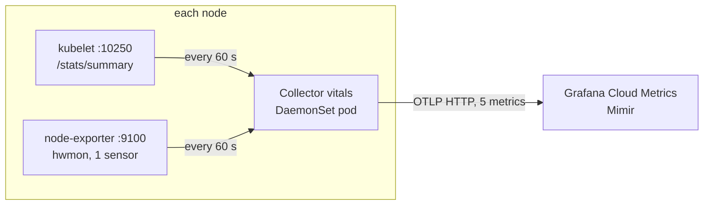

# Proposal: node and pod vitals in Grafana Cloud, inside the free tier

**Purpose**: Propose a small OpenTelemetry Collector deployment that sends CPU, memory and temperature vitals from the
homelab cluster to Grafana Cloud, and account for every piece of telemetry the Grafana Cloud stack is billed for.

**Scope**: What gets deployed and how, the full telemetry inventory (what reaches Grafana Cloud before and after),
the levers that raise each stream, the free-tier budget, and the rollback. Nothing here is applied to the cluster.

**Overview**: Two small DaemonSets: a node-exporter that exposes one temperature per node, and a Collector (`vitals`)
that reads its node's kubelet and that node-exporter, keeps five metrics with three labels, and sends them to Grafana
Cloud once a minute. Measured cost: about 160 active series with three nodes up, about 184 with four, which is under 2%
of the free tier's 10,000. No logs and no spans are added.

**Related**: `otel-operator/vitals-collector.yaml`, `node-exporter/values.yaml`, `helmfile.yaml.gotmpl`
(releases `prometheus-node-exporter` and `opentelemetry-operator`), `env.example`, `otel-operator/collector.yaml`

Measurements in this document were taken on 2026-11-25 with read-only `kubectl`, read-only SSH to the nodes, and the
stack's own usage data source (`grafanacloud-usage`) and Mimir, Loki and Tempo data sources.

---

## 1. What we want, and the constraint

- Key vitals only: memory per pod and per node, CPU per pod and per node, and node temperature.
- The constraint is Grafana Cloud's free tier. From [grafana.com/pricing](https://grafana.com/pricing/):

| Signal | Free tier | Retention |
|---|---|---|
| Metrics | 10k active series per month | 14 days |
| Logs | 50 GB ingested per month | 14 days |
| Traces | 50 GB ingested per month | 14 days |
| Profiles | 50 GB ingested per month | 14 days |
| Synthetics | 100k API test executions and 10k browser test executions per month | |

- How metrics are counted ([metrics invoice docs](https://grafana.com/docs/grafana-cloud/cost-management-and-billing/understand-your-invoice/metrics-invoice/)):
  an *active series* is one that received a data point in the previous 20 minutes. Usage is the 95th percentile of
  `max(active series, total DPM / included DPM)`, and the included rate is 1 data point per minute (DPM) per series
  (`grafanacloud_org_metrics_included_dpm_per_series = 1` on this stack). So a series sent every 60 s costs 1; the
  same series every 15 s costs 4.
- The org is on a trial (`grafanacloud_org_info{org_grafana_cloud="trial"}`, `trial_end_date` 2026-12-05). The budget
  below uses the free-tier limits, not the trial's.

## 2. What is already in the cluster

| Thing | Where | What it does | Reaches Grafana Cloud? |
|---|---|---|---|
| OpenTelemetry Operator 0.115.0 | `opentelemetry-operator-system`, helmfile release `opentelemetry-operator` | Reconciles `OpenTelemetryCollector` CRs | No |
| Collector `gateway` (Deployment) | `opentelemetry`, `otel-operator/collector.yaml` | Scrapes DCGM, kubelet `/metrics`, cAdvisor and kube-state-metrics every 30 s; exports to Better Stack | No. Every export fails with `401 Unauthorized` and is dropped |
| kube-state-metrics 7.4.0 | `kube-state-metrics` | Object state for the gateway | No |
| metrics-server (k3s) | `kube-system` | `kubectl top` | No |
| Studio collector (production) | `golden-rules-studio/otel-collector` (deployed from the Studio's deploy repo) | Studio traces and service-graph metrics | **Yes**: Tempo and Mimir |
| Studio collector (POC) | `golden-rules-studio-otel/otel-collector` | Studio POC traces | **Yes**: Tempo |
| Synthetic Monitoring private probe | `sm-probe` (`grafana/synthetic-monitoring-agent:v0.71.0`) | Runs checks from inside the cluster | **Yes**: Mimir and Loki |
| node-exporter, Grafana Alloy, k8s-monitoring chart | none | | Not installed |

Cluster shape: 4 nodes. `cluster-node-1..3` are Intel N-series NucBox G2 (4 cores, 12 GB) and Ready;
`cluster-node-4` (AMD, RTX 5080, 32 GB) has been `NotReady` since 2026-10-30. 68 pods run on the three Ready nodes.

**Why not reuse the gateway's scrape jobs.** Counted on the live endpoints, the gateway's four jobs expose about
127,600 series on three nodes (cAdvisor 15,360, kubelet `/metrics` 102,964, kube-state-metrics 9,294). That is 12.8
times the whole free tier. The gateway is left as it is in this proposal; retiring it is a separate change (section 9).

## 3. What gets deployed



| Piece | File | How it's deployed |
|---|---|---|
| node-exporter DaemonSet (chart `prometheus-community/prometheus-node-exporter` 5.2.0, image v1.13.1) | `node-exporter/values.yaml` | New helmfile release `prometheus-node-exporter` in namespace `node-exporter` |
| Collector `vitals` (DaemonSet, `otel/opentelemetry-collector-contrib:0.154.0`), ServiceAccount, ClusterRole (`nodes/stats` get only), binding | `otel-operator/vitals-collector.yaml` | `postsync` hook of the existing `opentelemetry-operator` release, the same way `collector.yaml` is applied |
| Secret `grafana-otlp-vitals` (endpoint, instance id, token) | from `.env` | `presync` hook of the same release |
| Grafana Cloud access-policy token, scope `metrics:write` only | Grafana Cloud UI, by hand | **Proposed, not created.** Separate from the Studio's token so it can be revoked alone and can't write logs or traces |

Both hooks skip themselves when `HOMELAB_VITALS_GRAFANA_OTLP_TOKEN` is unset, so the release keeps working without it.
To deploy, after review:

```bash
# 1. In Grafana Cloud: Access Policies > new policy "homelab-vitals", realm = this stack, scope metrics:write; add a token.
# 2. Put HOMELAB_VITALS_GRAFANA_OTLP_TOKEN in ~/credentials/homelab.env; endpoint and instance id in .env.
source .env && helmfile -f helmfile.yaml.gotmpl -l name=prometheus-node-exporter diff
source .env && helmfile -f helmfile.yaml.gotmpl -l name=prometheus-node-exporter apply
source .env && helmfile -f helmfile.yaml.gotmpl -l name=opentelemetry-operator diff
source .env && helmfile -f helmfile.yaml.gotmpl -l name=opentelemetry-operator apply
```

### Why each choice

- **kubelet_stats, not cAdvisor or hostmetrics.** The kubelet's stats summary is what `kubectl top` reads; it gives
  node and pod CPU and memory in one call with pod name and namespace already attached. cAdvisor is per container with
  dozens of label combinations; hostmetrics sees only the host, not pods.
- **DaemonSet.** Each pod reads only its own node (kubelet on `status.hostIP`, node-exporter on the same IP), so no
  service discovery and no pod/namespace watch RBAC are needed.
- **Temperature from node-exporter hwmon.** The Collector has no temperature scraper. Nodes 1 to 3 expose `coretemp`
  (`Package id 0` plus four cores) and an ACPI zone; node 4 is AMD (`k10temp`, unverified while it's down) and has no
  `x86_pkg_temp` thermal zone, so hwmon is the one source that covers both. One sensor per node: the CPU package.
  Read on 2026-11-25: node 1 at 87 to 88 °C, node 2 at 74 to 75 °C.
- **Memory = working set** (what the kubelet evicts on and `kubectl top` shows). **CPU = `cpu.usage`** in cores
  (a gauge; no rate needed).
- **60 s interval**: 1 DPM per series, exactly the included rate.
- **Collector 0.154.0**: the version this Operator release already reconciles for `gateway`.

## 4. The collector config, line by line

Real values from a local dry run of this config against `cluster-node-1`'s kubelet (through `kubectl proxy`) and a
hwmon endpoint carrying that node's readings:

| Config | What it does | Result on cluster-node-1 |
|---|---|---|
| `kubelet_stats`, `metric_groups: [node, pod]`, `collection_interval: 60s` | Reads `/stats/summary` | ~30 node and pod metrics, 19 pods |
| `prometheus/hwmon`, `metric_relabel_configs` keep `node_hwmon_temp_celsius;(platform_coretemp_0\|pci0000_00_0000_00_18_3);temp1` | One temperature | `node_hwmon_temp_celsius` = 68 |
| `filter/vitals` (allow-list of 5 names) | Drops everything else, including `up` and `scrape_*` | 5 metric names left |
| `transform/labels`, datapoint context | Adds `k8s.node.name`; copies `k8s.namespace.name` and `k8s.pod.name` from the resource; deletes `chip` and `sensor` | 3 labels |
| `transform/labels`, resource context | Deletes every resource attribute, sets `service.name=homelab-vitals`, `service.instance.id=<node>` | `job="homelab-vitals"`, `instance="cluster-node-1"`; one `target_info` per node |
| `otlp_http/grafana` + `basicauth/grafana` | Grafana Cloud OTLP gateway | |

What reaches Mimir from cluster-node-1 (42 series):

```
k8s_node_cpu_usage{instance="cluster-node-1", job="homelab-vitals", k8s_node_name="cluster-node-1"}            0.289
k8s_node_memory_working_set_bytes{...}                                                                          9.34e9
k8s_pod_cpu_usage{..., k8s_namespace_name="golden-rules-studio", k8s_pod_name="golden-rules-studio-8466b7f899-ckmf7"}   0.158
k8s_pod_memory_working_set_bytes{..., k8s_namespace_name="golden-rules-studio", k8s_pod_name="golden-rules-studio-8466b7f899-ckmf7"}  3.38e9
node_hwmon_temp_celsius{instance="cluster-node-1", job="homelab-vitals", k8s_node_name="cluster-node-1"}       68
target_info{instance="cluster-node-1", job="homelab-vitals"}                                                    1
```

(Grafana Cloud also adds `otel_scope_name` and `otel_scope_version`; each is constant per metric, so they add no series.)

Without the filter and with the receiver's default groups, the same node produced **736** series (container 229,
pod 261, volume 225, node 11, plus scrape series): 17.5 times the allow-list.

## 5. Budget: what this adds

Formula: **2 x pods + 2 x nodes (CPU, memory) + 1 x nodes (temperature) + 1 x nodes (`target_info`)**.
The two DaemonSets add two pods per node to the pod count.

| Metric | Labels | 3 nodes up (74 pods) | 4 nodes up (84 pods) |
|---|---|---|---|
| `k8s_pod_cpu_usage` | node, namespace, pod | 74 | 84 |
| `k8s_pod_memory_working_set_bytes` | node, namespace, pod | 74 | 84 |
| `k8s_node_cpu_usage` | node | 3 | 4 |
| `k8s_node_memory_working_set_bytes` | node | 3 | 4 |
| `node_hwmon_temp_celsius` | node | 3 | 4 |
| `target_info` | job, instance | 3 | 4 |
| **Total active series** | | **160** | **184** |
| DPM (1 per series) | | 160 | 184 |

Churn: a pod that is replaced leaves its old series active for 20 minutes. If every pod were replaced inside one
20-minute window, the pod rows double: **at most 308 series with three nodes (2 x 148 + 12) or 352 with four
(2 x 168 + 16)**. Plan for a ceiling of **400**.

## 6. Exhaustive inventory: everything that reaches Grafana Cloud

### Metrics (Mimir): 2,425 active series now; 30-day p95 1,902; 30-day max 2,554; about 22 samples/s (0.54 DPM per series)

| Stream | Producer | Series (instant count) | Levers that raise it |
|---|---|---|---|
| `probe_*`, `sm_check_info` | Synthetic Monitoring: 14 checks (HTTP, scripted, browser) from the in-cluster private probe and the Ohio and Oregon public probes | 1,095 | Checks x probe locations; a scripted or browser check costs about 77 to 140 series per probe, an HTTP check about 39 |
| `asserts:*` | Grafana's Application Observability / Asserts recording rules over the Studio's traces | 432 | Services, service-graph edges and request contexts (span names, routes) seen in traces |
| `traces_service_graph_*` | Studio production collector's `service_graph` connector | 138 | Edges (client to server pairs, including virtual nodes such as azure-blob-storage) x `failed` x 10 latency buckets x `dimensions` |
| `grafana_slo_*` | Grafana SLO app: 7 SLOs | 91 | About 13 series per SLO |
| `traces_spanmetrics_*`, `traces_target_info`, span-metrics native histograms | Tempo metrics generator (Application Observability) | 4, plus 28 native-histogram series | Services and span kinds |
| other (`GRAFANA_ALERTS`, `asserts_artifact_info`) | Alerting, Asserts | 3 | Alert rules firing |
| **Proposed: `k8s_*`, `node_hwmon_temp_celsius`, `target_info`** | **Collector `vitals`** | **160 (184 with node 4)** | **Pods, nodes, metrics in the allow-list, labels, interval (section 7)** |

The instant sum (1,763) is lower than active series (2,425) because active series also counts series that stopped
within the last 20 minutes (SM check runs, churned edges).

### Logs (Loki): about 0.15 to 0.18 GB per 30 days of 50 GB

| Stream | Producer | Volume | Levers |
|---|---|---|---|
| 17 streams labeled `job`, `instance`, `probe`, `check_name` | Synthetic Monitoring check logs (every check run) | 67.7 B/s 7-day average (296 B/s max); 0.0248 GB in the first 5 days of the billing period | Checks x probes x frequency; scripted and browser checks log more per run |
| Proposed | Collector `vitals` | **0**: its own logs stay in the pod (`kubectl logs`) | |

### Traces (Tempo): about 0.2 to 0.4 GB per 30 days of 50 GB

| Stream | Producer | Volume (last 24 h) | Levers |
|---|---|---|---|
| `golden-dataset-studio`, environment `production` | Studio server, via `golden-rules-studio/otel-collector` | 24,202 spans | User traffic; spans per request; the `filter/noise` rule (polls and assets under 1 s) |
| `golden-dataset-studio-web`, `production` | Studio web app (browser), same collector | 1,908 spans | Page views and clicks per session |
| `golden-dataset-studio` and `-web`, environment `otel-poc` | Studio POC namespace `golden-rules-studio-otel` | 4,096 + 5,871 spans | Same; turning the POC off removes it |
| Proposed | Collector `vitals` | **0** | |

Bytes: 151.6 B/s 7-day average, 11 kB/s peak; 0.038 GB in the first 5 days of the billing period.

### Synthetic Monitoring executions (separate limits)

| Class | Rate (7-day average, per 30 days) | Free tier |
|---|---|---|
| protocol (HTTP) + scripted | 18,558 + 15,013 = 33,571 | 100,000 |
| browser | 5,100 | **10,000**: the closest any stream is to a limit |

## 7. Levers that raise the vitals series

| Lever | Effect | Example |
|---|---|---|
| More pods | +2 per pod | A new app with 3 replicas: +6 |
| More nodes | +8 per node (4 node-level series, plus 4 pod series for the 2 DaemonSet pods) | node 4 back: +24 including its 8 pods |
| Pod churn | Each replaced pod keeps its old 2 series for 20 min | A CronJob every 5 min: about 8 extra series |
| A sixth metric | +pods or +nodes | `k8s.pod.memory_limit_utilization`: +74 |
| A container label, or container metrics | x containers per pod | Container group: +229 on node 1 alone |
| Network or filesystem metrics | x interfaces x direction | Node network on node 1: 5 interfaces x 2 directions per metric |
| Removing the filter | Everything the receiver emits | 736 on node 1; about 2,600 cluster-wide |
| Keeping resource attributes (`k8s.pod.uid`, ...) | A `target_info` series per pod, and a new one on every restart | +74 |
| Shorter interval | Same series, more DPM: 15 s = 4 DPM, billed as 4x | 160 series billed as 640 |
| Per-core temperature | +4 per Intel node | +12 |

Guardrail (proposed, not created): an alert on `count({job="homelab-vitals"}) > 400` for 30 minutes.

## 8. Free-tier budget

| Signal | Free tier | Used now | Proposal adds | After | Share of free tier |
|---|---|---|---|---|---|
| Metrics, active series (p95, 30 days) | 10,000 | 1,902 (now 2,425; max 2,554) | 160 to 184 (ceiling 400) | about 2,100 to 2,600 (worst case 2,906) | 21% to 26% (worst case 29%) |
| Metrics, DPM | 1 per series | about 0.54 per series | 1 per series | below 1 per series | billed on series |
| Logs | 50 GB/month | about 0.15 to 0.18 GB | 0 | same | under 0.4% |
| Traces | 50 GB/month | about 0.2 to 0.4 GB | 0 | same | under 1% |
| SM API executions | 100k/month | about 33.6k | 0 | same | 34% |
| SM browser executions | 10k/month | about 5.1k | 0 | same | 51% |

## 9. Rollback

1. Stop sending: `kubectl delete opentelemetrycollector vitals -n opentelemetry` (the Operator removes the DaemonSet),
   or revoke the `homelab-vitals` token in Grafana Cloud (the Collector then gets 401s and drops data).
2. Remove the rest: `kubectl delete -f otel-operator/vitals-collector.yaml`,
   `kubectl delete secret grafana-otlp-vitals -n opentelemetry`,
   `helmfile -f helmfile.yaml.gotmpl -l name=prometheus-node-exporter destroy`.
3. Revert the branch's commit so the hooks don't recreate them.
4. The series stop counting as active 20 minutes after the last data point; the stored data ages out after 14 days.

## 10. Decisions made without asking, and follow-ups

- A new Collector next to `gateway`, rather than repointing `gateway` at Grafana: its scrape jobs are 12.8 times the
  free tier, and it exports to Better Stack, which rejects it (401). **Follow-up:** delete `gateway` (and
  kube-state-metrics, which only it uses) or fix its token. Either way, don't point it at Grafana Cloud.
- One CPU package temperature per node; no per-core, ACPI, NVMe or GPU temperatures. (Node 4's GPU temperature
  already exists in DCGM, and only `gateway` scrapes it.)
- Labels: node, namespace, pod. No container, deployment or pod uid.
- No dashboards or alerts are created by this change; the queries below are enough to start:
  - `sum by (k8s_node_name) (k8s_node_memory_working_set_bytes)`
  - `topk(10, k8s_pod_memory_working_set_bytes)`
  - `k8s_node_cpu_usage`, `topk(10, k8s_pod_cpu_usage)`
  - `max by (k8s_node_name) (node_hwmon_temp_celsius)`
- Node 4's k10temp chip label (`pci0000_00_0000_00_18_3`) is derived from node-exporter's naming code, not read from
  the node (it's down). If it differs, node 4 sends no temperature and costs nothing; fix the regex then.
- Node 1 runs hot (87 to 88 °C package, 4 cores at 11% CPU). Worth a look once the series exist.
